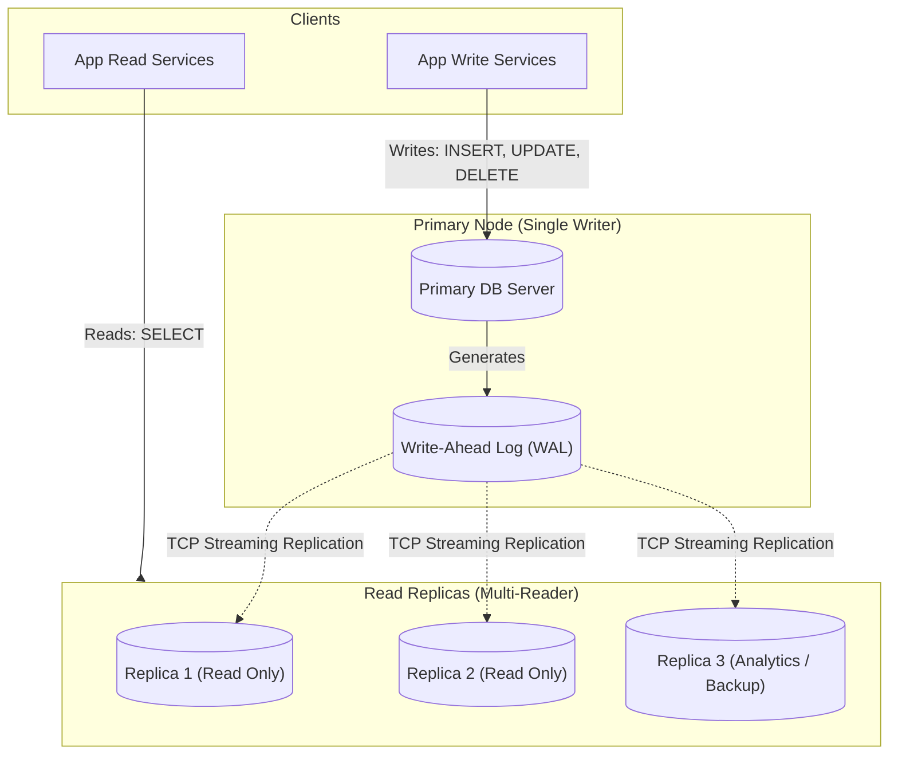

## Fast Revision (10-Second Recall)
- **Core Architecture:** Single Primary (Master) accepts all writes (INSERT, UPDATE, DELETE, DDL). One or more Replicas (Slaves) consume the primary's transaction stream and serve read queries (SELECT).
- **How It Works:**
- 1. Client writes transaction to Primary $\rightarrow$ Primary writes to WAL $\rightarrow$ Primary commits to disk.
- 2. Background sender process (walsender) streams WAL changes over TCP to replica receiver process (walreceiver).
- 3. Replica replayer process applies changes to its local data files.
- **Strengths:** Simple consistency model (single source of truth for writes), transparent read scaling.
- **Weaknesses:** Primary is single point of failure for writes; failover requires automated orchestration (Patroni / Orchestrator) to prevent split-brain.

## The 30-Second Spoken Script
"Master-slave replication—now referred to as Primary-Replica architecture—is a database deployment pattern where a single primary node handles all data mutations, while one or more secondary replica nodes synchronize continuously from the primary to handle read queries.

The primary maintains a Write-Ahead Log (WAL in PostgreSQL, binary log in MySQL). Whenever a transaction commits on the primary, the log records are flushed to disk and streamed across the network to connected replicas via background replication processes. The replica reads these log segments and replays them into its local storage engines.

This architecture provides three major advantages:
First, read throughput scales linearly—you can add multiple replicas behind a load balancer to serve read-heavy workloads like catalogs and reports.
Second, high availability—if the primary hardware fails, a consensus manager like Patroni with etcd can automatically elect the replica with the most up-to-date log position, promote it to primary, and re-route traffic with minimal downtime.
Third, operational safety—long-running analytical reports or backups can be pointed exclusively to a replica without competing for I/O locks on the primary.

The primary constraint is that writes cannot be scaled horizontally across replicas; all mutations must route to the single primary."

## Scenario / Problem Context
Master-slave (now commonly termed Primary-Replica) is the industry-standard high availability and read-scaling pattern for relational databases like PostgreSQL and MySQL. The interviewer tests your knowledge of write routing, log streaming, and failover mechanics.

## Architectural Workflow / Sequence


## Deep-Dive Analysis & Root Causes

| Component | Role | Characteristics |
| --- | --- | --- |
| Primary Node | Sole writer and source of truth | Processes DDL, enforces unique constraints, commits transactions, emits WAL stream
Streaming Connection | Real-time byte-level replication | PostgreSQL walsender / walreceiver processes communicate over dedicated TCP port
Read Replicas | Horizontal read offload | Read-only mode (`hot_standby = on`), replaying WAL in continuous recovery mode
Consensus Coordinator (Patroni / etcd) | Automated Failover & Leader Election | Monitors heartbeats; enforces distributed lease to prevent split-brain situations |


## Practical Debugging Commands & Code
```sql
-- 1. PostgreSQL: Verify if node is Primary or Standby:
SELECT CASE 
         WHEN pg_is_in_recovery() THEN 'STANDBY / REPLICA (READ-ONLY)' 
         ELSE 'PRIMARY (READ-WRITE)' 
       END AS role;

-- 2. Check replication status and delay from the Primary:
SELECT application_name, client_addr, state,
       now() - pg_last_xact_replay_timestamp() AS replication_lag
FROM pg_stat_replication;

-- 3. On MySQL: Verify Replica status:
-- SHOW REPLICA STATUS\G
-- Look for:
--   Replica_IO_Running: Yes
--   Replica_SQL_Running: Yes
--   Seconds_Behind_Source: 0
```

## Prevention & Senior Best Practices
- **Prevent Split-Brain with Quorum Fencing:** Never deploy automated failover with only 2 nodes without an external witness or etcd quorum cluster. If network partitions occur, both nodes could think they are primary.
- **Enable `hot_standby_feedback = on` on Replicas:** Informs the primary of replica query `xmin` horizon to prevent the primary from vacuuming tuples still being read by replica queries.
- **Use Dedicated Replication Users:** Create a locked-down database user with minimal `REPLICATION` privileges and explicit subnet CIDR restrictions in `pg_hba.conf`.
