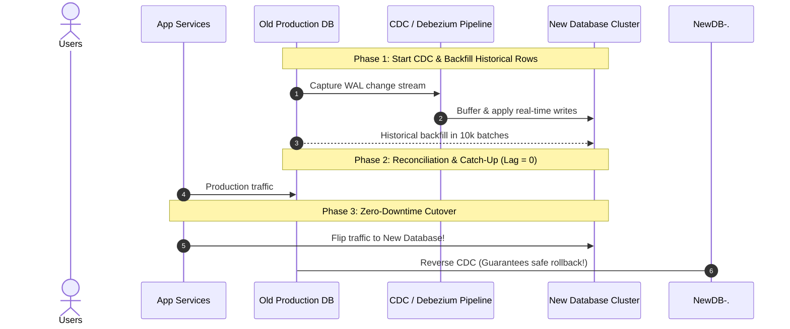

## Fast Revision (10-Second Recall)
- **The Golden Rule:** Never attempt a "big-bang" maintenance window cutover for mission-critical databases with millions of rows.
- **The 5-Stage Zero-Downtime Migration Playbook:**
- 1. **Schema Initialization:** Provision target database with schema, but defer foreign keys and secondary indexes until after initial bulk load to maximize insert speeds.
- 2. **Replication / Dual-Write / CDC:** Establish real-time replication using Change Data Capture (Debezium / AWS DMS) or application-level dual-writing.
- 3. **Historical Backfill:** Backfill historical data in chunked ID batches (`WHERE id BETWEEN a AND b`) running in background threads.
- 4. **Reconciliation & Shadow Validation:** Run verification jobs comparing checksums of source vs target; shadow write or read to measure latency.
- 5. **Cutover & Rollback Safety:** Point application reads and writes to new DB; reverse replication (new $\rightarrow$ old) so instant rollback is possible if issues arise.

## The 30-Second Spoken Script
"Migrating a database with millions of records without downtime requires an asynchronous Change Data Capture (CDC) or Dual-Writing strategy combined with phased cutover.

My standard 5-step playbook:

Step 1: Setup and Schema Preparation. I provision the target database with the identical schema, but intentionally omit foreign keys and non-primary indexes. This allows historical bulk loads to write at maximum raw throughput.

Step 2: Stream Continuous Changes. Before starting the historical data copy, I establish real-time CDC replication using tools like Debezium with Kafka or AWS Database Migration Service (DMS). This captures all INSERT, UPDATE, and DELETE operations occurring on the live production database and queues them in a replication buffer.

Step 3: Chunked Historical Backfill. In the background, a worker script copies historical rows in indexed batches—such as 10,000 rows at a time using WHERE id BETWEEN X AND Y—throttled with small sleeps to ensure production I/O remains unaffected.

Step 4: Catch-Up and Reconciliation. Once the historical backfill finishes, the CDC replication worker replays the queued change stream until replication lag reaches zero. I run automated checksum validation scripts comparing record counts and row hashes between source and target.

Step 5: Cutover with Reverse Replication. During a scheduled 30-second low-traffic window, we flip application configuration to direct traffic to the new database. Crucially, we immediately establish reverse replication from the new database back to the old database. If an unforeseen failure occurs 2 hours later, we can roll back instantly with zero data loss."

## Scenario / Problem Context
The company is migrating from an on-premise PostgreSQL instance to AWS Aurora or changing database engines. The table has 150 million rows and 24/7 active traffic. The interviewer tests your zero-downtime migration strategy and risk mitigation.

## Architectural Workflow / Sequence


## Deep-Dive Analysis & Root Causes

| Phase | Action | Impact |
| --- | --- | --- |
| 1. Initial Load Optimization | Disable foreign keys and secondary indexes on target | Speeds up bulk insert throughput by 5x to 10x
2. Change Data Capture (CDC) | Stream transaction log mutations via Debezium / Kafka | Zero impact on production application code; captures all live mutations
3. Micro-Batch Backfill | Query rows using indexed primary key ranges (`WHERE id >= ? AND id < ?`) | Avoids table locks and prevents transaction log exhaustion
4. Shadow Validation | Hash row checksums across random sample batches | Verifies data fidelity before routing live user traffic
5. Reverse Replication | Target streams changes back to source after cutover | Provides a fail-safe parachute; allows instant rollback without data loss |


## Practical Debugging Commands & Code
```sql
-- 1. Safe Chunked Migration Script Pattern (Pseudocode / SQL loop):
-- DO $$
-- DECLARE
--   batch_size INT := 5000;
--   max_id BIGINT;
--   current_id BIGINT := 0;
-- BEGIN
--   SELECT max(id) INTO max_id FROM source_table;
--   WHILE current_id < max_id LOOP
--     INSERT INTO target_table
--     SELECT * FROM source_table
--     WHERE id > current_id AND id <= current_id + batch_size
--     ON CONFLICT (id) DO NOTHING;
--     
--     current_id := current_id + batch_size;
--     PERFORM pg_sleep(0.05); -- Throttle to protect production I/O!
--   END LOOP;
-- END $$;

-- 2. Verify Row Count and Checksum Fidelity:
SELECT count(*) FROM target_table;
SELECT count(*) FROM source_table;
```

## Prevention & Senior Best Practices
- **Never Use `OFFSET` for Backfill Pagination:** `LIMIT 10000 OFFSET 5000000` causes an expensive full table scan on every batch. Always use Keyset Pagination (`WHERE id > last_seen_id`).
- **Always Test Full Migration in Staging:** Replay production traffic and run full volume migrations in a staging environment to benchmark backfill throughput and uncover constraint conflicts.
- **Never Delete Old Database on Cutover Day:** Retain the old database and reverse replication stream for at least 7 to 14 days post-cutover.
