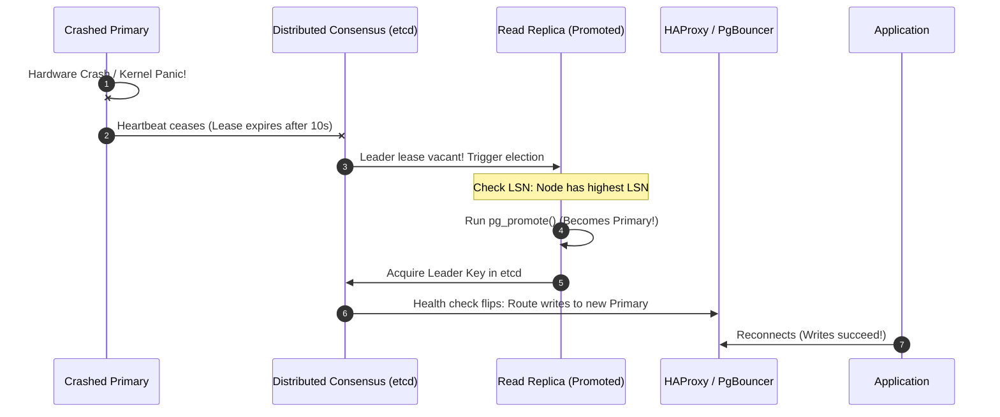

## Fast Revision (10-Second Recall)
- **Emergency Action Steps:**
- 1. **Confirm Failure vs False Alarm:** Distinguish genuine crash from network glitch / GC pause before triggering irreversible failover.
- 2. **Fencing / STONITH (Shoot The Other Node In The Head):** Isolate crashed primary to guarantee it cannot wake up and accept writes (Split-Brain Prevention).
- 3. **Identify Most Up-To-Date Replica:** Check replay LSN; select replica with smallest or zero replication lag to minimize data loss.
- 4. **Promote Standby to Primary:** Issue `SELECT pg_promote();` or let orchestrator (Patroni/Orchestrator) execute promotion.
- 5. **Re-route Application Traffic:** Update virtual IP, AWS Route53 DNS, or reload ProxySQL / HAProxy endpoints.
- 6. **Re-attach Replicas and Old Primary:** Reconfigure other standbys to follow new primary using `pg_rewind`.

## The 30-Second Spoken Script
"If the primary database crashes in production, manual intervention is too slow; the system must rely on automated failover orchestration using Patroni with a distributed consensus store like etcd, or AWS Aurora / RDS Multi-AZ.

Here is the exact automated failover lifecycle:

Step 1: Heartbeat Detection and Leader Loss. All nodes in the cluster continuously renew a leader lease key in etcd. When the primary server crashes, its heartbeat ceases. After a configurable lease timeout—typically 10 to 15 seconds—etcd marks the leader lease expired.

Step 2: Fencing and STONITH. To prevent the most dangerous database disaster—Split-Brain, where two nodes both believe they are primary and accept conflicting writes—fencing is enforced. The orchestrator uses STONITH (Shoot The Other Node In The Head) or watchdog hardware devices to forcefully shut off power or revoke network routes to the old primary.

Step 3: Election and Promotion. The surviving replicas run a leader election. The candidate replica with the highest Write-Ahead Log Log Sequence Number (LSN)—meaning the absolute least replication lag—wins the election. Patroni issues pg_promote() on this standby, transforming it into the new read-write primary.

Step 4: Traffic Re-Routing. The cluster's virtual IP, load balancer proxy (such as HAProxy or PgBouncer), or internal DNS endpoint updates within 2 seconds to direct write connections to the newly promoted primary node.

Step 5: Cluster Healing. When the crashed server recovers, pg_rewind rolls back any unstreamed local WAL blocks on that node, and rejoins it to the cluster as a read replica streaming from the new primary."

## Scenario / Problem Context
At 2:00 AM, the primary database server undergoes catastrophic hardware failure (motherboard failure, kernel panic). The application is throwing 500 errors. The interviewer evaluates your crisis mitigation steps, automated failover mechanics, and ability to prevent data corruption through split-brain.

## Architectural Workflow / Sequence


## Deep-Dive Analysis & Root Causes

| Stage | Risk | Mitigation |
| --- | --- | --- |
| 1. Failure Detection | Flapping / Transient network partition | Require multiple missed heartbeats (e.g., 3 checks over 15s) and node quorum before declaring node dead
2. Split-Brain Prevention | Two primaries accept conflicting writes, causing irreversible data corruption | Fencing via software watchdog (`/dev/watchdog`) or cloud IAM power kill (STONITH)
3. Replica Promotion | Promoting a lagging replica drops committed transactions | Consensus leader election enforces candidate must have highest LSN
4. Cluster Re-Convergence | Old primary has unstreamed diverged WAL records | `pg_rewind` rewinds diverging timeline to the fork point and resynchronizes |


## Practical Debugging Commands & Code
```sql
-- 1. PostgreSQL: Manually promote a standby replica in emergency:
SELECT pg_promote();

-- 2. Check current WAL receive and replay position:
SELECT pg_last_wal_receive_lsn(), 
       pg_last_wal_replay_lsn(),
       pg_last_xact_replay_timestamp();

-- 3. Check Patroni Cluster Health via CLI:
-- patronictl -c /etc/patroni/db.yml topology
-- patronictl -c /etc/patroni/db.yml failover
```

## Prevention & Senior Best Practices
- **Always Deploy an Odd Number of Consensus Nodes:** Run 3 or 5 etcd nodes to ensure clear majority quorum during network partitions.
- **Configure Application Connection Retry Logic:** Applications should use exponential backoff with jitter on database disconnections so client pods do not crash during the 15-second failover window.
- **Conduct Regular Chaos Engineering Drills:** Use tools like Chaos Mesh to simulate sudden primary node crashes and verify failover completes under 30 seconds.
