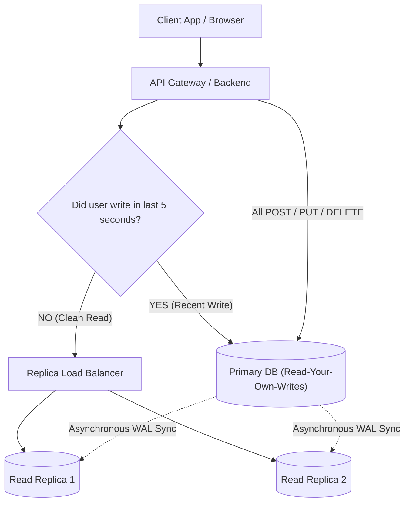

## Fast Revision (10-Second Recall)
- **Definition:** Architectural pattern where writes (`INSERT`, `UPDATE`, `DELETE`, `SELECT FOR UPDATE`) route to the Primary DB, and pure reads (`SELECT`) route to Read Replicas.
- **Implementation Strategies:**
- 1. **Application-Level:** Multiple datasources (e.g., Spring `@Transactional(readOnly = true)`, TypeORM / Prisma read replicas configuration).
- 2. **Proxy-Level:** Intelligent database proxies (ProxySQL for MySQL, Pgpool-II / Heimdall for PostgreSQL) inspect SQL syntax and route dynamically.
- **The Major Trap — Read-Your-Own-Writes Inconsistency:**
- User updates their profile name $\rightarrow$ Primary commits $\rightarrow$ Page reloads immediately $\rightarrow$ SELECT hits replica with 200ms lag $\rightarrow$ User still sees old name!
- **Solutions to Inconsistency:** Sticky session routing to primary for N seconds after mutation; LSN/GTID token tracking; explicit primary read overrides.

## The 30-Second Spoken Script
"Read/write splitting is an architecture where database operations are separated by intent: all state-mutating operations like INSERT, UPDATE, DELETE, and transactions requiring row locks are routed to the primary database, while read-only SELECT queries are load-balanced across one or more read replicas.

There are two primary ways to implement this:
First, at the application layer. In frameworks like Spring Boot or NestJS, we configure dual data sources. When a service method is annotated with readOnly=true, the ORM obtains a connection from the read replica pool; otherwise, it uses the primary pool.
Second, at the database proxy layer. Tools like ProxySQL or Pgpool-II sit between the application and database, parsing incoming SQL statements and automatically routing SELECT queries to healthy replicas.

The biggest challenge in read/write splitting is replication lag, which causes 'Read-Your-Own-Writes' inconsistency. For example, if a user updates their billing address and is immediately redirected to the checkout page, a query directed to a lagged replica will display the old address, causing customer confusion.

To solve this, I implement sticky routing: whenever a user performs a write, we store a session cookie or Redis flag indicating a recent mutation timestamp. Any subsequent reads from that specific user within a short window—such as 3 to 5 seconds—are routed directly to the primary database, guaranteeing immediate read-after-write consistency while leaving 95% of other reads on replicas."

## Scenario / Problem Context
When read traffic outgrows the capacity of a single database, read/write splitting directs mutation traffic to the primary and SELECT queries to read replicas. The interviewer wants to know how routing is implemented and how you solve eventual consistency bugs.

## Architectural Workflow / Sequence


## Deep-Dive Analysis & Root Causes

| Method | Pros | Cons |
| --- | --- | --- |
| Application Layer Splitting | No extra network hop, fine-grained control via code annotations (`@Transactional(readOnly=true)`) | Code coupling; developers must remember to tag transactions; connection pools per pod
Proxy Layer Splitting (ProxySQL, Pgpool) | Transparent to application code; automatic failover handling; central pool management | Extra network hop (+0.5ms latency); proxy itself requires high-availability clustering
Sticky Session Routing | Completely eliminates user-visible replication lag glitches after form submits | Requires session state or Redis check; slight increase in primary read load
WAL LSN / GTID Causal Token | Mathematically guarantees read consistency only waiting until replica reaches write LSN | Requires database client support to pass transaction position tokens in API responses |


## Practical Debugging Commands & Code
```sql
-- 1. Example: Application-level routing logic in TypeScript / Node.js:
// const getDbConnection = (isMutation: boolean, userId: string, hasRecentWrite: boolean) => {
//   if (isMutation || hasRecentWrite) {
//     return primaryPool.getConnection();
//   }
//   return replicaPool.getConnection(); // round-robin over read replicas
// };

-- 2. PostgreSQL: Check replication lag in seconds:
SELECT application_name, client_addr,
       extract(epoch from (now() - pg_last_xact_replay_timestamp())) AS lag_seconds
FROM pg_stat_replication;

-- 3. Forcing Primary Read in SQL when critical data is needed:
-- In ORMs or frameworks: db.transaction(async (trx) => {
--    const balance = await trx('accounts').where({ id }).first(); // explicitly routes to primary!
-- });
```

## Prevention & Senior Best Practices
- **Always Wrap Multi-Statement Operations in Write Transactions:** If a transaction reads data and then updates it, the entire transaction MUST execute on the primary to avoid dirty state reads.
- **Monitor Replica Replication Lag Continuously:** If a replica's lag exceeds 1 second, remove it from the read-balancer pool automatically.
- **Do Not Use Replicas for Distributed Mutexes:** Never check advisory locks or run `SELECT FOR UPDATE` against read replicas; they will throw read-only transaction errors.
