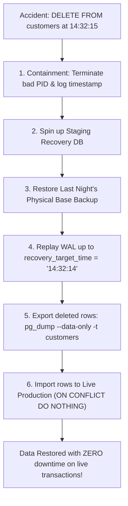

## Fast Revision (10-Second Recall)
- **First Move:** Stop the bleeding! Kill runaway connections (`pg_terminate_backend`), revoke destructive permissions, and identify the exact timestamp of the incident.
- **Recovery Options Matrix:**
- 1. **Point-In-Time Recovery (PITR):** The gold standard. Restore base backup to a temporary staging instance and replay Write-Ahead Logs (WAL/binlog) up to the exact millisecond before the destructive query (`recovery_target_time`). Extract deleted rows and re-insert into production.
- 2. **Delayed Read Replica:** If a replica is configured with a 4-hour replication delay (`recovery_min_apply_delay = '4h'`), pause replication immediately, dump the deleted table, and restore it.
- 3. **Database Flashback / Time-Travel:** Supported in Oracle Flashback, CockroachDB (`AS OF SYSTEM TIME`), and Snowflake (`AT (TIMESTAMP => ...)`).
- 4. **Soft Deletes:** Prevent accidental destruction at application level using `deleted_at TIMESTAMP NULL` and partial indexes.

## The 30-Second Spoken Script
"If records are accidentally deleted in production, my incident response follows three distinct phases: immediate containment, surgical data extraction, and architectural remediation.

First, containment. I identify and terminate the runaway connection using pg_terminate_backend to prevent further cascading deletions, and note the exact wall-clock timestamp of when the command executed.

Second, recovery via Point-In-Time Recovery (PITR). I never restore a backup directly over the running production database because doing so would destroy all valid orders and transactions created after the incident. Instead, I spin up an isolated staging database instance, restore the most recent full physical base backup, and configure PostgreSQL recovery parameters with recovery_target_time set to precisely one second before the accidental DELETE. The database replays the archived Write-Ahead Logs up to that exact timestamp and halts.

Third, surgical re-insertion. From the restored staging instance, I use pg_dump with the --data-only and --table flags to extract only the deleted customer records, and re-import them into production using INSERT ON CONFLICT DO NOTHING to avoid overwriting newer valid records.

Finally, to permanently eliminate this class of failure, we implement soft deletes with deleted_at timestamps at the application layer, enforce transactional safeguards like sql_safe_updates, and maintain a dedicated replica with a 4-hour replication delay."

## Scenario / Problem Context
A junior engineer or buggy migration script executed `DELETE FROM customers;` in production without a WHERE clause, deleting 50,000 active accounts. The interviewer tests your emergency disaster response, backup restoration, and architectural prevention.

## Architectural Workflow / Sequence


## Deep-Dive Analysis & Root Causes

| Method | RecoverySpeed | DataLoss | BestFor |
| --- | --- | --- | --- |
| Point-In-Time Recovery (PITR) | 30 to 90 minutes | 0 records (surgical recovery up to the second before deletion) | Catastrophic table truncations, dropped tables, or corrupted bulk updates
Delayed Standby Replica | 5 to 15 minutes | Zero data loss if caught before delayed replay timer expires | Fastest recovery: pause standby replay (`pg_wal_replay_pause()`) and extract data
Cloud Time-Travel / Flashback | 1 minute | Zero | Databases with native time-travel (Snowflake, BigQuery, CockroachDB)
Application Soft Deletes | Seconds (`UPDATE tbl SET deleted_at = NULL`) | Zero | Day-to-day user-facing deletions |


## Practical Debugging Commands & Code
```sql
-- 1. PostgreSQL: Configure PITR in postgresql.conf on recovery instance:
-- restore_command = 'cp /mnt/wal_archive/%f %p'
-- recovery_target_time = '2024-03-15 14:32:14 UTC'
-- recovery_target_action = 'pause'

-- 2. Pause replication immediately on a delayed standby if disaster occurs:
SELECT pg_wal_replay_pause();

-- 3. Surgical pg_dump from staging recovery node:
-- pg_dump -h staging-db -U postgres -d prod_db -t customers --data-only > recovered_customers.sql

-- 4. Import safely into live production:
-- psql -h live-prod-db -U postgres -d prod_db -f recovered_customers.sql
```

## Prevention & Senior Best Practices
- **Enforce Safe Update Modes:** Enable `SET sql_safe_updates = 1;` in MySQL to reject any `UPDATE` or `DELETE` that lacks a `WHERE` clause with an indexed key.
- **Maintain a Delayed Replica:** Configure a standby replica with `recovery_min_apply_delay = '4h'`. This gives your team a 4-hour window to pause replication and extract accidentally dropped data without running full PITR.
- **Restrict Direct Production Access:** Never grant direct DML permissions to developer accounts in production; all data fixes must pass through reviewed, audited deployment pipelines.
