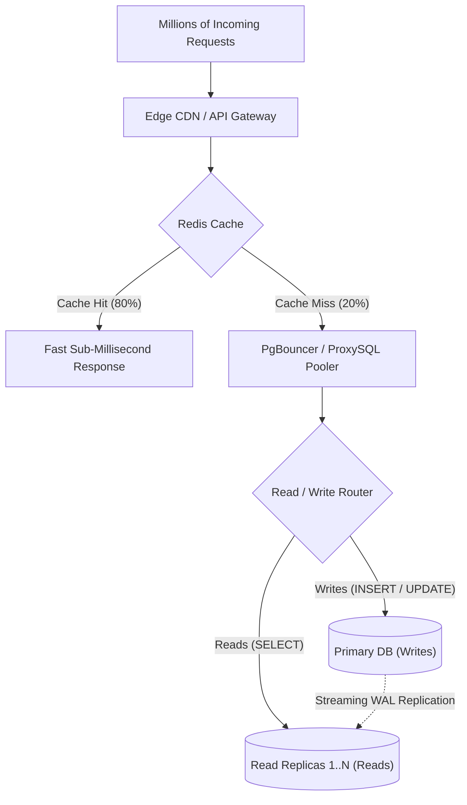

## Fast Revision (10-Second Recall)
- **Follow the Scaling Ladder (Cheapest to Most Complex):**
- 1. **Query & Index Tuning:** Kill full table scans, add covering indexes, eliminate N+1 queries (fixes 60% of issues instantly).
- 2. **Caching Layer:** Cache high-read static/semi-static data in Redis/Memcached (Look-aside pattern, CDN for static content).
- 3. **Connection Pooling:** Introduce PgBouncer or ProxySQL to prevent process fork overhead from thousands of connections.
- 4. **Read/Write Splitting:** Route SELECT traffic to read replicas via WAL streaming replication.
- 5. **Vertical Scaling:** Upgrade compute, NVMe SSDs, and optimize buffer pool (`shared_buffers` / `innodb_buffer_pool_size`).
- 6. **Table Partitioning:** Range/Hash partition hot tables (orders, logs) on single instance to keep working sets in RAM.
- 7. **Horizontal Sharding:** Distribute data across independent database clusters using a shard key (last resort due to operational complexity).

## The 30-Second Spoken Script
"When scaling a database to handle millions of requests, I follow a disciplined 6-stage scaling ladder from lowest operational cost to highest:

First, before changing architecture, I optimize the existing database. I inspect pg_stat_statements or slow query logs to identify the top 5 queries consuming 80% of CPU time, add missing composite or covering indexes, and tune database memory parameters like PostgreSQL's shared_buffers and work_mem.

Second, I reduce database load with caching. I place Redis in front of the database using the cache-aside pattern with TTLs, caching hot entity reads and session states. In high-traffic systems, this offloads 80% to 90% of read traffic.

Third, I add connection pooling via PgBouncer or ProxySQL in transaction-pooling mode. This prevents connection thrashing and enables thousands of client application pods to share a few hundred physical database connections.

Fourth, if read throughput remains saturated, I scale reads horizontally with Read Replicas using streaming replication, configuring application datasources or ProxySQL for read/write splitting.

Fifth, for high-write tables with hundreds of millions of rows, I implement Table Partitioning—such as range partitioning by month—to ensure queries only scan recent partitions and indexes fit entirely in RAM.

Finally, if a single primary database can no longer sustain write throughput or storage limits, I implement Horizontal Database Sharding using consistent hashing on an entity key like tenant_id or user_id."

## Scenario / Problem Context
Traffic has surged by 10x due to a viral marketing campaign or product launch. The database CPU hits 95%, connection pools are exhausted, and p99 query latency jumps from 15ms to 8 seconds. The interviewer is assessing your systematic scalability playbook and ability to avoid premature, risky re-architectures like blind sharding.

## Architectural Workflow / Sequence


## Deep-Dive Analysis & Root Causes

| Layer | TargetLoad | Tradeoff |
| --- | --- | --- |
| 1. In-Memory Caching (Redis) | 80% Read offload | Cache invalidation complexity, eventual consistency risk
2. Connection Pooling (PgBouncer) | 10,000 to 500 connections | Transaction pooling mode disables session-level prepared statements and temp tables
3. Read Replicas | Scales read concurrency 10x | Replication lag can cause stale reads (read-your-own-writes inconsistency)
4. Partitioning | Hot table queries (Orders, Logs) | Queries lacking partition key scan all child partitions
5. Horizontal Sharding | Scales write throughput 10x+ | Loss of ACID transactions across shards, cross-shard joins impossible without 2PC/Saga |


## Practical Debugging Commands & Code
```sql
-- 1. Check top CPU-consuming queries in PostgreSQL:
SELECT query, calls, round(total_exec_time::numeric, 2) AS total_ms,
       round(mean_exec_time::numeric, 2) AS mean_ms,
       round((100 * total_exec_time / sum(total_exec_time) OVER ())::numeric, 2) AS percentage
FROM pg_stat_statements
ORDER BY total_exec_time DESC
LIMIT 10;

-- 2. Inspect active connections vs max allowed:
SELECT count(*) AS active_connections,
       current_setting('max_connections')::int AS max_allowed,
       round(100.0 * count(*) / current_setting('max_connections')::int, 2) AS percent_used
FROM pg_stat_activity
WHERE state != 'idle';

-- 3. PgBouncer Configuration (pgbouncer.ini):
-- pool_mode = transaction
-- max_client_conn = 10000
-- default_pool_size = 50
-- reserve_pool_size = 10
```

## Prevention & Senior Best Practices
- **Do Not Shard Early:** Exhaust indexing, caching, connection pooling, and read replicas first. Sharding adds enormous distributed system complexity.
- **Enforce Read-Your-Own-Writes Routing:** After a user submits a mutation (e.g., updates profile), route their subsequent reads to the primary database for 5 seconds to prevent stale replica reads.
- **Set Guardrail Timeouts:** Set `statement_timeout = '5s'` so rogue analytics queries cannot exhaust pooler threads during peak load.
