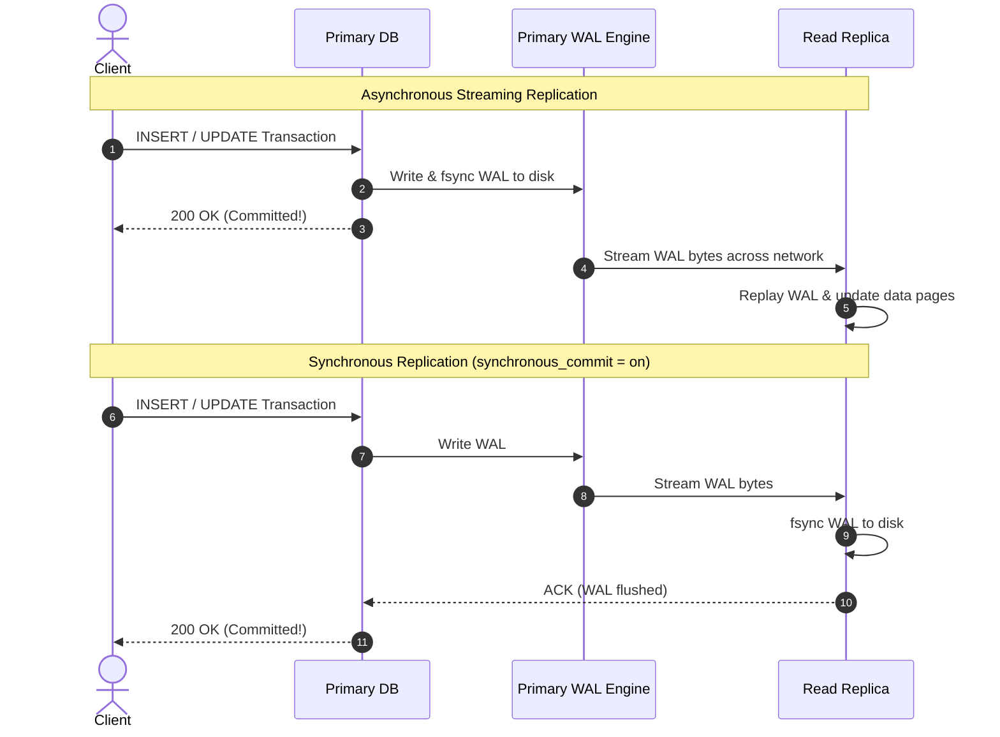

## Fast Revision (10-Second Recall)
- **Core Purpose:** High Availability (automatic failover), Read Scalability (offloading reads), Disaster Recovery (cross-region replicas), and Zero-Downtime Upgrades.
- **Replication Modes:**
- 1. **Asynchronous:** Primary commits immediately without waiting for replicas. Maximum write throughput; risk of data loss (RPO &gt; 0) if primary crashes before WAL transmits.
- 2. **Synchronous:** Primary waits for at least one replica to write WAL to disk before committing. Zero data loss (RPO = 0); write latency increases by network round-trip time (RTT).
- **Replication Types:**
- 1. **Physical Streaming Replication:** Byte-for-byte binary copy of Write-Ahead Logs (WAL/binlog). Fast, low CPU overhead, identical block layout; replicas are read-only.
- 2. **Logical Replication:** Replays SQL changes (row inserts, updates, deletes) decoded from WAL. Allows selective table replication, cross-version upgrades, and writes to replicas.

## The 30-Second Spoken Script
"Database replication is the automated process of copying data and transactions from a primary database to one or more replica nodes. It serves three critical production needs: high availability during hardware failures, read scalability by offloading SELECT queries, and disaster recovery across geographical regions.

Under the hood, replication relies on the database transaction log—the Write-Ahead Log (WAL) in PostgreSQL or the Binary Log (binlog) in MySQL. Every mutation written to disk is serialized into this log.

There are two primary dimensions:
First, Physical vs Logical replication. Physical streaming replication sends raw byte-level disk changes directly to the replica, which replays them. It is extremely fast and low-overhead, but replicas must run the exact same major version and operating system. Logical replication publishes decoded row-level changes (INSERT, UPDATE, DELETE). This allows replicating individual tables, filtering columns, and performing zero-downtime upgrades between major database versions.

Second, Synchronous vs Asynchronous replication. In asynchronous replication, the primary commits transactions immediately without waiting for replicas. This delivers maximum write performance, but creates replication lag and potential data loss if the primary crashes. In synchronous replication, the primary blocks until at least one replica confirms writing the log to disk, guaranteeing zero data loss at the cost of higher write latency."

## Scenario / Problem Context
High availability and read scalability require replicating data across multiple physical database instances. The interviewer wants to know if you understand how data moves under the hood, synchronous vs asynchronous tradeoffs, and failure recovery.

## Architectural Workflow / Sequence


## Deep-Dive Analysis & Root Causes

| Attribute | Detail | Pros | Cons |
| --- | --- | --- | --- |
| Physical Streaming Replication | Replays binary block changes (WAL/redo log) | Ultra-low CPU overhead, highest throughput, 100% faithful replica | Standby is strictly read-only, cannot replicate subset of tables, identical OS/architecture required
Logical Replication | Decodes WAL into logical tuples (INSERT/UPDATE/DELETE events) | Cross-version migrations, selective table replication, multi-primary topologies | Higher CPU and memory overhead, does not replicate DDL or large objects automatically
Synchronous Replication | Primary waits for replica disk flush before COMMIT returns to client | Zero data loss (RPO = 0), guaranteed durability | Write latency includes network RTT; if replica stalls, primary writes block
Asynchronous Replication | Primary returns COMMIT immediately after local disk flush | Fastest write latency, replica failure does not impact primary writes | Replication lag; potential data loss if primary dies before streaming uncommitted WAL |


## Practical Debugging Commands & Code
```sql
-- 1. PostgreSQL: Check replication status on Primary:
SELECT client_addr, state, sync_state, sync_priority,
       pg_wal_lsn_diff(pg_current_wal_lsn(), sent_lsn) AS sent_lag_bytes,
       pg_wal_lsn_diff(sent_lsn, write_lsn) AS write_lag_bytes,
       pg_wal_lsn_diff(write_lsn, flush_lsn) AS flush_lag_bytes,
       pg_wal_lsn_diff(flush_lsn, replay_lsn) AS replay_lag_bytes
FROM pg_stat_replication;

-- 2. PostgreSQL: Check if current instance is in recovery (Standby / Replica):
SELECT pg_is_in_recovery(); -- returns true on replica, false on primary

-- 3. Configure synchronous replication in postgresql.conf:
-- synchronous_commit = on
-- synchronous_standby_names = 'FIRST 1 (replica_node_1, replica_node_2)'
```

## Prevention & Senior Best Practices
- **Use Quorum Synchronous Standby for Mission-Critical Data:** Set `synchronous_standby_names = 'ANY 1 (node1, node2)'` so that if one replica fails, the primary does not hang waiting for ACKs.
- **Alert on Replication Lag Bytes:** Monitor `replay_lag` in milliseconds and bytes. If replay lag exceeds 1GB, investigate slow analytical queries on the replica.
- **Never Run Backups on the Primary:** Point physical backups and analytical batch jobs to a dedicated replica to protect primary I/O.
