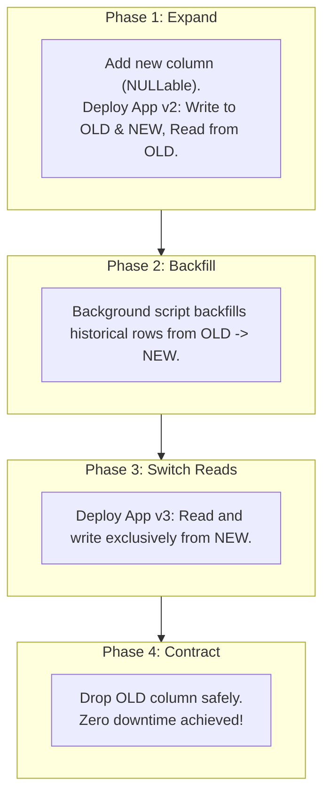

## Fast Revision (10-Second Recall)
- **Core Principle:** Application code and database schemas are decoupled. The database must ALWAYS support both the currently running application version (v1) and the newly deploying version (v2) simultaneously.
- **The Industry Gold Standard: Expand and Contract Pattern (Parallel Run):**
- 1. **Phase 1 (Expand):** Add the new schema elements (new column, new table) alongside the old one. Update the app to write to BOTH old and new, but read from old.
- 2. **Phase 2 (Backfill):** Run an asynchronous background migration to backfill historical data from old column to new column.
- 3. **Phase 3 (Switch Reads):** Deploy new application code that reads from the new column and continues writing to both (or writes only to new).
- 4. **Phase 4 (Contract):** Once all old application pods are fully terminated and verified, drop the old column or table in a safe final cleanup migration.
- **Renaming Columns:** Never run `ALTER TABLE RENAME COLUMN`! It breaks running v1 pods instantly. Always use Expand/Contract.

## The 30-Second Spoken Script
"Handling database schema changes without downtime requires treating schema evolution as a multi-step rollout using the Expand and Contract pattern, also known as Parallel Run.

In modern cloud environments with rolling deployments, older application pods and newer pods run concurrently for several minutes during a rollout. If you rename or delete a column in a single migration, older pods will crash immediately when executing SELECT or INSERT statements.

The Expand and Contract pattern breaks changes into four distinct, backward-compatible phases:

Phase 1 is Expand. We add the new column or structure to the database. For example, if we want to split a 'full_name' column into 'first_name' and 'last_name', we create the new columns as NULLable. We then deploy application version 2, which writes to both the old full_name column and the new first/last columns simultaneously, while continuing to read from full_name.

Phase 2 is Backfill. An asynchronous background worker script iterates over existing historical records, parsing and backfilling the new columns in small batches without acquiring heavy locks.

Phase 3 is Switch Reads. We deploy application version 3. Now that all historical and new data exists in the new columns, version 3 reads and writes exclusively to the new columns.

Phase 4 is Contract. After confirming that no active application code references the old full_name column, we deploy a final migration that drops the old column and frees disk space.

By following this discipline, every single deployment is 100% backward-compatible, enabling continuous deployment with zero user disruption."

## Scenario / Problem Context
A fast-growing application deploys 10 times a day with rolling container deployments. Modifying columns, renaming tables, or dropping fields breaks existing running instances if done in a single step. The interviewer wants to test your mastery of backward-compatible database evolution.

## Architectural Workflow / Sequence


## Deep-Dive Analysis & Root Causes

| Operation | DangerousSingleStep | ZeroDowntimePattern |
| --- | --- | --- |
| Renaming a Column | `ALTER TABLE users RENAME COLUMN phone TO mobile;` (Crashes running v1 code immediately) | Add `mobile` $\rightarrow$ Dual-write $\rightarrow$ Backfill $\rightarrow$ Read `mobile` $\rightarrow$ Drop `phone`
Changing Column Type (e.g., INT to BIGINT) | `ALTER TABLE orders ALTER COLUMN id TYPE BIGINT;` (Rewrites entire table, locking all traffic) | Add `new_id BIGINT` $\rightarrow$ Dual-write via trigger/app $\rightarrow$ Backfill $\rightarrow$ Swap foreign keys $\rightarrow$ Drop `old_id`
Adding Foreign Key Constraint | `ALTER TABLE orders ADD CONSTRAINT fk_user ...;` (Locks parent and child tables during validation) | `ADD CONSTRAINT ... NOT VALID` (instant) $\rightarrow$ `VALIDATE CONSTRAINT` (non-blocking scan) |


## Practical Debugging Commands & Code
```sql
-- 1. Always set strict lock timeouts on migrations:
SET lock_timeout = '2s';
SET statement_timeout = '10s';

-- 2. Phase 1: Expand - Add new column as NULLable:
ALTER TABLE users ADD COLUMN phone_number_v2 VARCHAR(32);

-- 3. Application Dual-Write (in ORM / App Service):
-- async function saveUser(user) {
--   await db('users').update({
--     phone: user.phone,          // Old column
--     phone_number_v2: user.phone // New column
--   });
-- }

-- 4. Phase 4: Contract - Drop old column after all v1 code is gone:
ALTER TABLE users DROP COLUMN phone;
```

## Prevention & Senior Best Practices
- **Enforce CI/CD Migration Linting:** Integrate tools like `strong_migrations` (Ruby), `atlas` (Go), or `squawk` to reject unsafe DDL in pull requests.
- **Decouple Migrations from Code Deployments:** Run database migrations before container deployments, never inside container startup scripts (`CMD npm start` running migrations is an anti-pattern!).
- **Always Have Rollback Scripts Ready:** Every migration script must have an idempotent, tested down-migration.
