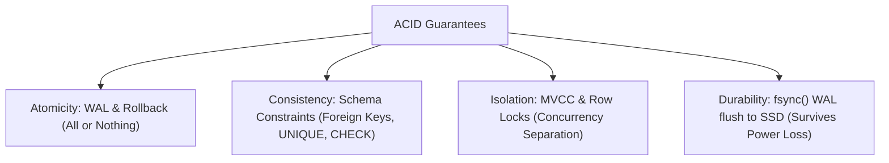

## Scenario

> **What are ACID properties?**

Every candidate memorizes "Atomicity, Consistency, Isolation, Durability", but senior engineers can explain HOW the database physically implements each property under the hood.

## Fast Revision (10-Second Recall)

- **The 4 Pillars of ACID & Their Physical Implementation:**
- 1. **Atomicity (All-or-Nothing):** Implemented via **Write-Ahead Logging (WAL)** and rollback segments.
- 2. **Consistency (Valid State to Valid State):** Implemented via **Schema Constraints** (Foreign Keys, NOT NULL, CHECK, UNIQUE).
- 3. **Isolation (Concurrent Transactions Don't Interfere):** Implemented via **MVCC (Multi-Version Concurrency Control)** and Locks.
- 4. **Durability (Committed Data Survives Power Loss):** Implemented via **`fsync()` to persistent non-volatile storage** before acknowledging commit.

## The 30-Second Spoken Script

If asked this in an interview, deliver this structured response:

> *ACID represents the four foundational guarantees that relational database engines enforce to ensure data integrity under concurrent access and catastrophic hardware failures.*
>
> *Atomicity means All-or-Nothing. A transaction consisting of multiple inserts or updates either completes in its entirety or leaves zero trace. The database achieves this using Write-Ahead Logging (WAL). If any step fails or the machine loses power, the engine uses the log to roll back intermediate changes.*
>
> *Consistency guarantees that the database transitions strictly from one valid state to another valid state, never violating relational constraints, data types, unique keys, or foreign key cascades. If a write would violate a NOT NULL or CHECK constraint, the entire transaction is rejected.*
>
> *Isolation ensures that concurrent transactions execute as if they were running serially in isolation. PostgreSQL implements this using Multi-Version Concurrency Control (MVCC) and snapshot isolation, allowing readers to read data without locking writers, and writers to modify rows without blocking readers.*
>
> *Durability guarantees that once a transaction receives a successful commit acknowledgment, its changes survive power outages, server crashes, and OS kernel panics. The database ensures this by performing a synchronous disk flush (fsync) of the Write-Ahead Log to non-volatile disk before sending the 200 OK commit response to the client.*

## Diagnostic Lifecycle



## Root Causes & Solutions Matrix

| Suspected Layer | Symptoms & Evidence | Immediate Resolution |
| :--- | :--- | :--- |
| **Atomicity** | Server crashes mid-transfer; sender debited but receiver not credited. | Enforced via Write-Ahead Log (WAL) undo recovery. |
| **Consistency** | User attempts to insert negative bank balance or orphaned order. | Enforced via database `CHECK (balance >= 0)` and `FOREIGN KEY`. |
| **Isolation** | Concurrent transactions read dirty uncommitted rows. | Enforced via MVCC snapshot isolation levels. |
| **Durability** | Committed data lost after server reboot due to un-flushed OS disk cache. | Enforced via synchronous `fsync` before commit response. |

## Practical Debugging Commands & Code

### Enforcing Consistency with Database-Level CHECK Constraints
```sql
-- Demonstrating Database-Enforced Consistency
CREATE TABLE bank_accounts (
  id BIGSERIAL PRIMARY KEY,
  account_number VARCHAR(34) UNIQUE NOT NULL,
  balance NUMERIC(15, 2) NOT NULL,
  
  -- Database guarantees Consistency: Balance CANNOT drop below $0.00!
  CONSTRAINT chk_positive_balance CHECK (balance >= 0.00)
);

-- Transaction demonstrating Atomicity, Isolation, and Durability:
BEGIN;
-- Deduct from Alice
UPDATE bank_accounts 
SET balance = balance - 500.00 
WHERE account_number = 'ACC_ALICE';

-- Credit Bob
UPDATE bank_accounts 
SET balance = balance + 500.00 
WHERE account_number = 'ACC_BOB';

-- If Alice's balance drops to -100, the CHECK constraint fails immediately!
-- The entire transaction rolls back (Atomicity + Consistency).
COMMIT; -- On commit, WAL is fsync'd to disk (Durability).
```

## Prevention & Senior Best Practices

1. **Enforce Constraints at the Database Tier:** Never rely solely on application-level validation for consistency; define `FOREIGN KEY` and `CHECK` constraints.
2. **Never Disable `fsync` in Production:** Setting `fsync = off` delivers 10x write speed but guarantees database corruption on power loss.
3. **Keep Transactions Small for Durability:** Massive transactions force huge WAL flushes on commit, spiking disk I/O.
