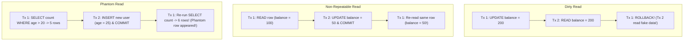

## Scenario

> **Explain dirty reads, non-repeatable reads, and phantom reads.**

The classic database interview question. The interviewer wants clear concrete timeline examples for each anomaly and how database engines eliminate them.

## Fast Revision (10-Second Recall)

- **The 3 Concurrency Read Anomalies:**
- 1. **Dirty Read:** Reading data that has been modified by an active transaction but **NOT YET COMMITTED** (disastrous if rolled back!).
- 2. **Non-Repeatable Read (Fuzzy Read):** Reading a row, another transaction **UPDATES or DELETES** that row and commits; re-reading the same row returns different values.
- 3. **Phantom Read:** Executing a range query (`WHERE age > 30`), another transaction **INSERTS** a new row matching that range and commits; re-running the range query returns a new "phantom" row.
- **MVCC Defense:** MVCC uses transaction IDs (`xmin`/`xmax`) to determine whether a row version is visible to a given transaction snapshot.

## The 30-Second Spoken Script

If asked this in an interview, deliver this structured response:

> *The three classic read anomalies represent different levels of data inconsistency that occur when multiple transactions execute concurrently.*
>
> *First is a Dirty Read. Transaction 1 modifies a row from $100 to $200 but has not committed. Transaction 2 reads that row and sees $200. Transaction 1 encounters an error and rolls back. Transaction 2 has now operated on dirty data that never existed in the database. Read Committed eliminates dirty reads by ensuring queries only see committed row versions.*
>
> *Second is a Non-Repeatable Read. Transaction 1 reads a customer's status as ACTIVE. Meanwhile, Transaction 2 updates that customer to BANNED and commits. Transaction 1 re-reads the exact same customer row and now sees BANNED. The read was not repeatable within the same transaction. Repeatable Read eliminates this by freezing the transaction's view to a single snapshot taken at transaction start.*
>
> *Third is a Phantom Read. Transaction 1 queries for all users in Canada and gets 10 records. Meanwhile, Transaction 2 inserts a brand new Canadian user and commits. When Transaction 1 re-runs the exact same query, 11 records appear—the new record is a phantom. Serializable isolation (or InnoDB's next-key gap locks in Repeatable Read) prevents phantom reads by locking the index range.*

## Diagnostic Lifecycle



## Root Causes & Solutions Matrix

| Suspected Layer | Symptoms & Evidence | Immediate Resolution |
| :--- | :--- | :--- |
| **Dirty Read** | Tx reads uncommitted values; values disappear on rollback. | Enforce `READ COMMITTED` isolation level. |
| **Non-Repeatable Read** | Row values mutate between queries inside the same transaction. | Enforce `REPEATABLE READ` snapshot isolation. |
| **Phantom Read** | New rows pop into existence inside range query on subsequent reads. | Enforce `SERIALIZABLE` isolation or InnoDB Gap Locking. |
| **Write Skew Anomaly** | Two concurrent transactions evaluate constraints and produce invalid combined state. | Enforce `SERIALIZABLE` or explicit table locks. |

## Practical Debugging Commands & Code

### Anomaly Matrix Across Standard Isolation Levels
```sql
/*
====================================================================
ISOLATION LEVEL         DIRTY READ    NON-REPEATABLE READ   PHANTOM READ
====================================================================
Read Uncommitted        Allowed       Allowed               Allowed
Read Committed          Prevented     Allowed               Allowed
Repeatable Read         Prevented     Prevented             Prevented (in PG & MySQL InnoDB)
Serializable            Prevented     Prevented             Prevented (Strict Serial Order)
====================================================================
*/

-- Demonstrating Repeatable Read snapshot defense against Non-Repeatable Reads
BEGIN TRANSACTION ISOLATION LEVEL REPEATABLE READ;

-- Query 1
SELECT balance FROM accounts WHERE id = 10; -- Returns 1000

-- (Concurrent transaction updates balance to 500 and commits)

-- Query 2 in same transaction:
SELECT balance FROM accounts WHERE id = 10; -- STILL RETURNS 1000! (Snapshot preserved!)

COMMIT;
```

## Prevention & Senior Best Practices

1. **Know Your Database Defaults:** PostgreSQL defaults to Read Committed; MySQL InnoDB defaults to Repeatable Read.
2. **Use Serializable for Multi-Row Invariants:** Whenever business rules span multiple rows (e.g. checking if sum of shifts > 40 hours), use `SERIALIZABLE`.
3. **Beware of Gap Locks in MySQL:** MySQL Repeatable Read uses Next-Key Gap Locks to prevent phantom reads, which can increase deadlocks on unindexed columns.
