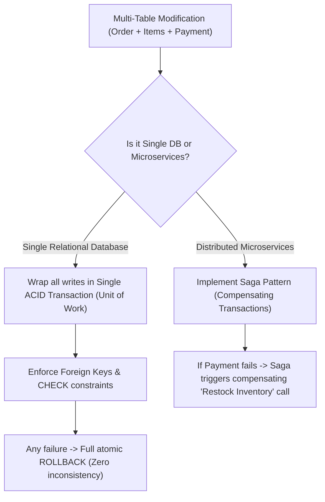

## Scenario

> **How would you ensure data consistency across multiple tables?**

When an order is created, rows must be inserted into orders, order_items, payments, and inventory decremented. If one fails, data is corrupted. The interviewer evaluates your consistency strategies in monoliths and distributed systems.

## Fast Revision (10-Second Recall)

- **Monolith (Single DB):** **ACID Database Transactions (`BEGIN ... COMMIT`)** and **Foreign Key Constraints**.
- **Distributed / Microservices:** **The Saga Pattern (Orchestration or Choreography)** with compensating transactions.
- **The 3 Monolithic Consistency Tools:**
- 1. **Unit of Work / ACID Transaction:** All table writes enclosed in a single database transaction.
- 2. **Foreign Key Integrity:** `ON DELETE RESTRICT` / `CASCADE` prevents orphaned child records.
- 3. **CHECK Constraints & Triggers:** Enforce cross-table invariant rules at the database level.

## The 30-Second Spoken Script

If asked this in an interview, deliver this structured response:

> *To ensure data consistency across multiple tables, the architecture depends on whether the tables reside within a single relational database or are distributed across microservices.*
>
> *Within a single database, I enforce consistency through two primary mechanisms:
First, ACID Database Transactions using the Unit of Work pattern. Every write operation spanning orders, order_items, and payment_logs is wrapped in a single BEGIN ... COMMIT transaction block. If inserting the payment record fails, the entire transaction rolls back, ensuring no partial orders exist.
Second, Declarative Relational Constraints. I enforce foreign keys with ON DELETE RESTRICT to prevent orphaned records, and define CHECK constraints to maintain domain invariants.*
>
> *In a distributed microservices environment where services own independent databases, single-database ACID transactions are impossible. In that scenario, I implement the Saga Pattern using an Orchestrator. 
The orchestrator coordinates the multi-table workflow across services. If the Order Service and Inventory Service succeed but the Payment Service fails, the Saga orchestrator dispatches Compensating Transactions—such as calling Inventory Service to restock the reserved items and marking the Order as Cancelled—guaranteeing eventual consistency.*

## Diagnostic Lifecycle



## Root Causes & Solutions Matrix

| Suspected Layer | Symptoms & Evidence | Immediate Resolution |
| :--- | :--- | :--- |
| **Orphaned Child Records** | Parent row deleted, leaving millions of orphaned records in child table. | Add `FOREIGN KEY (parent_id) REFERENCES parent(id) ON DELETE CASCADE`. |
| **Partial Monolith Write** | Order header created, but server crashed before order items were saved. | Enclose all writes in a single `BEGIN ... COMMIT` transaction. |
| **Microservice Partial Failure** | Payment service charged user, but Order service timed out. | Implement Saga pattern with compensating refund transactions. |
| **Cross-Table Sum Inconsistency** | Order total does not match sum of individual order item prices. | Use database trigger or calculate total dynamically via view/generated column. |

## Practical Debugging Commands & Code

### Unit of Work Pattern in Node.js / TypeScript
```typescript
import { PoolClient } from 'pg';

interface CreateOrderPayload {
  customerId: number;
  items: Array<{ productId: number; quantity: number; price: number }>;
}

export async function createOrderTransactional(payload: CreateOrderPayload, client: PoolClient) {
  try {
    // 1. Begin Single Transactional Unit of Work
    await client.query('BEGIN');

    // 2. Insert Order Header
    const orderRes = await client.query(
      'INSERT INTO orders (customer_id, status) VALUES ($1, $2) RETURNING id',
      [payload.customerId, 'PENDING']
    );
    const orderId = orderRes.rows[0].id;

    // 3. Insert All Order Items & Decrement Inventory
    for (const item of payload.items) {
      // Insert item linked via Foreign Key
      await client.query(
        'INSERT INTO order_items (order_id, product_id, quantity, price) VALUES ($1, $2, $3, $4)',
        [orderId, item.productId, item.quantity, item.price]
      );

      // Decrement inventory with stock check
      const stockRes = await client.query(
        'UPDATE products SET stock = stock - $1 WHERE id = $2 AND stock >= $1',
        [item.quantity, item.productId]
      );

      if (stockRes.rowCount === 0) {
        throw new Error(`Insufficient stock for product ID ${item.productId}`);
      }
    }

    // 4. Commit all writes atomically!
    await client.query('COMMIT');
    return { success: true, orderId };
  } catch (error) {
    // 5. Any failure rolls back EVERYTHING across all tables!
    await client.query('ROLLBACK');
    throw error;
  }
}
```

## Prevention & Senior Best Practices

1. **Never Allow DDL to Disable Foreign Keys:** Maintain strict foreign key integrity constraints in production schemas.
2. **Use Outbox Pattern for Events:** When publishing domain events from transactions, write to an `outbox` table in the same transaction to prevent event loss.
3. **Enforce Database-Level Consistency Checks:** Validate data consistency with periodic checksum jobs comparing ledger tables.
