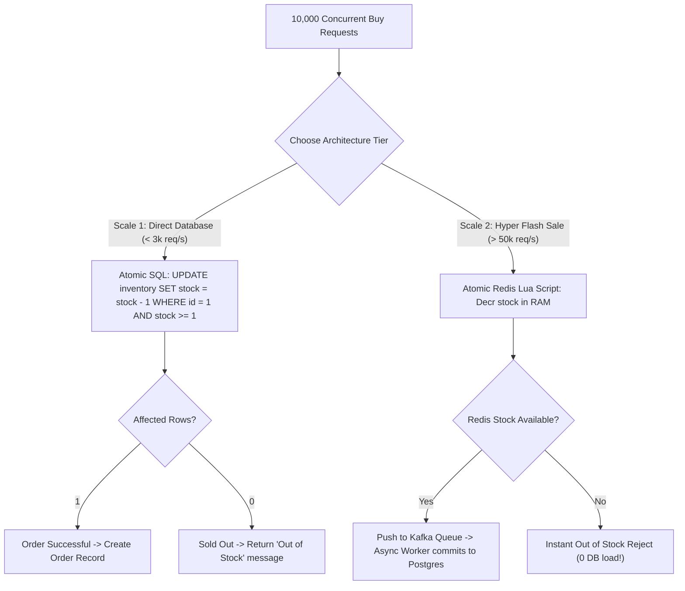

## Scenario

> **How would you handle concurrent inventory updates?**

The quintessential e-commerce interview question: 10,000 users click "Buy Now" simultaneously for an iPhone with only 5 units in stock. How do you guarantee zero overselling while keeping latency under 100ms?

## Fast Revision (10-Second Recall)

- **First Move:** Apply an **Atomic Decrement with a Database Guard Condition** (`WHERE stock >= quantity`).
- **The 3 Engineering Architectures:**
- 1. **Single-Node / Moderate Traffic (Up to 2,000 orders/sec):** Atomic SQL update `UPDATE products SET stock = stock - 1 WHERE id = 101 AND stock >= 1;`. Check affected rows: 1 = success, 0 = sold out.
- 2. **Pessimistic Row Lock:** `SELECT stock FROM products WHERE id = 101 FOR UPDATE`. Slower due to row lock contention.
- 3. **Ultra-High Flash Sale (100,000 req/sec):** Decouple database with **Redis Lua Script** for atomic decrement, followed by asynchronous Kafka queue to persist orders in database.
- **Safety Net:** Add database constraint `CHECK (stock >= 0)` so the database physically rejects negative stock.

## The 30-Second Spoken Script

If asked this in an interview, deliver this structured response:

> *To handle concurrent inventory updates during high-concurrency flash sales, the primary goal is preventing overselling while maintaining high throughput.*
>
> *For standard e-commerce traffic, I use an Atomic In-Database Decrement. Instead of reading the stock into application memory and writing it back, the application executes a single atomic SQL statement:
UPDATE inventory SET stock = stock - :quantity WHERE product_id = :id AND stock >= :quantity;
Because relational databases acquire an exclusive row-level lock during an update, the database evaluates the condition sequentially at the microsecond level. If the update returns 1 affected row, the purchase succeeded. If it returns 0 rows, the inventory is sold out. As a hard safety net, I add a CHECK (stock >= 0) constraint on the table so the database will physically reject any negative inventory write.*
>
> *For hyper-scale flash sales—like 100,000 requests per second—hitting PostgreSQL directly will exhaust connection pools and trigger severe row-lock queue timeouts. 
In that scenario, I move inventory decrementing to Redis using an atomic Lua script (DECRBY). If Redis confirms stock is available, it pushes an order event into a Kafka message queue. A background worker pool consumes from Kafka and batches writes into PostgreSQL asynchronously, shielding the relational database from traffic spikes.*

## Diagnostic Lifecycle



## Root Causes & Solutions Matrix

| Suspected Layer | Symptoms & Evidence | Immediate Resolution |
| :--- | :--- | :--- |
| **Overselling Glitch** | Stock was 5; database balance ended at -12 after concurrent checkout. | Add `CHECK (stock >= 0)` constraint and atomic `WHERE stock >= :qty`. |
| **Row Lock Queue Timeout** | 5,000 requests wait on same row lock; database connection pool crashes. | Offload inventory check to Redis atomic Lua script. |
| **Uncommitted Cart Abandonment** | User adds item to cart; item locked forever if user closes tab. | Implement a 15-minute reservation TTL in Redis; release on expiration. |
| **Read-Modify-Write Race** | App checks `if (stock > 0)` in TypeScript before issuing `UPDATE`. | Never check stock in application memory; check in SQL statement. |

## Practical Debugging Commands & Code

### Atomic Inventory Decrement & Redis Lua Flash Sale Script
```typescript
// 1. Direct PostgreSQL Atomic Decrement (Safe up to thousands of requests/sec)
export async function purchaseItemDirect(productId: number, quantity: number, db: any) {
  const result = await db.query(
    `UPDATE products 
     SET stock = stock - $1 
     WHERE id = $2 AND stock >= $1`,
    [quantity, productId]
  );

  if (result.rowCount === 0) {
    throw new Error('Item is out of stock or insufficient quantity available.');
  }

  // Create order record...
  return { success: true };
}

// 2. Redis Lua Script for High-Scale Flash Sales (> 50,000 req/sec)
// Executes atomically on single Redis thread with zero concurrency race!
const flashSaleLuaScript = `
  local currentStock = tonumber(redis.call('get', KEYS[1]))
  local purchaseQty = tonumber(ARGV[1])

  if not currentStock or currentStock < purchaseQty then
    return 0 -- Out of stock
  end

  redis.call('decrby', KEYS[1], purchaseQty)
  return 1 -- Success!
`;

export async function purchaseItemRedis(productId: number, quantity: number, redisClient: any) {
  const stockKey = `inventory:product:${productId}`;
  const result = await redisClient.eval(flashSaleLuaScript, 1, stockKey, quantity);

  if (result === 0) {
    throw new Error('Sold out!');
  }

  // Publish to Kafka queue for asynchronous DB write
  // kafkaProducer.send({ topic: 'orders', message: { productId, quantity } });
  return { success: true, message: 'Order reserved successfully' };
}
```

## Prevention & Senior Best Practices

1. **Always Add Database Check Constraint:** `ALTER TABLE products ADD CONSTRAINT chk_stock_non_negative CHECK (stock >= 0);` guarantees physical integrity.
2. **Use Idempotency Keys on Payment Calls:** Ensure users cannot accidentally trigger multiple inventory decrements on network retries.
3. **Implement Expiring Cart Reservations:** Use Redis key expiration (`EXPIRE`) to automatically return stock if checkout is not completed within 10 minutes.
