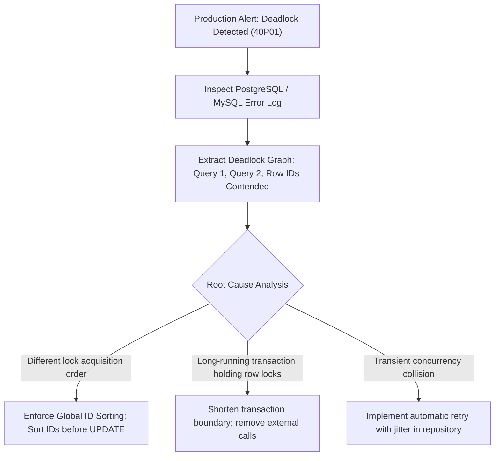

## Scenario

> **How would you identify and resolve a deadlock?**

Deadlocks are intermittent and impossible to reproduce on local single-threaded dev environments. The interviewer evaluates your ability to extract deadlock logs in production and architect permanent structural code fixes.

## Fast Revision (10-Second Recall)

- **First Move:** Inspect the database error log for the **Deadlock Graph Detail**—it lists the exact two queries, PIDs, and conflicting lock types.
- **The 3 Structural Fixes:**
- 1. **Consistent Lock Ordering:** Sort entities by ID (`ORDER BY id ASC`) before issuing updates or `SELECT FOR UPDATE`.
- 2. **Batching / Single-Statement Updates:** Replace multiple discrete updates with a single batched `UPDATE ... FROM (VALUES ...)` statement.
- 3. **Application Retries with Jitter:** Catch error code `40P01` (Postgres) or `1213` (MySQL) and retry with exponential backoff.
- **Tuning:** Adjust `deadlock_timeout` (default 1000ms) if detection latency is too slow.

## The 30-Second Spoken Script

If asked this in an interview, deliver this structured response:

> *To identify and resolve database deadlocks in production, I combine log analysis with structural code refactoring.*
>
> *First, to identify the deadlock, I inspect our database error logs. When PostgreSQL detects a deadlock, it writes a detailed graph to the log: showing the exact SQL queries of both processes, their process IDs, the exact relation and tuple being contended, and which transaction was chosen as the victim.*
>
> *Second, to permanently resolve the deadlock, 90% of the time the root cause is inconsistent lock ordering between two application endpoints. For example, a transfer endpoint updates Account A then Account B, while a refund endpoint updates Account B then Account A. 
The permanent structural fix is enforcing Global Resource Ordering. Before acquiring locks or updating rows, the application sorts the entities by Primary Key. If both transactions always lock the lower ID first followed by the higher ID, circular wait cycles are mathematically impossible to form.*
>
> *Third, at the application resilience layer, I implement an automatic retry mechanism. When a repository catches SQLState 40P01 (deadlock detected), it retries the transaction after a random jitter delay of 50 to 100 milliseconds, ensuring zero failed requests bubble up to end users.*

## Diagnostic Lifecycle



## Root Causes & Solutions Matrix

| Suspected Layer | Symptoms & Evidence | Immediate Resolution |
| :--- | :--- | :--- |
| **Inconsistent Code Ordering** | Endpoint A locks User then Account; Endpoint B locks Account then User. | Standardize locking sequence across all endpoints. |
| **Batch Insert Deadlocks** | Two concurrent bulk inserts insert records in different key orders. | Sort bulk insert payloads by primary/unique key before executing `INSERT`. |
| **Unindexed Child Foreign Key** | Updating child row acquires table-level share lock on parent. | Add index on all child foreign key columns. |
| **High Contention Hotspot** | Hundreds of workers contending on single company wallet row. | Shard the wallet into 10 sub-accounts and aggregate at query time. |

## Practical Debugging Commands & Code

### Global Lock Ordering & Automated Deadlock Retry Wrapper
```typescript
// 1. Permanent Structural Fix: Enforce Global Resource Ordering
export async function transferFunds(
  fromAccountId: number, 
  toAccountId: number, 
  amount: number, 
  db: any
) {
  // CRITICAL: Sort IDs so all transactions acquire locks in identical order!
  const firstId = Math.min(fromAccountId, toAccountId);
  const secondId = Math.max(fromAccountId, toAccountId);

  await db.transaction(async (tx: any) => {
    // Locks always acquired: lowest ID first, highest ID second!
    // A deadlock is mathematically impossible!
    await tx.query('SELECT id FROM accounts WHERE id = $1 FOR UPDATE', [firstId]);
    await tx.query('SELECT id FROM accounts WHERE id = $2 FOR UPDATE', [secondId]);

    await tx.query('UPDATE accounts SET balance = balance - $1 WHERE id = $2', [amount, fromAccountId]);
    await tx.query('UPDATE accounts SET balance = balance + $1 WHERE id = $2', [amount, toAccountId]);
  });
}

// 2. Application-Level Resilient Deadlock Retry Wrapper
export async function withDeadlockRetry<T>(fn: () => Promise<T>, maxRetries = 3): Promise<T> {
  let attempt = 0;
  while (true) {
    try {
      return await fn();
    } catch (error: any) {
      attempt++;
      // Postgres: '40P01', MySQL: '1213' (ER_LOCK_DEADLOCK)
      const isDeadlock = error.code === '40P01' || error.errno === 1213;

      if (isDeadlock && attempt <= maxRetries) {
        const jitter = Math.floor(Math.random() * 50) + 50; // 50-100ms jitter
        console.warn(`Deadlock victim. Retrying attempt ${attempt}/${maxRetries} in ${jitter}ms...`);
        await new Promise((resolve) => setTimeout(resolve, jitter));
        continue;
      }
      throw error;
    }
  }
}
```

## Prevention & Senior Best Practices

1. **Sort Primary Keys Before Locking:** `const [first, second] = [idA, idB].sort()` guarantees 100% deadlock immunity between two resources.
2. **Log Deadlock Details in Postgres:** Ensure `log_lock_waits = on` and `deadlock_timeout = 1000` are configured.
3. **Use Single-Statement Batches:** Replace multi-query loops with single `UPDATE ... CASE` statements.
