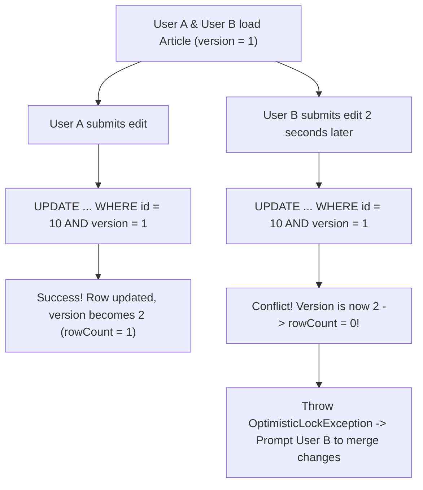

## Scenario

> **What is optimistic locking?**

Optimistic locking allows high concurrency without holding database locks. The interviewer tests your understanding of versioning, collision detection, and user resolution workflows.

## Fast Revision (10-Second Recall)

- **First Move:** Define optimistic locking as a **non-blocking concurrency pattern** where transactions assume no conflicts will occur, but verify before committing.
- **How It Works:**
- 1. Table includes a `version INT DEFAULT 1` or `updated_at TIMESTAMPTZ` column.
- 2. Read entity: `SELECT id, name, version FROM articles WHERE id = 10;` (Reads version = 1).
- 3. Write entity: `UPDATE articles SET name = 'New', version = version + 1 WHERE id = 10 AND version = 1;`.
- 4. If `affectedRows === 1`: Success.
- 5. If `affectedRows === 0`: Conflict detected! Another user committed version 2. Abort or prompt user.
- **Advantage:** Zero database row locks held during user think-time.

## The 30-Second Spoken Script

If asked this in an interview, deliver this structured response:

> *Optimistic Locking is a concurrency control strategy that allows multiple transactions to read and modify the same record concurrently without holding database locks. It operates on the assumption that data conflicts are rare.*
>
> *Instead of locking rows with SELECT FOR UPDATE while a user is editing a form, the table includes a version integer column (or an updated_at timestamp).*
>
> *When an application loads the record, it reads the current version—for example, version 1.
When the user submits their update, the application issues a conditional UPDATE statement:
UPDATE articles SET title = :title, version = version + 1 WHERE id = :id AND version = 1;*
>
> *If no other user touched the record, the database updates the row and increments version to 2, returning 1 affected row.
However, if a concurrent user submitted an update first, the version was already incremented to 2. The second query's WHERE version = 1 clause finds no matching rows, returning 0 affected rows.*
>
> *The application catches this 0-row result, detects an OptimisticLockException, and handles it cleanly—either by retrying automatically or prompting the user with a conflict resolution screen showing the differences between their changes and the newer committed version.*

## Diagnostic Lifecycle



## Root Causes & Solutions Matrix

| Suspected Layer | Symptoms & Evidence | Immediate Resolution |
| :--- | :--- | :--- |
| **Concurrent Document Edit** | User B blindly overwrites changes made by User A 5 seconds earlier. | Add `version INT` column and conditional update clause. |
| **Zero Rows Affected** | ORM throws `OptimisticLockException` during entity save. | Reload latest entity, compare diff, and prompt user or auto-retry. |
| **Long User Think Time** | User holds open modal for 10 minutes; pessimistic lock would exhaust pool. | Optimistic locking holds 0 locks while user reads/types. |
| **High Write Contention Failure** | 90% of requests fail with optimistic lock exceptions on flash sale. | Switch to Pessimistic Locking or atomic SQL decrements for hot rows. |

## Practical Debugging Commands & Code

### Optimistic Locking Implementation in SQL and TypeORM
```sql
-- 1. Add version column to table
ALTER TABLE documents ADD COLUMN version INT NOT NULL DEFAULT 1;

-- 2. Client loads document:
SELECT id, title, content, version FROM documents WHERE id = 42;
-- Returned: title = 'RFC Draft', version = 3

-- 3. Client submits update:
-- Increments version to 4, but ONLY if version is still 3!
UPDATE documents 
SET 
  title = 'RFC Draft Approved', 
  content = 'Updated body...', 
  version = version + 1 
WHERE id = 42 AND version = 3;

-- If another user updated it first, version is already 4.
-- Query returns: UPDATE 0 (Zero rows affected!)
-- Application layer detects conflict and notifies user!
```

## Prevention & Senior Best Practices

1. **Use Integer Versions Over Timestamps:** Timestamps can suffer from clock drift, sub-millisecond precision truncation, or equal timestamp collisions.
2. **Only Use Optimistic for Low Contention:** If conflict rate exceeds 15-20%, retries waste more CPU than pessimistic queueing.
3. **Provide Meaningful Conflict UI:** Never just say "Error saving"; show what changed and let users copy their uncommitted text.
