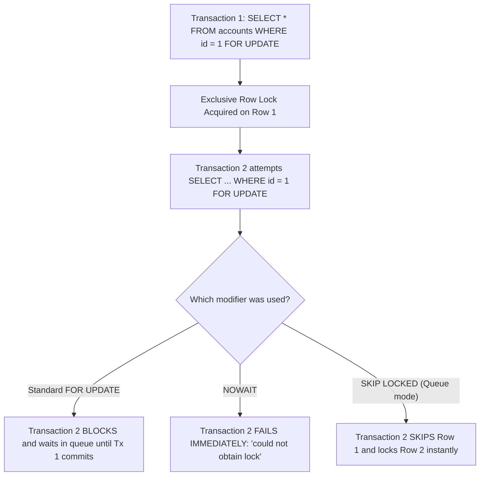

## Scenario

> **What is pessimistic locking?**

When conflicts are frequent and retries are unacceptable, pessimistic locking acquires exclusive locks immediately. The interviewer tests your knowledge of `FOR UPDATE`, `FOR SHARE`, `NOWAIT`, and `SKIP LOCKED`.

## Fast Revision (10-Second Recall)

- **First Move:** Define pessimistic locking as an **eager locking strategy** where a transaction locks database rows at read time, blocking competitors until commit.
- **The 3 Key Pessimistic Clauses:**
- 1. **`SELECT ... FOR UPDATE`:** Acquires exclusive row-level lock. Competitors block and wait.
- 2. **`SELECT ... FOR UPDATE NOWAIT`:** If row is locked, fails immediately with an error rather than waiting in a queue.
- 3. **`SELECT ... FOR UPDATE SKIP LOCKED`:** Bypasses locked rows and grabs the next available unlocked row (ideal for job queues!).
- **Danger:** Long transactions holding pessimistic locks cause connection pool exhaustion and deadlocks.

## The 30-Second Spoken Script

If asked this in an interview, deliver this structured response:

> *Pessimistic Locking is a concurrency control strategy that operates on the assumption that data conflicts are highly likely. It prevents conflicts by explicitly locking the target rows the moment they are read, preventing other transactions from modifying or locking them until the active transaction completes.*
>
> *In SQL, pessimistic locking is implemented using SELECT ... FOR UPDATE.*
>
> *When Transaction 1 executes:
SELECT balance FROM accounts WHERE id = 101 FOR UPDATE;
The database places an exclusive row-level lock on Account 101. If Transaction 2 attempts to read Account 101 with FOR UPDATE or attempts to UPDATE it, Transaction 2 is blocked and forced to wait in a queue until Transaction 1 commits or rolls back.*
>
> *To prevent transactions from waiting indefinitely and exhausting connection pools, modern engines support two crucial modifiers:
1. NOWAIT: If the row is currently locked by another transaction, the query fails immediately with an error instead of blocking, allowing the application to fail fast.
2. SKIP LOCKED: When building background worker queues, workers run SELECT ... FOR UPDATE SKIP LOCKED. Instead of blocking or failing, the worker skips any rows currently being processed by peer workers and locks the next available task. This enables parallel, lock-free queue processing directly in PostgreSQL.*

## Diagnostic Lifecycle



## Root Causes & Solutions Matrix

| Suspected Layer | Symptoms & Evidence | Immediate Resolution |
| :--- | :--- | :--- |
| **Standard `FOR UPDATE`** | Transactions queue up; average latency spikes under concurrency. | Use only for short, fast operations; sort IDs to prevent deadlocks. |
| **`FOR UPDATE NOWAIT`** | Thread needs to fail fast rather than waiting 5 seconds for a lock. | Catch lock error immediately and return "System busy, retry shortly". |
| **`FOR UPDATE SKIP LOCKED`** | Multiple background workers all contend on the same top queue job. | `SKIP LOCKED` allows 20 workers to process 20 distinct jobs in parallel. |
| **Read Lock (`FOR SHARE`)** | Need to prevent other transactions from updating row, but allow reads. | Use `SELECT ... FOR SHARE`. |

## Practical Debugging Commands & Code

### Pessimistic Locking Patterns: NOWAIT & SKIP LOCKED Job Queue
```sql
-- 1. Standard Pessimistic Lock (Blocks until lock is released)
BEGIN;
SELECT balance FROM accounts WHERE id = 42 FOR UPDATE;
-- Any other transaction trying to modify Account 42 pauses here!
UPDATE accounts SET balance = balance - 100 WHERE id = 42;
COMMIT; -- Lock is released!

-- 2. Fail-Fast Pattern with NOWAIT
BEGIN;
-- If another transaction holds lock on id = 42, throws ERROR 55P03 immediately!
SELECT balance FROM accounts WHERE id = 42 FOR UPDATE NOWAIT;
UPDATE accounts SET balance = balance - 100 WHERE id = 42;
COMMIT;

-- 3. High-Performance Job Worker Queue using SKIP LOCKED
-- 10 worker pods can run this concurrently without blocking each other!
BEGIN;
SELECT id, task_payload 
FROM background_jobs 
WHERE status = 'QUEUED' 
ORDER BY priority DESC, created_at ASC 
LIMIT 1 
FOR UPDATE SKIP LOCKED;

-- Mark locked job as processing:
UPDATE background_jobs SET status = 'PROCESSING' WHERE id = :locked_id;
COMMIT;
```

## Prevention & Senior Best Practices

1. **Always Set `lock_timeout`:** Set `SET lock_timeout = '2s';` before acquiring pessimistic locks to prevent indefinite hanging.
2. **Never Call External APIs While Holding Row Locks:** External API latency will stall your database connection pool.
3. **Sort IDs When Locking Multiple Rows:** Prevent deadlocks by always locking rows in ascending primary key order.
