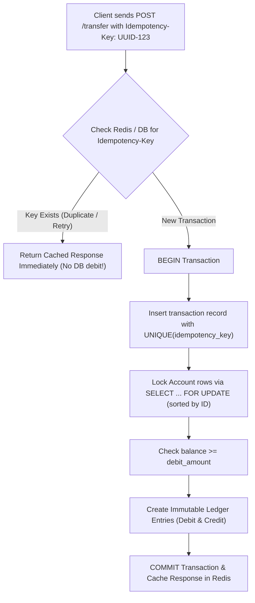

## Scenario

> **How would you prevent a bank account from being debited twice?**

In financial systems, losing money or charging twice destroys customer trust and violates regulatory laws. The interviewer evaluates your defense-in-depth architecture across API, database, and ledger accounting models.

## Fast Revision (10-Second Recall)

- **First Rule:** Never use naive `balance = balance - amount` without **Double-Entry Bookkeeping and Idempotency Keys**.
- **The 4 Layers of Financial Defense:**
- 1. **API Layer Idempotency:** Client sends `Idempotency-Key: UUID`; repeated requests return cached response without re-executing.
- 2. **Database Unique Constraints:** Insert into `transactions (idempotency_key, account_id, amount)` with a UNIQUE constraint.
- 3. **Double-Entry Bookkeeping:** Balances are NOT updated directly; every transfer creates equal and opposite Credit and Debit ledger entries ($SUM(debits) = SUM(credits)$).
- 4. **Pessimistic Row Lock:** `SELECT FOR UPDATE` on account rows ordered by ID to eliminate race conditions.

## The 30-Second Spoken Script

If asked this in an interview, deliver this structured response:

> *Preventing double debits in financial systems requires a defense-in-depth architecture combining API idempotency keys, database-level unique constraints, and double-entry ledger bookkeeping.*
>
> *First, at the API boundary, every financial mutation requires a client-generated Idempotency-Key (UUIDv4). If a mobile client loses connection and retries the request 3 times, the API gateway checks Redis for the idempotency key and returns the original response without re-executing the transaction.*
>
> *Second, at the database tier, we enforce a UNIQUE constraint on the idempotency_key column in our transactions table. If two concurrent threads attempt to debit the account simultaneously, the database unique index immediately rejects the second attempt with a unique constraint violation.*
>
> *Third, in mature financial engineering, we do not update raw balance columns directly. We implement Immutable Double-Entry Bookkeeping. Every movement of money consists of two ledger entries: a Debit to one account and a Credit to another. The account balance is the immutable sum of all ledger entries.*
>
> *Finally, when acquiring locks on accounts during transfers, we sort account IDs ascending and acquire row locks via SELECT FOR UPDATE, ensuring serialized execution without deadlocks.*

## Diagnostic Lifecycle



## Root Causes & Solutions Matrix

| Suspected Layer | Symptoms & Evidence | Immediate Resolution |
| :--- | :--- | :--- |
| **Network Retry Duplication** | Network drops after server deducts funds; client retries and deducts again. | Enforce `Idempotency-Key` header with Redis deduplication. |
| **Concurrent Double Click** | User double-taps "Send $500" 40ms apart; two threads debit concurrently. | Unique constraint on `idempotency_key` rejects duplicate insert. |
| **Direct Balance Mutation Glitch** | Manual balance update loses audit trail of who transferred what. | Use Double-Entry Bookkeeping: append immutable ledger rows. |
| **Negative Balance Overdraft** | Simultaneous debits drain account below $0.00. | Database constraint: `CHECK (balance >= 0)`. |

## Practical Debugging Commands & Code

### Idempotent Financial Transfer with Double-Entry Ledger Pattern
```sql
-- 1. Schema: Ledger with Idempotency Protection
CREATE TABLE ledger_transactions (
  id UUID PRIMARY KEY DEFAULT gen_random_uuid(),
  idempotency_key VARCHAR(64) UNIQUE NOT NULL, -- Prevents duplicate charges!
  source_account_id INT NOT NULL REFERENCES bank_accounts(id),
  destination_account_id INT NOT NULL REFERENCES bank_accounts(id),
  amount NUMERIC(12, 2) NOT NULL CHECK (amount > 0),
  created_at TIMESTAMPTZ DEFAULT NOW()
);

-- 2. Idempotent Transfer Execution
BEGIN;

-- Step 1: Insert transaction record. If idempotency_key already exists,
-- Postgres aborts immediately with Unique Violation (23505)!
INSERT INTO ledger_transactions (idempotency_key, source_account_id, destination_account_id, amount)
VALUES ('idem_req_948194821', 101, 202, 150.00);

-- Step 2: Lock accounts in strictly ascending order to prevent deadlocks
SELECT id, balance 
FROM bank_accounts 
WHERE id IN (101, 202) 
ORDER BY id ASC 
FOR UPDATE;

-- Step 3: Debit Source Account (CHECK constraint prevents balance < 0)
UPDATE bank_accounts 
SET balance = balance - 150.00 
WHERE id = 101 AND balance >= 150.00;

-- Step 4: Credit Destination Account
UPDATE bank_accounts 
SET balance = balance + 150.00 
WHERE id = 202;

COMMIT;
```

## Prevention & Senior Best Practices

1. **Mandate Idempotency Keys on All Payment APIs:** Reject any payment or transfer request that lacks an `Idempotency-Key` header.
2. **Use Database CHECK Constraints:** Never allow accounts to overdraft unless an explicit overdraft protection credit line is active.
3. **Audit Ledger Balances Daily:** Run automated reconciliation scripts verifying that total debits equal total credits across the system.
