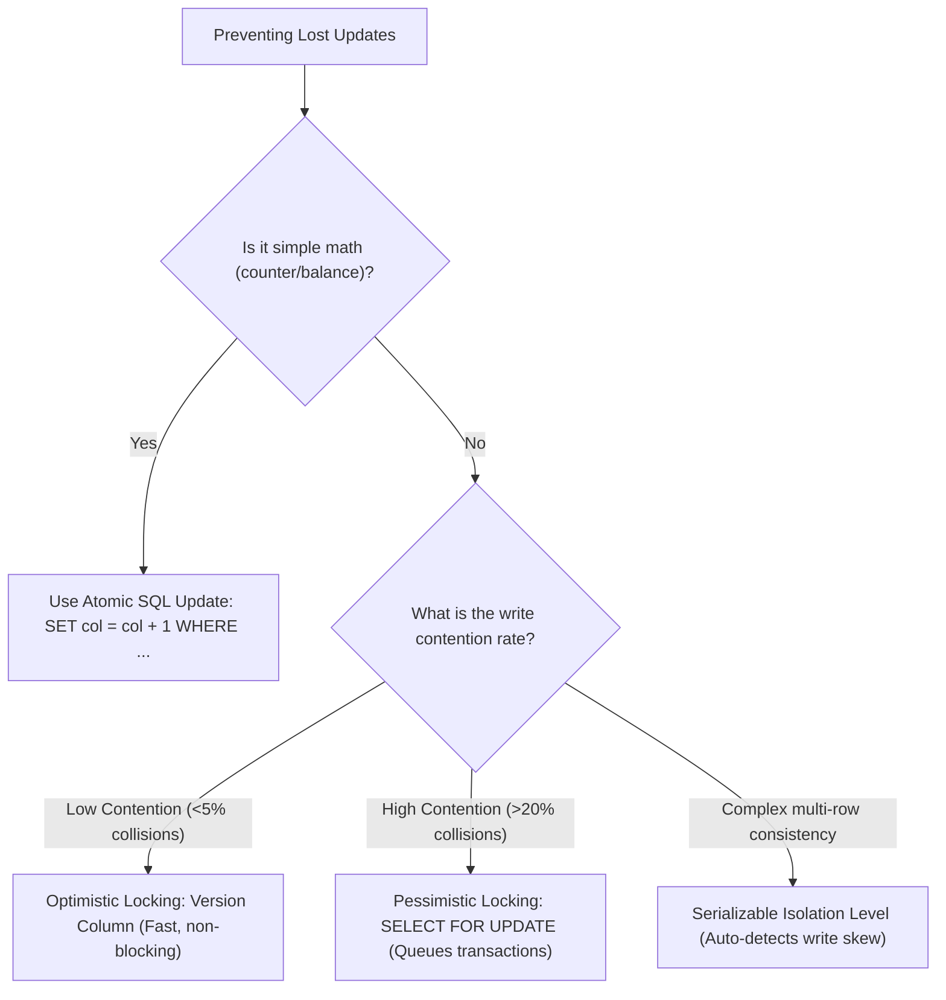

## Scenario

> **How would you prevent lost updates?**

When concurrent threads update the same row, blind overwrites destroy data consistency. The interviewer tests whether you can select the right concurrency control strategy based on write contention.

## Fast Revision (10-Second Recall)

- **First Move:** Choose concurrency control based on **Contention Probability** (Low contention $\rightarrow$ Optimistic; High contention $\rightarrow$ Pessimistic / Atomic).
- **The 4 Prevention Mechanisms:**
- 1. **Atomic In-Database Expressions:** `UPDATE counter SET count = count + 1` (safest and fastest, zero lock overhead).
- 2. **Optimistic Concurrency Control (OCC):** Add `version INT` column; `WHERE id = ? AND version = ?`. If rows affected is 0, abort and retry.
- 3. **Pessimistic Locking:** `SELECT ... FOR UPDATE` acquires row-level exclusive lock, queuing competitors.
- 4. **Database Isolation Level:** Elevate transaction isolation to `REPEATABLE READ` or `SERIALIZABLE` (throws serialization failure on conflict).

## The 30-Second Spoken Script

If asked this in an interview, deliver this structured response:

> *To prevent lost updates, I choose between atomic expressions, optimistic concurrency control, and pessimistic locking based on the frequency of write contention.*
>
> *First, for numeric adjustments like decrementing inventory or incrementing counters, I use atomic SQL expressions: UPDATE products SET stock = stock - 1 WHERE id = 42 AND stock >= 1. The database evaluates the current row value under an exclusive row lock at the instant of modification, completely eliminating lost updates without application-level locking.*
>
> *Second, for complex entity edits where a user modifies multiple fields in a web form (like editing a customer profile), I use Optimistic Concurrency Control with a version column. When saving, the query checks WHERE id = :id AND version = :version. If another user committed a change in the meantime, the version mismatch causes the query to affect 0 rows. The application catches this, rolls back, and prompts the user: 'Another user modified this record; please review changes.'*
>
> *Third, for high-contention, high-value financial transactions where retries are expensive or unacceptable, I use Pessimistic Locking with SELECT FOR UPDATE. This forces concurrent transactions to queue until the active transaction commits.*
>
> *Finally, in systems supporting strict isolation, running under Repeatable Read or Serializable guarantees that any transaction attempting to update a row modified by a concurrent transaction immediately fails with a serialization error.*

## Diagnostic Lifecycle



## Root Causes & Solutions Matrix

| Suspected Layer | Symptoms & Evidence | Immediate Resolution |
| :--- | :--- | :--- |
| **Atomic SQL Expression** | Two API threads increment counter simultaneously; counter only increments by 1. | `UPDATE stats SET views = views + 1 WHERE id = 1`. |
| **Optimistic Locking Failure** | Affected rows returns 0; concurrent user updated row first. | Catch zero row update in ORM; refresh entity and notify user. |
| **Pessimistic Lock Starvation** | Threads queue up waiting for row lock; connection pool exhausted. | Add `NOWAIT` or `SKIP LOCKED`: `SELECT ... FOR UPDATE NOWAIT`. |
| **Serialization Error (40001)** | Postgres throws `ERROR: could not serialize access due to concurrent update`. | Catch error 40001 in backend repository and retry transaction. |

## Practical Debugging Commands & Code

### Prisma / TypeORM Optimistic Concurrency Control Pattern
```typescript
// Optimistic Locking in TypeScript / TypeORM / Prisma
interface UpdateProductDTO {
  id: string;
  name: string;
  price: number;
  expectedVersion: number;
}

export async function updateProductOptimistically(dto: UpdateProductDTO, db: any) {
  // Execute atomic update conditioned on expected version
  const result = await db.query(
    `UPDATE products 
     SET name = $1, price = $2, version = version + 1 
     WHERE id = $3 AND version = $4`,
    [dto.name, dto.price, dto.id, dto.expectedVersion]
  );

  // If 0 rows were updated, a concurrent transaction modified the row first!
  if (result.rowCount === 0) {
    throw new OptimisticLockException(
      'Conflict: This product was updated by another user. Please refresh and try again.'
    );
  }

  return { success: true, newVersion: dto.expectedVersion + 1 };
}
```

## Prevention & Senior Best Practices

1. **Always Include `version` in DTOs:** Never accept updates from web clients without an accompanying `version` or `updated_at` timestamp token.
2. **Set Lock Timeouts:** Always configure `SET lock_timeout = '2s';` when using pessimistic locking to prevent deadlocks.
3. **Use `SKIP LOCKED` for Worker Queues:** When processing task queues, use `SELECT * FROM tasks FOR UPDATE SKIP LOCKED` so workers never block each other.
