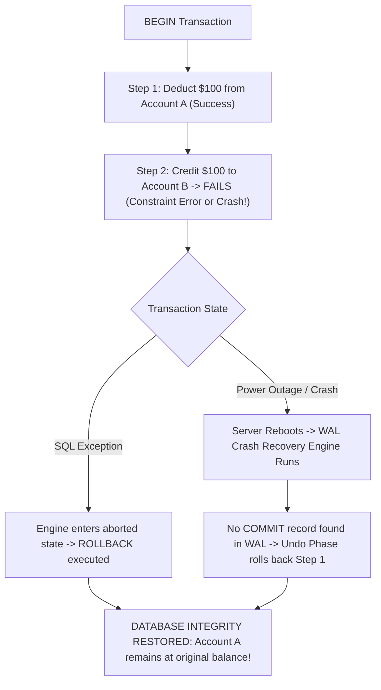

## Scenario

> **What happens if a transaction fails halfway?**

A transaction debits $100 from Account A, and then the server crashes or throws a constraint violation before crediting Account B. Does money disappear? The interviewer tests your understanding of database atomicity and WAL recovery.

## Fast Revision (10-Second Recall)

- **First Axiom:** Under **Atomicity (the A in ACID)**, a transaction is **All-or-Nothing**—if it fails halfway, **EVERY change made so far is completely rolled back**.
- **How the Database Enforces This:**
- 1. **Application Error (SQL Exception):** The database issues a `ROLLBACK`, restoring all modified rows to their pre-transaction state.
- 2. **Server Crash / Power Outage Mid-Transaction:** Upon reboot, the database crash recovery process replays the WAL up to the crash point, identifies uncommitted transactions, and rolls them back.
- **Underlying Technology:** Write-Ahead Log (WAL in Postgres) or Undo/Redo Logs (InnoDB in MySQL).

## The 30-Second Spoken Script

If asked this in an interview, deliver this structured response:

> *If a database transaction fails halfway through its execution, the database enforces the Atomicity guarantee of ACID: the transaction is strictly all-or-nothing, meaning all modifications made prior to the failure are completely rolled back as if they never happened.*
>
> *Here is the exact mechanical breakdown:*
>
> *Case 1: An SQL error occurs during execution—such as a foreign key violation or division by zero.
In PostgreSQL, the transaction enters an aborted error state. Any subsequent commands are rejected with 'current transaction is aborted, commands ignored until end of transaction block'. When the application issues a ROLLBACK (or disconnects), the engine discards uncommitted changes and unpins locks.*
>
> *Case 2: The database server crashes or loses power midway through.
The database relies on Write-Ahead Logging (WAL) and MVCC. When the database restarts, it enters Crash Recovery:
1. Redo Phase: It scans the WAL from the last checkpoint to reconstruct database state.
2. Undo Phase: It inspects transaction commit markers. Any transaction lacking an explicit 'COMMIT' record in the WAL is recognized as uncommitted. The engine rolls back every intermediate modification using undo pointers or MVCC visibility flags.*
>
> *Because dirty buffer pages written to disk are marked with the aborted transaction ID, future transactions treat those tuples as completely invisible. Data integrity is 100% preserved.*

## Diagnostic Lifecycle



## Root Causes & Solutions Matrix

| Suspected Layer | Symptoms & Evidence | Immediate Resolution |
| :--- | :--- | :--- |
| **Constraint Violation Mid-Tx** | Step 1 succeeds; Step 2 throws `CheckConstraintViolation`. | Transaction aborted; `ROLLBACK` undoes Step 1 cleanly. |
| **Application Disconnect** | Network drops between app server and DB while transaction is open. | Database detects broken TCP socket and auto-issues `ROLLBACK`. |
| **Hardware Crash / Power Cut** | Server loses power while flushing pages to disk. | WAL crash recovery engine rolls back uncommitted transactions on reboot. |
| **Partial Savepoint Rollback** | Only sub-operation fails inside a nested transaction. | Use `ROLLBACK TO SAVEPOINT` to retry only the failed sub-step. |

## Practical Debugging Commands & Code

### Savepoints for Partial Rollback & Transactional Safety
```sql
-- 1. Standard All-or-Nothing Rollback
BEGIN;
UPDATE accounts SET balance = balance - 100 WHERE id = 1; -- Deducts $100

-- Deliberate failure: Table does not exist!
INSERT INTO non_existent_table VALUES (1); 

-- Entire transaction is aborted!
-- Running COMMIT will fail with: "ROLLBACK executed instead"
COMMIT; -- Changes to id = 1 are completely discarded!

-- 2. Advanced: Nested Savepoints (Recover from partial failure)
BEGIN;
UPDATE accounts SET balance = balance - 100 WHERE id = 1;

SAVEPOINT payment_attempt;

-- Attempt optional bonus credit
UPDATE bonus_rewards SET points = points + 50 WHERE user_id = 1;

-- If bonus update fails, rollback strictly to the savepoint!
-- ROLLBACK TO SAVEPOINT payment_attempt;

-- The deduction on Account 1 remains intact!
COMMIT;
```

## Prevention & Senior Best Practices

1. **Always Wrap Multi-Table Writes in Transactions:** Never issue multiple standalone `UPDATE` statements without `BEGIN ... COMMIT`.
2. **Use Savepoints for Optional Sub-Steps:** Isolate optional non-critical writes with `SAVEPOINT` so their failure doesn't abort the primary transaction.
3. **Ensure Reliable Storage for WAL:** Place Write-Ahead Logs on enterprise SSD storage with battery-backed write cache.
