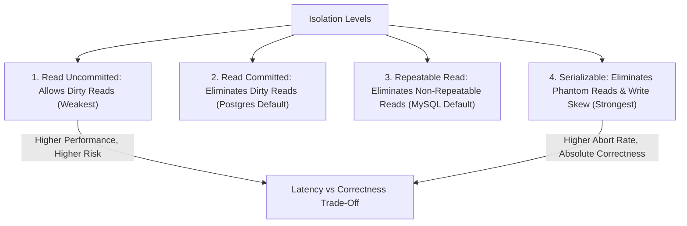

## Scenario

> **What is transaction isolation?**

Isolation controls the degree to which concurrent transactions see each other's intermediate modifications. The interviewer tests your knowledge of ANSI SQL isolation levels and MVCC snapshot mechanics.

## Fast Revision (10-Second Recall)

- **The 4 Standard Isolation Levels (Weakest to Strongest):**
- 1. **Read Uncommitted:** Allows Dirty Reads (rarely used; Postgres does not even implement it!).
- 2. **Read Committed (Default in Postgres & MySQL):** Each query sees only data committed before that query began. Eliminates Dirty Reads.
- 3. **Repeatable Read:** Transaction sees a frozen snapshot as of the transaction start. Eliminates Non-Repeatable Reads.
- 4. **Serializable:** Strict mathematical equivalence to serial execution. Eliminates Phantom Reads and Write Skew.
- **The Trade-off:** Stronger isolation eliminates anomalies but increases lock contention and transaction abort rates.

## The 30-Second Spoken Script

If asked this in an interview, deliver this structured response:

> *Transaction isolation defines the boundary that separates concurrently executing transactions, dictating whether intermediate uncommitted writes from one transaction are visible to another.*
>
> *The SQL standard defines four isolation levels to manage three classic concurrency anomalies: Dirty Reads, Non-Repeatable Reads, and Phantom Reads.*
>
> *First is Read Uncommitted. A transaction can read uncommitted dirty modifications made by other transactions. If that other transaction rolls back, the first transaction is operating on phantom data. PostgreSQL doesn't even allow this; it automatically maps Read Uncommitted to Read Committed.*
>
> *Second is Read Committed, which is the default in PostgreSQL and Oracle. Each statement within a transaction sees a snapshot of rows committed before that individual statement began. It eliminates dirty reads, but allows non-repeatable reads if another transaction commits changes between two SELECT queries.*
>
> *Third is Repeatable Read, the default in MySQL InnoDB. The transaction takes a snapshot at the moment the transaction starts. Reading the same row five times guarantees identical results.*
>
> *Fourth is Serializable. This is the strictest isolation level, mathematically guaranteeing that the concurrent execution produces the exact same result as if transactions ran sequentially one after the other. It detects write skew and phantom insertions, aborting conflicting transactions with serialization errors.*

## Diagnostic Lifecycle



## Root Causes & Solutions Matrix

| Suspected Layer | Symptoms & Evidence | Immediate Resolution |
| :--- | :--- | :--- |
| **Read Uncommitted** | Reading uncommitted data that gets rolled back 10ms later (Dirty Read). | Use `READ COMMITTED` or higher. |
| **Read Committed** | Same query inside same transaction returns different values 2 seconds apart. | Elevate to `REPEATABLE READ` if snapshot consistency is required. |
| **Repeatable Read** | Write Skew anomaly (two doctors take call concurrently; both approve). | Elevate to `SERIALIZABLE` or use `SELECT FOR UPDATE`. |
| **Serializable Abort Rate** | High transaction retry rate under heavy write contention. | Use `REPEATABLE READ` with explicit pessimistic locks on hot rows. |

## Practical Debugging Commands & Code

### Configuring Isolation Levels in PostgreSQL
```sql
-- 1. Check current transaction isolation level
SHOW transaction_isolation;

-- 2. Set isolation level for a specific transaction
BEGIN TRANSACTION ISOLATION LEVEL REPEATABLE READ;

SELECT * FROM inventory WHERE product_id = 100;
-- Any concurrent updates committed by other users after this BEGIN
-- are 100% INVISIBLE to this transaction!

COMMIT;

-- 3. Set isolation level to SERIALIZABLE (Guarantees zero write skew)
BEGIN TRANSACTION ISOLATION LEVEL SERIALIZABLE;

-- Perform complex cross-table balance checks:
SELECT SUM(balance) FROM user_wallets WHERE user_id = 42;
-- If another transaction modifies this user's wallets concurrently,
-- PostgreSQL throws ERROR 40001 (serialization_failure) on commit!
COMMIT;
```

## Prevention & Senior Best Practices

1. **Default to Read Committed:** Use `Read Committed` for 95% of OLTP endpoints to maximize throughput without lock overhead.
2. **Use Repeatable Read for Reports:** Ensure multi-query financial reporting scripts take a frozen snapshot via `REPEATABLE READ`.
3. **Always Handle Serialization Retries:** If using `SERIALIZABLE`, the application layer must catch error `40001` and retry.
