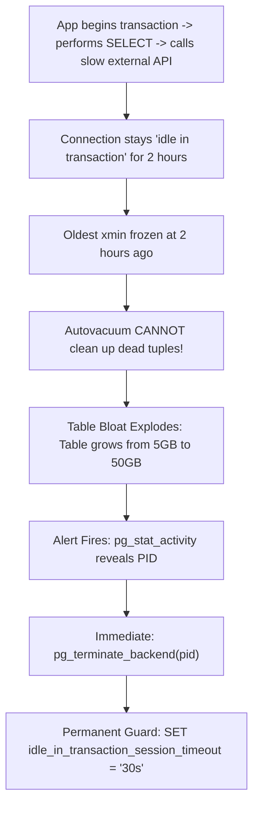

## Scenario

> **How would you troubleshoot long-running transactions?**

A single forgotten `BEGIN` transaction left open by an idle connection holds back table vacuuming, causes dead tuple bloat, and blocks schema migrations. The interviewer tests your ability to detect and prevent runaway transactions.

## Fast Revision (10-Second Recall)

- **First Move:** Query **`pg_stat_activity`** where `state = 'idle in transaction'` or `(now() - xact_start) > interval '5 minutes'`.
- **The Severe Consequences of Long Transactions:**
- 1. **Blocks Autovacuum:** PostgreSQL cannot clean up dead tuples newer than the oldest active transaction's `xmin` $\rightarrow$ Massive table bloat across the entire database!
- 2. **Transaction ID Wraparound:** Threatens total database shutdown if active transaction is days old.
- 3. **Cascading Lock Queues:** A long-running transaction holding a shared lock blocks a DDL migration, which blocks all reads behind it.
- **The Ultimate Weapon:** Configure `idle_in_transaction_session_timeout = '30s'`.

## The 30-Second Spoken Script

If asked this in an interview, deliver this structured response:

> *Long-running transactions are severe operational threats in PostgreSQL because of MVCC mechanics: autovacuum cannot clean up any dead tuples that were created after the oldest active transaction started. A single forgotten transaction left open for 6 hours prevents vacuuming across the entire database, causing massive table bloat and performance degradation.*
>
> *My troubleshooting protocol:
First, I query pg_stat_activity looking for transactions where now() minus xact_start exceeds 5 minutes, checking their state. 
90% of the time, the state is 'idle in transaction'. This happens when application code begins a transaction, performs a database query, and then executes a slow external HTTP request or enters an infinite loop before calling commit.*
>
> *Second, if an idle transaction is blocking schema migrations or autovacuum, I terminate it immediately using pg_terminate_backend(pid).*
>
> *Third, to prevent recurrence, I enforce database-level guardrails:
1. I set idle_in_transaction_session_timeout = '30s'. If an application connection opens a transaction and goes idle for more than 30 seconds without committing, PostgreSQL forcefully terminates the connection.
2. I set statement_timeout = '30s' so runaway analytical queries are automatically aborted.
3. In application code, I ensure database connections are wrapped in try-finally blocks or managed by connection pools that close orphaned transactions.*

## Diagnostic Lifecycle



## Root Causes & Solutions Matrix

| Suspected Layer | Symptoms & Evidence | Immediate Resolution |
| :--- | :--- | :--- |
| **`idle in transaction` Trap** | Connection idle for 3 hours holding oldest `xmin`; table bloat spikes. | Configure `idle_in_transaction_session_timeout = '30s'`. |
| **Runaway Analytical Query** | Report query running for 45 minutes; locking table resources. | Terminate with `pg_cancel_backend(pid)` and enforce `statement_timeout`. |
| **Blocked DDL Migration** | `ALTER TABLE` waiting for lock; 200 user queries queue up behind it. | Set `lock_timeout = '5s'` on migrations so DDL fails fast. |
| **Connection Pool Leak** | Node.js/Java app leaks uncommitted transactions on error catch. | Ensure connection pool client is released in `finally` block. |

## Practical Debugging Commands & Code

### Detecting and Auto-Terminating Long-Running Transactions
```sql
-- 1. Identify Transactions Running or Idle for > 5 Minutes
SELECT 
  pid,
  usename,
  client_addr,
  state,
  now() - xact_start AS transaction_age,
  now() - state_change AS state_age,
  query
FROM pg_stat_activity
WHERE state != 'idle'
  AND (now() - xact_start) > interval '5 minutes'
ORDER BY transaction_age DESC;

-- 2. Forcefully terminate the rogue transaction
SELECT pg_terminate_backend(18492);

-- 3. Permanent Database Guardrails (postgresql.conf or ALTER DATABASE)
-- Kill any connection that stays idle with an uncommitted transaction > 30s
ALTER DATABASE production_db SET idle_in_transaction_session_timeout = '30000'; -- 30s

-- Kill any single SQL statement running longer than 15s
ALTER DATABASE production_db SET statement_timeout = '15000'; -- 15s

-- Abort any DDL lock wait after 5s so migrations don't queue user traffic
ALTER DATABASE production_db SET lock_timeout = '5000'; -- 5s
```

## Prevention & Senior Best Practices

1. **Enforce `idle_in_transaction_session_timeout` Everywhere:** This single configuration setting eliminates 90% of table bloat and connection leak incidents.
2. **Never Call External APIs Inside Transactions:** Always perform external HTTP requests before `BEGIN` or after `COMMIT`.
3. **Set `lock_timeout` on All Schema Migrations:** Prevent `ALTER TABLE` migrations from creating catastrophic queue pile-ups.
