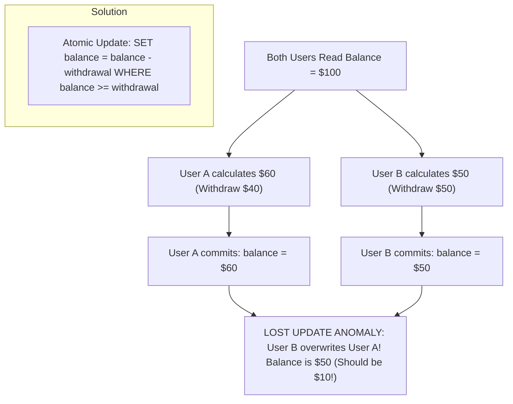

## Scenario

> **Two users update the same record simultaneously. What happens?**

A classic concurrency scenario: User A and User B both load Account #101 with balance $100. User A withdraws $40, User B withdraws $50. What happens in the database? The interviewer evaluates your knowledge of locking and isolation.

## Fast Revision (10-Second Recall)

- **First Move:** In standard databases without concurrency control, the default outcome is **Lost Update / Last-Write-Wins**.
- **What Happens Behind the Scenes:**
- 1. **Both read balance = $100** simultaneously in parallel transactions.
- 2. User A calculates $100 - $40 = $60 and issues `UPDATE accounts SET balance = 60`.
- 3. User B calculates $100 - $50 = $50 and issues `UPDATE accounts SET balance = 50`.
- 4. **Result:** User B's update silently overwrites User A's update. The final balance is $50 instead of $10! $40 has vanished into thin air.
- **The Solutions:** Atomic arithmetic (`SET balance = balance - 40`), Optimistic Locking (`version` column), or Pessimistic Locking (`SELECT FOR UPDATE`).

## The 30-Second Spoken Script

If asked this in an interview, deliver this structured response:

> *When two users update the same database record simultaneously without explicit concurrency controls, the database suffers from a Lost Update anomaly under the default Read Committed isolation level.*
>
> *Here is the exact breakdown of what happens:
Both users read the record with a balance of $100 into their respective application threads.
User A calculates 100 minus 40 equals $60.
User B calculates 100 minus 50 equals $50.
User A issues an UPDATE setting balance to $60. The database acquires a row-level exclusive lock on that row, updates the balance, and commits.
User B then issues their UPDATE setting balance to $50. Because User B had already computed their new balance based on stale read data, User B's commit overwrites User A's changes completely. The account now reflects $50 instead of the correct $10, and $40 of debited funds are permanently lost.*
>
> *To prevent this, I use one of three techniques:
1. In-database atomic updates: UPDATE accounts SET balance = balance - 40 WHERE id = 101 AND balance >= 40.
2. Optimistic Locking: Checking a version column (WHERE id = 101 AND version = 1), causing the second update to fail and prompt a retry.
3. Pessimistic Locking: Using SELECT FOR UPDATE to serialize access to the row at the start of the transaction.*

## Diagnostic Lifecycle



## Root Causes & Solutions Matrix

| Suspected Layer | Symptoms & Evidence | Immediate Resolution |
| :--- | :--- | :--- |
| **Last-Write-Wins (Blind Overwrite)** | User A's edit vanishes without error after User B hits Save. | Implement Optimistic Locking using a `version` integer column. |
| **Read-Modify-Write Anti-pattern** | Application fetches entity, mutates in memory, and writes full entity back. | Execute atomic in-database updates: `SET col = col + 1`. |
| **Row Lock Contention** | Pessimistic `FOR UPDATE` serializes users, causing queue timeouts. | Switch to Optimistic Locking if update contention is low (under 5%). |
| **Dirty Reads** | Transaction reads uncommitted changes from another active transaction. | Enforce Read Committed (default in PG/MySQL) or Repeatable Read. |

## Practical Debugging Commands & Code

### The 3 Ways to Handle Simultaneous Record Updates
```sql
-- ❌ BROKEN: Read-Modify-Write Anti-Pattern (Allows Lost Update!)
-- App reads: balance = 100
-- App writes:
UPDATE accounts SET balance = 60 WHERE id = 101; 

-- ✅ SOLUTION 1: Atomic In-Database Math (Best for simple counters/balances)
-- Database engine applies row-level lock and computes math on freshest value!
UPDATE accounts 
SET balance = balance - 40 
WHERE id = 101 AND balance >= 40;

-- ✅ SOLUTION 2: Optimistic Locking with Version Column
-- If User B updates first, version becomes 2. User A's update affects 0 rows!
UPDATE accounts 
SET balance = 60, version = version + 1 
WHERE id = 101 AND version = 1;

-- In application code: if affectedRows === 0, rollback & prompt user!

-- ✅ SOLUTION 3: Pessimistic Locking (SELECT ... FOR UPDATE)
BEGIN;
SELECT balance FROM accounts WHERE id = 101 FOR UPDATE; -- Blocks User B!
-- Perform business checks in app...
UPDATE accounts SET balance = balance - 40 WHERE id = 101;
COMMIT; -- Releases lock for User B
```

## Prevention & Senior Best Practices

1. **Never Compute Updates from Stale In-Memory State:** Always push arithmetic and conditional checks into the SQL `UPDATE` statement.
2. **Use Version Columns on Critical Entities:** Add `version INT DEFAULT 1` to orders, profiles, and contracts.
3. **Keep Locked Transactions Minimal:** Never hold a `SELECT FOR UPDATE` while calling external payment gateways or third-party APIs.
