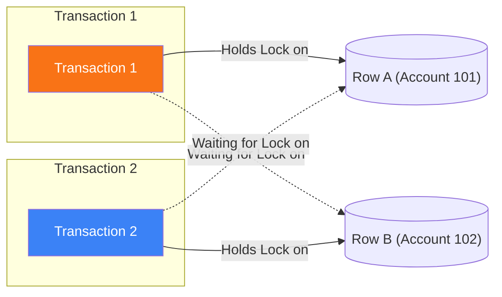

## Scenario

> **What is a database deadlock?**

Every backend engineer eventually encounters `ERROR: deadlock detected`. The interviewer tests your theoretical grasp of circular wait conditions and engine detection mechanics.

## Fast Revision (10-Second Recall)

- **First Move:** Define a deadlock as a **circular dependency condition** where Transaction A holds Lock 1 and waits for Lock 2, while Transaction B holds Lock 2 and waits for Lock 1.
- **The Deadlock Cycle:** Neither transaction can proceed $\rightarrow$ permanent freeze unless broken by an external supervisor.
- **The Engine's Resolution:** The database's **Deadlock Detector** thread detects the cycle in the lock wait-for graph, picks one transaction as the **victim**, and aborts it with an error (e.g. Postgres `40P01`).
- **The Primary Root Cause:** **Inconsistent lock acquisition ordering** across different application code paths.

## The 30-Second Spoken Script

If asked this in an interview, deliver this structured response:

> *A database deadlock is a concurrency anomaly where two or more transactions form a circular dependency, each holding a lock that the other transaction requires to proceed. Neither transaction can advance, creating an infinite stall.*
>
> *The classic scenario involves two transactions updating two rows in opposite order:
Transaction 1 acquires an exclusive row lock on Row A (Account 101) and attempts to update Row B (Account 102).
Simultaneously, Transaction 2 acquires an exclusive row lock on Row B (Account 102) and attempts to update Row A (Account 101).
Transaction 1 cannot update Row B until Transaction 2 releases its lock. Transaction 2 cannot update Row A until Transaction 1 releases its lock.*
>
> *Databases cannot wait indefinitely. PostgreSQL and MySQL run background deadlock detection threads (governed by deadlock_timeout, typically 1 second). The engine constructs a directed wait-for graph. The moment it detects a closed cycle, it terminates one of the transactions—known as the 'deadlock victim'—rolling back its changes and throwing a deadlock detected error (SQLState 40P01). The surviving transaction then proceeds to completion.*
>
> *The fundamental prevention for deadlocks is enforcing a strict global lock acquisition order across all application transactions.*

## Diagnostic Lifecycle



## Root Causes & Solutions Matrix

| Suspected Layer | Symptoms & Evidence | Immediate Resolution |
| :--- | :--- | :--- |
| **Inconsistent Lock Order** | Tx1 updates A then B; Tx2 updates B then A; cyclic deadlock occurs. | Sort resource IDs before locking: always lock `min(A, B)` then `max(A, B)`. |
| **Foreign Key Cascade Lock** | Inserting into child table locks parent row, conflicting with parent updates. | Index child foreign keys and ensure parent-child lock symmetry. |
| **Index Range Locks (MySQL)** | InnoDB Gap Locks on adjacent unindexed ranges conflict. | Ensure WHERE conditions use exact Unique/Primary Key matches. |
| **Deadlock Victim Crash** | Application throws unhandled 500 when database kills deadlock victim. | Wrap transactions in automated retry blocks with exponential backoff. |

## Practical Debugging Commands & Code

### Reproducing and Analyzing a Classic 2-Row Deadlock
```sql
-- Setup:
-- CREATE TABLE accounts (id INT PRIMARY KEY, balance INT);
-- INSERT INTO accounts VALUES (1, 100), (2, 200);

-- Session 1:
BEGIN;
UPDATE accounts SET balance = balance - 10 WHERE id = 1; -- Holds lock on Row 1

-- Session 2 (Concurrent):
BEGIN;
UPDATE accounts SET balance = balance - 20 WHERE id = 2; -- Holds lock on Row 2

-- Session 1:
UPDATE accounts SET balance = balance + 10 WHERE id = 2; -- Blocks waiting for Row 2!

-- Session 2:
UPDATE accounts SET balance = balance + 20 WHERE id = 1; -- Blocks waiting for Row 1!

-- Result after 1 second (deadlock_timeout):
-- ERROR:  deadlock detected
-- DETAIL: Process 14295 waits for ShareLock on transaction 821; blocked by process 14301.
--         Process 14301 waits for ShareLock on transaction 820; blocked by process 14295.
-- HINT:   See server log for query details.
```

## Prevention & Senior Best Practices

1. **Global Resource Ordering:** Always sort primary keys ascending before acquiring locks (`ids.sort()`) so every code path locks rows in the exact same sequence.
2. **Keep Transactions Short:** Never perform file processing, hashing, or external HTTP calls inside database transactions.
3. **Implement Application Retry on 40P01:** Catch SQLState `40P01` in your repository and immediately retry the transaction with a random jitter.
