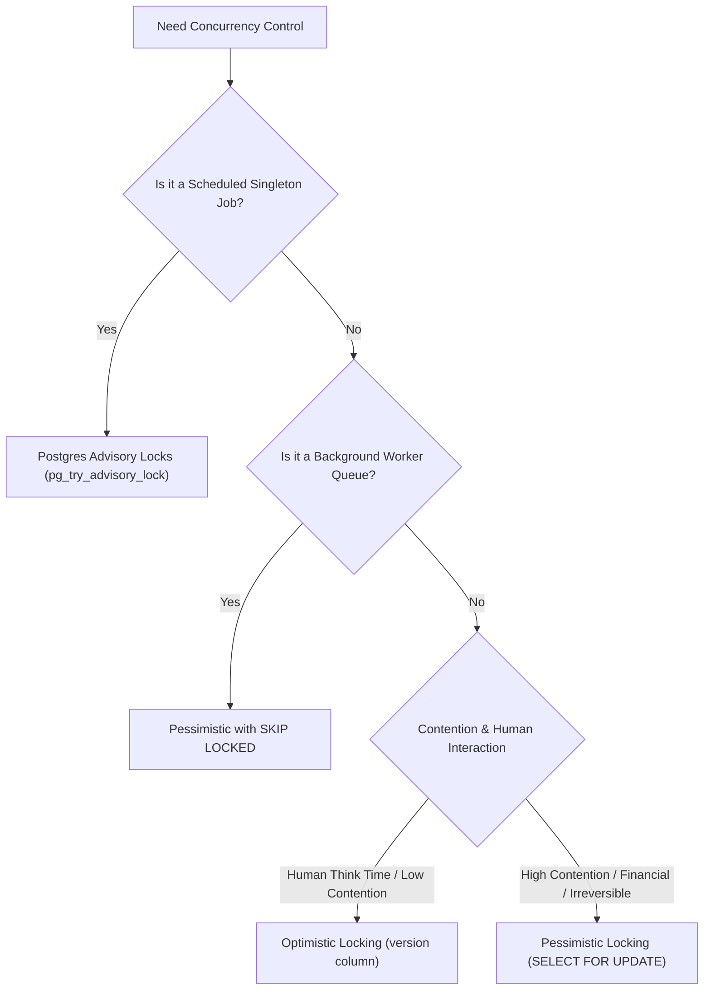

## Scenario

> **When would you use database locks?**

Locking too aggressively creates queuing bottlenecks; locking too leniently allows data corruption. Interviewers want a clear decision matrix for choosing locking mechanisms.

## Fast Revision (10-Second Recall)

- **The Locking Decision Matrix:**
- 1. **Use Optimistic Locking When:** Contention is low (under 5%), user think-time is long (web forms, admin panels), and retries are cheap.
- 2. **Use Pessimistic Locking (`FOR UPDATE`) When:** Contention is high, operations are non-reversible (financial transactions, seat reservations), and retries are expensive.
- 3. **Use `SKIP LOCKED` When:** Building background job queues or distributed task schedulers.
- 4. **Use PostgreSQL Advisory Locks When:** Coordinating application-level singleton tasks (e.g. ensuring only 1 worker runs midnight billing) without locking data tables.

## The 30-Second Spoken Script

If asked this in an interview, deliver this structured response:

> *I choose locking strategies based on contention probability, transaction duration, and business impact of collisions.*
>
> *First, I use Optimistic Locking for low-contention operations with human interaction. When a user opens a customer support ticket or edits a profile, they might hold the screen open for 10 minutes. Using a pessimistic lock would tie up a database connection and lock the row for 10 minutes. Optimistic locking with a version column holds zero locks while the user types, validating consistency only at the millisecond of saving.*
>
> *Second, I use Pessimistic Row Locking (SELECT FOR UPDATE) for high-contention, irreversible transactions where retries are unacceptable—such as banking debits or airline seat selection. When 5 requests attempt to reserve the final seat, acquiring an exclusive lock serializes access, guaranteeing that exactly one transaction succeeds without retry churn.*
>
> *Third, I use SKIP LOCKED specifically for queuing systems. When multiple background workers poll a tasks table, SKIP LOCKED enables them to claim distinct jobs concurrently with zero lock contention.*
>
> *Finally, I use PostgreSQL Advisory Locks for application-level synchronization. For example, to ensure only a single instance of a scheduled cron job executes a nightly billing run across a cluster of 10 microservice pods, an advisory lock coordinates the singleton execution purely in database memory without locking any application data tables.*

## Diagnostic Lifecycle



## Root Causes & Solutions Matrix

| Suspected Layer | Symptoms & Evidence | Immediate Resolution |
| :--- | :--- | :--- |
| **Web Form User Edit** | Pessimistic lock held while user eats lunch; connection pool exhausts. | Switch to Optimistic Locking with `version` column. |
| **Airline Seat Reservation** | Optimistic lock fails repeatedly under flash traffic, frustrating buyers. | Use Pessimistic Locking with a 10-minute reservation row. |
| **Distributed Cron Job** | 5 Kubernetes pods fire midnight report simultaneously, duplicating emails. | Use `pg_try_advisory_lock(cron_id)` to ensure single execution. |
| **Task Queue Processing** | Worker threads collide and deadlock trying to claim the top row. | Use `SELECT FOR UPDATE SKIP LOCKED`. |

## Practical Debugging Commands & Code

### PostgreSQL Advisory Locks for Distributed Singleton Cron Jobs
```sql
-- PostgreSQL Advisory Locks: Coordinate application singletons in DB RAM!
-- Does NOT lock any rows or tables. Fast, lightweight 64-bit integer lock.

-- 1. Try to acquire lock (Non-blocking: returns TRUE if acquired, FALSE if busy)
SELECT pg_try_advisory_lock(94821);

-- If TRUE: Pod runs the cron job!
-- If FALSE: Another pod is already running the job; exit gracefully!

-- 2. Execute singleton task...
-- Example: Nightly Invoice Generation

-- 3. Release lock when task completes
SELECT pg_advisory_unlock(94821);

-- 4. Session-bound vs Transaction-bound:
-- pg_try_advisory_xact_lock() automatically releases lock on COMMIT / ROLLBACK!
```

## Prevention & Senior Best Practices

1. **Never Hold Locks Across Network I/O:** Complete external HTTP/Stripe calls before acquiring database locks, or use two-phase status updates.
2. **Use Advisory Locks Over Redis Redlock for Simple Distributed Mutexes:** If you already run PostgreSQL, advisory locks eliminate the need for an external Redis cluster.
3. **Monitor Lock Wait Times:** Alert when `pg_stat_database.conflicts` spikes.
