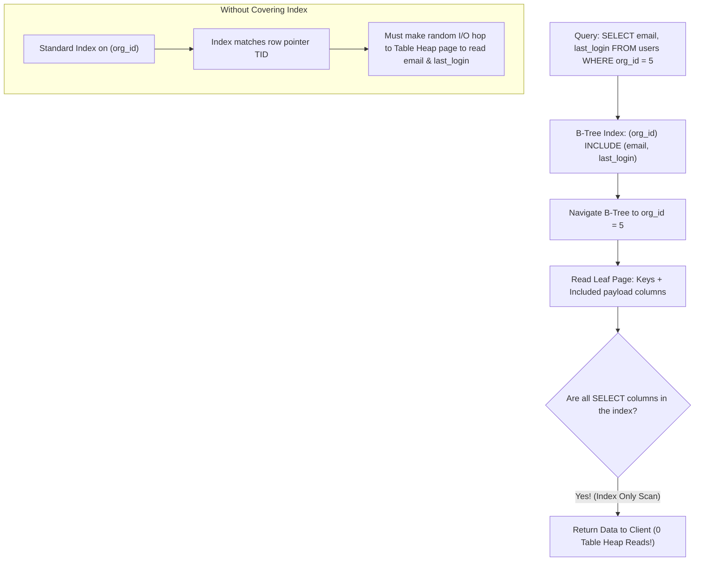

## Scenario

> **What is a covering index?**

A covering index satisfies a query entirely within the index leaf pages, avoiding 100% of table heap disk reads. The interviewer tests whether you know how to design covering indexes with the `INCLUDE` clause.

## Fast Revision (10-Second Recall)

- **First Move:** Define a covering index as an index that **contains all columns required by the query** (both filter conditions and projected SELECT columns).
- **Execution Mode:** Enables **Index Only Scan**—the database never visits table heap storage.
- **The Modern `INCLUDE` Clause:** Keys used for search/filter are stored in the B-Tree branch nodes; payload columns specified in `INCLUDE` are stored ONLY in the leaf pages.
- **PostgreSQL Prerequisite:** Index Only Scans require the **Visibility Map** to confirm pages contain no uncommitted dead tuples; maintained by `VACUUM`.

## The 30-Second Spoken Script

If asked this in an interview, deliver this structured response:

> *A covering index is an index designed to satisfy a specific query completely without requiring the database engine to visit the table heap.*
>
> *In a normal index scan, the engine navigates the B-tree to find matching row pointers, and then performs secondary random disk I/O to read the table heap blocks to fetch any unindexed columns listed in the SELECT clause.*
>
> *A covering index includes both the filtered search keys and the projected payload columns. When the engine executes the query, it reads the data directly from the index leaf pages and returns the response immediately—executing an Index Only Scan.*
>
> *In modern PostgreSQL, we create covering indexes using the INCLUDE clause:
CREATE INDEX idx_orders_covering ON orders (user_id, status) INCLUDE (total_amount, created_at);*
>
> *The search columns (user_id, status) are placed in the B-tree navigation keys to maintain tree balance, while the payload columns (total_amount, created_at) are stored strictly at the leaf level. This keeps the B-tree index compact while eliminating 100% of heap fetch I/O.*

## Diagnostic Lifecycle



## Root Causes & Solutions Matrix

| Suspected Layer | Symptoms & Evidence | Immediate Resolution |
| :--- | :--- | :--- |
| **Normal Index Scan** | Plan shows `Index Scan ... Heap Fetches: 25000` causing high disk read time. | Add projected columns to index via `INCLUDE (...)` clause. |
| **Index Only Scan** | Plan shows `Index Only Scan ... Heap Fetches: 0`. | Optimal; query served 100% from index cache memory. |
| **Visibility Map Delay** | `Index Only Scan` shows unexpectedly high `Heap Fetches` after bulk updates. | Run `VACUUM table_name` to update the table visibility map. |
| **Index Key Bloat** | Adding columns directly to composite index increases B-tree depth from 3 to 5. | Move non-filter columns from index key into `INCLUDE` clause. |

## Practical Debugging Commands & Code

### Implementing Covering Indexes with PostgreSQL INCLUDE Clause
```sql
-- 1. Problem Query: Fetches order summary for customer dashboard
-- SELECT order_id, order_date, total_amount, shipping_status 
-- FROM orders 
-- WHERE customer_id = 4921 AND status = 'COMPLETED';

-- ❌ INEFFICIENT: Adding all columns to B-Tree keys bloats branch nodes
-- CREATE INDEX idx_orders_bloated ON orders (customer_id, status, total_amount, shipping_status);

-- ✅ MODERN COVERING INDEX: Search keys in B-Tree, payload in leaf INCLUDE!
CREATE INDEX CONCURRENTLY idx_orders_customer_covering 
ON orders (customer_id, status) 
INCLUDE (order_date, total_amount, shipping_status);

-- 2. Verify Execution Plan shows "Index Only Scan" with 0 Heap Fetches
EXPLAIN (ANALYZE, BUFFERS)
SELECT order_date, total_amount, shipping_status 
FROM orders 
WHERE customer_id = 4921 AND status = 'COMPLETED';

-- Output:
-- Index Only Scan using idx_orders_customer_covering on orders
--   Index Cond: ((customer_id = 4921) AND (status = 'COMPLETED'))
--   Heap Fetches: 0   <-- 0 random disk reads! Pure index speed!
```

## Prevention & Senior Best Practices

1. **Do Not Over-Include Columns:** Adding 15 columns to `INCLUDE` inflates index size; include only high-frequency read columns.
2. **Run Regular Autovacuum:** PostgreSQL Index Only Scans check the Visibility Map; if pages are dirty from recent updates, it still checks heap.
3. **Reserve for Hot Endpoints:** Use covering indexes on top-10 most frequent API endpoints to maximize ROI.
