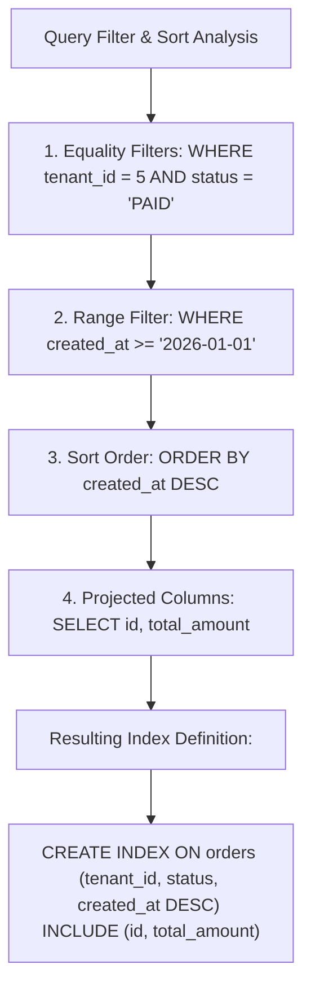

## Scenario

> **How would you decide the column order in a composite index?**

Putting columns in the wrong order in a composite index renders the index 90% useless. Interviewers test whether you understand how B-Trees navigate equality versus range boundaries.

## Fast Revision (10-Second Recall)

- **The Golden Rule of Composite Index Ordering:**
- 1. **Step 1: Equality Columns First (`=`):** Columns checked for exact match (`WHERE tenant_id = 5 AND status = 'ACTIVE'`).
- 2. **Step 2: Range Columns Second (`<`, `>`, `BETWEEN`, `LIKE`):** Columns checked for inequality (`WHERE created_at >= '2026-01-01'`). Once a range column is evaluated, the B-Tree CANNOT use subsequent columns for tree navigation!
- 3. **Step 3: ORDER BY Columns Third:** Columns used for sorting.
- 4. **Step 4: Projected Columns in `INCLUDE` Clause:** Columns only needed for SELECT, avoiding table heap reads.

## The 30-Second Spoken Script

If asked this in an interview, deliver this structured response:

> *Deciding column order in a composite index follows an ironclad rule: Equality columns first, Range filter columns second, and Sort columns aligned with the range.*
>
> *The technical reason for this order lies in how B-trees navigate keys:
When you search for an exact match on column 1, the B-tree narrows down to a specific subtree. Within that subtree, column 2 is perfectly sorted, allowing the engine to binary search column 2.*
>
> *However, the moment a range filter is encountered—such as WHERE created_at > '2026-01-01'—the B-tree must scan across a range of leaf pages. Once scanning across a range, the ordering of any subsequent third column inside those disparate pages is scattered. The engine can no longer perform direct tree lookups on column 3.*
>
> *Therefore, the formula is:
1. Equality filters first (e.g. user_id = 10).
2. Range filters second (e.g. created_at >= '2026-01-01').
3. Any additional non-filter columns required for an Index Only Scan should not be added to the index key; instead, put them in the INCLUDE clause so they don't bloat the B-tree leaf key size.*

## Diagnostic Lifecycle



## Root Causes & Solutions Matrix

| Suspected Layer | Symptoms & Evidence | Immediate Resolution |
| :--- | :--- | :--- |
| **Range Column Placed First** | Index on `(created_at, user_id)`; query has `WHERE created_at > ... AND user_id = 5`. | Swap column order: `(user_id, created_at)` so equality precedes range. |
| **Cardinality Myth** | Developer puts high-cardinality range column before low-cardinality equality column. | Equality ALWAYS comes before range, regardless of column cardinality! |
| **Sorting Misalignment** | Query filters `WHERE user_id = 5 ORDER BY score DESC`; planner does in-memory sort. | Add sort column to index: `(user_id, score DESC)`. |
| **Key Size Bloat** | Composite index has 6 wide varchar columns, blowing index page size. | Move read-only projection columns to `INCLUDE (...)` clause. |

## Practical Debugging Commands & Code

### Demonstrating the Impact of Range Column Placement
```sql
-- Target Query:
-- SELECT * FROM logs 
-- WHERE app_id = 101 AND severity = 'ERROR' AND logged_at >= '2026-01-01';

-- ❌ BAD INDEX ORDER: Range filter placed before equality filter!
-- The B-tree navigates to logged_at >= '2026-01-01', but then must scan 
-- every single log entry across all apps and filter severity manually!
CREATE INDEX idx_logs_bad ON logs (logged_at, app_id, severity);

-- ✅ PERFECT INDEX ORDER: Equality first, Range second!
-- B-tree navigates directly to app_id = 101 -> severity = 'ERROR' -> logged_at range.
-- Zero wasted scans!
CREATE INDEX idx_logs_perfect ON logs (app_id, severity, logged_at);

-- With covering columns for instant Index Only Scan:
CREATE INDEX idx_logs_covering 
ON logs (app_id, severity, logged_at) 
INCLUDE (message, user_id);
```

## Prevention & Senior Best Practices

1. **Equality Always Beats Cardinality:** Never place a range column before an equality column, even if the range column has millions of distinct values.
2. **Match ORDER BY Direction Exactly:** If sorting by `(date DESC, id ASC)`, index must match `(date DESC, id ASC)`.
3. **Use INCLUDE for Non-Search Columns:** Keep B-tree navigation keys compact; append payload columns via `INCLUDE`.
