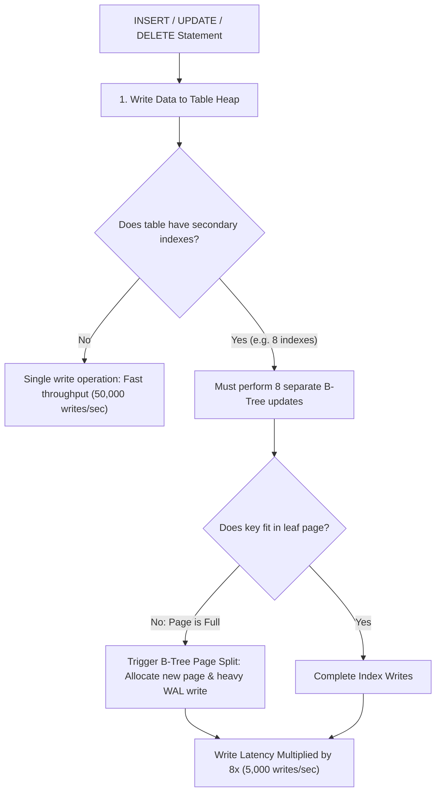

## Scenario

> **How do indexes affect INSERT, UPDATE, and DELETE operations?**

Every index is a read accelerator and a write decelerator. The interviewer wants to test whether you understand the mechanical cost of indexes during data modifications.

## Fast Revision (10-Second Recall)

- **The Fundamental Trade-Off:** **Indexes speed up SELECT queries, but penalize every INSERT, UPDATE, and DELETE**.
- **Impact Breakdown:**
- 1. **`INSERT` Overhead:** Must append row to table heap AND traverse/insert keys into every single index on the table ($N$ index writes).
- 2. **`UPDATE` Overhead:** If an indexed column changes, the old index key must be deleted and the new key inserted. Destroys Heap-Only Tuple (HOT) optimization.
- 3. **`DELETE` Overhead:** Must delete pointers from all indexes and mark heap tuple as dead.
- **Bulk Operation Strategy:** For loading millions of rows, drop indexes first $\rightarrow$ load data $\rightarrow$ recreate indexes concurrently.

## The 30-Second Spoken Script

If asked this in an interview, deliver this structured response:

> *Indexes create a direct trade-off between read speed and write throughput: every index added accelerates queries but imposes an overhead penalty on INSERT, UPDATE, and DELETE operations.*
>
> *First, for INSERT operations:
When inserting a row into a table with 5 indexes, the database must write the row to table heap storage and perform 5 separate B-tree traversals to insert keys into each index. If an index page is full, it triggers a page split, allocating a new page, moving half the keys, and generating extra Write-Ahead Log (WAL) traffic.*
>
> *Second, for UPDATE operations:
If the UPDATE modifies columns that are NOT indexed, PostgreSQL can use Heap-Only Tuple (HOT) optimization, placing the new row version on the same data page without touching any indexes. However, if even a single indexed column is modified, the database must update that B-tree index, increasing I/O and creating dead tuples.*
>
> *Third, for DELETE operations:
Deleting a row requires marking the tuple as dead in the table heap and updating all corresponding index leaf pages.*
>
> *To minimize write penalties during bulk data loading (such as importing 10 million rows), the standard engineering best practice is to drop all secondary indexes, perform the bulk insert via COPY, and recreate the indexes concurrently afterward.*

## Diagnostic Lifecycle



## Root Causes & Solutions Matrix

| Suspected Layer | Symptoms & Evidence | Immediate Resolution |
| :--- | :--- | :--- |
| **Bulk Data Ingestion** | Importing 5M rows takes 3 hours with 6 active indexes. | Drop indexes $\rightarrow$ run `COPY` $\rightarrow$ recreate indexes concurrently (takes 15 mins total). |
| **High-Frequency UPDATEs** | Updating `view_count` on articles table causes heavy index thrashing. | Do not index high-frequency counters, or batch updates in Redis. |
| **B-Tree Page Split Contention** | Random UUID insertions cause high I/O waits and buffer page locking. | Use time-ordered UUIDv7 to keep inserts appending to rightmost leaf. |
| **Cascade Deletes Sluggish** | Deleting parent record hangs due to unindexed child foreign keys. | Foreign key must be indexed so parent delete can find children fast. |

## Practical Debugging Commands & Code

### Optimized Bulk Ingestion Protocol: Drop, Load, and Rebuild
```sql
-- ❌ SLOW: Inserting 5 million rows into table with 6 active indexes
-- Every single row updates 6 B-Trees sequentially -> Takes hours!

-- ✅ SENIOR PATTERN: Bulk Data Load Protocol
-- Step 1: Drop non-constraint secondary indexes
DROP INDEX IF EXISTS idx_orders_customer_id;
DROP INDEX IF EXISTS idx_orders_created_at;
DROP INDEX IF EXISTS idx_orders_status;

-- Step 2: Use high-speed streaming COPY (bypasses individual SQL parsing)
COPY orders (customer_id, status, total_amount, created_at)
FROM '/data/orders_2026.csv' 
WITH (FORMAT csv, HEADER true);

-- Step 3: Recreate indexes CONCURRENTLY in parallel
-- Building an index once on a full sorted table is 10x faster than 5M incremental inserts!
SET maintenance_work_mem = '2GB';
CREATE INDEX CONCURRENTLY idx_orders_customer_id ON orders (customer_id);
CREATE INDEX CONCURRENTLY idx_orders_created_at ON orders (created_at DESC);
CREATE INDEX CONCURRENTLY idx_orders_status ON orders (status);

-- Step 4: Refresh planner statistics
ANALYZE orders;
```

## Prevention & Senior Best Practices

1. **Drop Indexes Before Giant Imports:** For migrations > 5M rows, dropping and rebuilding indexes is always faster than inserting with active indexes.
2. **Decouple High-Churn Counters:** Never place B-tree indexes on columns updated dozens of times per second (e.g. `view_count`, `last_ping`).
3. **Audit Index Count on Write-Heavy Tables:** Keep index counts under 3 on high-volume event ingestion tables.
