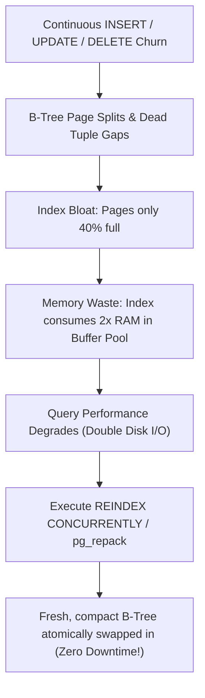

## Scenario

> **What is index fragmentation?**

Over months of inserts, updates, and deletes, B-Trees become bloated and fragmented, doubling query latency. The interviewer evaluates your knowledge of index maintenance and reorganization.

## Fast Revision (10-Second Recall)

- **First Move:** Define index fragmentation as **wasted space (bloat) and out-of-order physical pages** within B-Tree structures caused by continuous data churn.
- **Two Types of Fragmentation:**
- 1. **Internal Fragmentation (Bloat):** B-Tree leaf pages are only 30-50% full due to deletes and page splits, wasting RAM and I/O.
- 2. **External Fragmentation:** Logical page sequence no longer matches physical disk sequence, turning sequential scans into random seeks.
- **The Solution in PostgreSQL:** `REINDEX TABLE CONCURRENTLY table_name;` or `pg_repack`.
- **Proactive Prevention:** Set `fillfactor = 90` or `80` to reserve space on pages for future updates.

## The 30-Second Spoken Script

If asked this in an interview, deliver this structured response:

> *Index fragmentation occurs when continuous INSERT, UPDATE, and DELETE operations leave B-tree index structures bloated with empty space and physically disorganized on disk.*
>
> *Fragmentation takes two primary forms:
Internal fragmentation, or bloat, happens when leaf pages become partially empty. When rows are deleted or updated, dead index keys leave empty gaps. Furthermore, inserting out-of-order keys forces 50/50 B-tree page splits. Over time, an index might be 40% empty space, forcing the database to read twice as many disk blocks and consuming double the RAM buffer cache.*
>
> *External fragmentation occurs when the physical layout of index pages on disk diverges from their logical B-tree order, degrading sequential range scan performance.*
>
> *To remediate index fragmentation in PostgreSQL without locking live application traffic, I execute REINDEX TABLE CONCURRENTLY or use pg_repack. This constructs a fresh, perfectly packed B-tree in the background and atomically swaps it in, immediately recovering gigabytes of memory and restoring query speed.*
>
> *For tables with frequent updates, I proactively configure a fillfactor of 85 or 90 to leave breathing room for updates on the same page.*

## Diagnostic Lifecycle



## Root Causes & Solutions Matrix

| Suspected Layer | Symptoms & Evidence | Immediate Resolution |
| :--- | :--- | :--- |
| **Internal Fragmentation (Bloat)** | Index size is 25GB, but actual distinct keys measure only 8GB. | Run `REINDEX INDEX CONCURRENTLY idx_name`. |
| **Frequent Page Splits** | Random UUID inserts constantly split 8KB B-tree pages. | Switch to sequential UUIDv7 or adjust `fillfactor = 80`. |
| **Heavy Table Write Contention** | Standard `REINDEX` locks out live user writes. | Always use `CONCURRENTLY` keyword or `pg_repack`. |
| **Buffer Pool Eviction** | Fragmented index displaces active query cache from RAM. | Reindex bloated indexes to shrink memory footprint. |

## Practical Debugging Commands & Code

### Detecting Index Bloat and Executing Zero-Downtime REINDEX
```sql
-- 1. Detect Index Bloat in PostgreSQL (Estimated Wasted Bytes)
SELECT
  current_database(),
  schemaname,
  tblname,
  idxname,
  pg_size_pretty(bs*(sub.relpages)::bigint) AS real_size,
  pg_size_pretty(bs*(sub.relpages-est_pages)::bigint) AS estimated_bloat
FROM (
  SELECT ceil(reltuples*(datahdr+ma-CASE WHEN datahdr%ma=0 THEN ma ELSE datahdr%ma END)/(bs-20)) AS est_pages,
         tbl.reltuples, tbl.relpages, idx.relpages AS relpages, tbl.relname AS tblname, idx.relname AS idxname,
         fillfactor, current_setting('block_size')::numeric AS bs, 24 AS datahdr, 8 AS ma, nspname
  FROM pg_index i
  JOIN pg_class tbl ON tbl.oid = i.indrelid
  JOIN pg_class idx ON idx.oid = i.indexrelid
  JOIN pg_namespace n ON n.oid = tbl.relnamespace
  WHERE tbl.relname = 'orders'
) sub
WHERE sub.relpages > est_pages;

-- 2. Zero-Downtime Concurrent Reindex (Postgres 12+)
-- Builds new index alongside old one and atomically swaps; zero write lock!
REINDEX TABLE CONCURRENTLY orders;

-- 3. Set fillfactor on high-churn tables to prevent page splits
ALTER TABLE orders SET (fillfactor = 85);
```

## Prevention & Senior Best Practices

1. **Schedule Maintenance Off-Peak:** Run `REINDEX CONCURRENTLY` during weekly low-traffic maintenance windows.
2. **Use Sequential Primary Keys:** UUIDv7 or auto-incrementing IDs prevent mid-tree page splits on inserts.
3. **Monitor Index Size vs Table Size:** Alert when index size exceeds 1.5x expected data volume.
