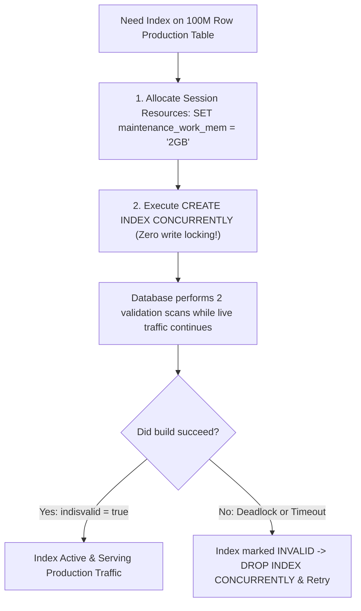

## Scenario

> **How would you index a table containing 100 million records?**

Running a standard `CREATE INDEX` on a 100-million-row production table takes an exclusive lock, blocking all writes for 2 hours and taking down the application. The interviewer evaluates your zero-downtime operational procedures.

## Fast Revision (10-Second Recall)

- **First Rule:** **ALWAYS use `CREATE INDEX CONCURRENTLY`** (Postgres) or `ALGORITHM=INPLACE, LOCK=NONE` (MySQL) to avoid locking table writes.
- **The 4 Steps for Large Table Indexing:**
- 1. **Pre-flight Resource Tuning:** Temporarily increase `maintenance_work_mem` (e.g. 2GB) and `max_parallel_maintenance_workers` to accelerate build.
- 2. **Execute Concurrently:** Run `CREATE INDEX CONCURRENTLY idx_name ON table(col);` in an independent session.
- 3. **Verify Index Validity:** Check `indisvalid = true` in `pg_index` (if build fails midway, an invalid index remains and must be cleaned up).
- 4. **Consider BRIN or Partitioning:** For 100M+ append-only rows, a BRIN index takes 99% less space than B-Tree.

## The 30-Second Spoken Script

If asked this in an interview, deliver this structured response:

> *Indexing a 100-million-record production table requires careful resource planning and zero-downtime execution to prevent locking active user traffic.*
>
> *First, I never run a standard CREATE INDEX command. A standard index creation acquires an AccessExclusiveLock, blocking all concurrent INSERT, UPDATE, and DELETE operations for the hours it takes to build. Instead, I always execute CREATE INDEX CONCURRENTLY in PostgreSQL (or ALGORITHM=INPLACE, LOCK=NONE in MySQL). This builds the index in two passes while allowing live transactions to continue unhindered.*
>
> *Second, to make the build as fast as possible, I temporarily tune maintenance memory in the build session: setting maintenance_work_mem to 2GB or 4GB and increasing max_parallel_maintenance_workers to 4 so PostgreSQL can leverage multi-core parallel sorts.*
>
> *Third, after the build finishes, I check pg_index to ensure indisvalid is true. If a concurrent index build is interrupted by a deadlock or network timeout, PostgreSQL leaves behind an INVALID index that consumes disk space and degrades writes without being usable for reads. If invalid, I drop it concurrently and re-run.*
>
> *Finally, for 100M+ records that are naturally ordered by time, I evaluate whether a BRIN (Block Range Index) or Table Partitioning is a better architectural fit than a massive 20GB B-Tree.*

## Diagnostic Lifecycle



## Root Causes & Solutions Matrix

| Suspected Layer | Symptoms & Evidence | Immediate Resolution |
| :--- | :--- | :--- |
| **Table Locking Outage** | Standard `CREATE INDEX` takes exclusive lock; 500 API workers back up and crash. | Always use `CREATE INDEX CONCURRENTLY` in PostgreSQL. |
| **Slow Index Build (Takes 6 hours)** | Build uses default 64MB memory, constantly swapping to disk. | Increase session `maintenance_work_mem = '4GB'` and enable parallel workers. |
| **Invalid Index Left Behind** | Failed concurrent build leaves `INVALID` index that slows down writes. | Check `pg_index.indisvalid`; drop invalid index with `DROP INDEX CONCURRENTLY`. |
| **Massive B-Tree Size (30GB)** | Index exceeds available RAM buffer pool, degrading cache hit ratio. | Use BRIN index for append-only data, or partition table by month. |

## Practical Debugging Commands & Code

### Zero-Downtime Concurrent Index Build on 100M Row Table
```sql
-- 1. Tune memory and parallel workers for the current session ONLY
SET maintenance_work_mem = '2GB';
SET max_parallel_maintenance_workers = 4;

-- 2. Execute Zero-Downtime Concurrent Build (Postgres)
-- Note: CONCURRENTLY cannot run inside a multi-command transaction block!
CREATE INDEX CONCURRENTLY idx_transactions_account_date 
ON transactions (account_id, created_at DESC);

-- 3. Verify the index built successfully and is VALID
SELECT 
  c.relname AS index_name,
  i.indisvalid,
  i.indisready,
  pg_size_pretty(pg_relation_size(c.oid)) AS index_size
FROM pg_index i
JOIN pg_class c ON c.oid = i.indexrelid
WHERE c.relname = 'idx_transactions_account_date';

-- 4. If indisvalid is FALSE (failed build), drop and clean up:
-- DROP INDEX CONCURRENTLY idx_transactions_account_date;
```

## Prevention & Senior Best Practices

1. **Never Execute in Transaction Blocks:** `CREATE INDEX CONCURRENTLY` cannot run inside `BEGIN ... COMMIT` blocks.
2. **Monitor Disk Space Before Building:** Ensure the volume has at least 2x the anticipated index size free before starting.
3. **Run During Low-Traffic Windows:** Even though concurrent builds don't lock writes, they consume significant CPU and disk I/O.
