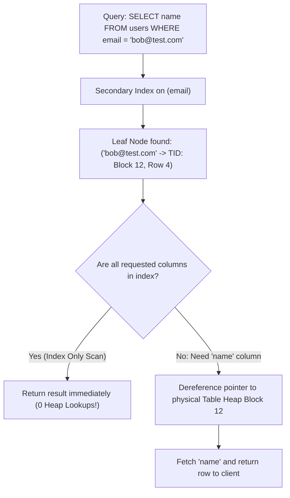

## Scenario

> **What is a non-clustered index?**

While a table can have only one clustered index, it can have dozens of non-clustered indexes. The interviewer tests your understanding of secondary index pointers and the cost of heap dereferencing.

## Fast Revision (10-Second Recall)

- **First Move:** Define a non-clustered index as an **independent auxiliary structure that contains a sorted copy of indexed columns plus a pointer to the original row**.
- **Pointer Mechanism Divergence:**
- 1. **PostgreSQL / Heap Databases:** Leaf node stores a Tuple Identifier (TID: `BlockNumber, Offset`) pointing directly to physical table heap.
- 2. **MySQL InnoDB:** Leaf node stores the **Primary Key value** (not physical disk pointer); looking up non-indexed columns requires traversing the Clustered Index B-Tree (Bookmark Lookup).
- **Maximum Count:** Tables can have dozens of non-clustered indexes.
- **Optimization:** Use Covering Indexes (`INCLUDE`) to avoid the pointer dereferencing step entirely.

## The 30-Second Spoken Script

If asked this in an interview, deliver this structured response:

> *A non-clustered index (also called a secondary index) is an auxiliary B-tree structure stored separately from the actual table data. It contains a sorted subset of columns along with row pointers that map back to the full table record.*
>
> *The leaf nodes of a non-clustered index do not contain the full data row. Instead, they contain:
1. The indexed key values in sorted order.
2. A row identifier pointing to where the rest of the data lives.*
>
> *The pointer implementation differs significantly between database engines:
In PostgreSQL and heap-based databases, the pointer is a physical Tuple Identifier (TID) consisting of a block number and row offset. The engine reads the leaf page and makes a direct jump to that table heap block.*
>
> *In MySQL InnoDB, the pointer is the table's Primary Key value. When a query uses a secondary index to find non-indexed columns, InnoDB performs what is called a Bookmark Lookup: first traversing the secondary index to find the primary key, and then traversing the clustered primary key index to fetch the full row.*
>
> *Because secondary lookups require two navigation steps, we eliminate this overhead by creating covering indexes with the INCLUDE clause, allowing queries to be answered entirely within the secondary index.*

## Diagnostic Lifecycle



## Root Causes & Solutions Matrix

| Suspected Layer | Symptoms & Evidence | Immediate Resolution |
| :--- | :--- | :--- |
| **Secondary Index Lookup** | Query hits index fast, but performs 5,000 random disk seeks to fetch heap. | Turn into a covering index: `CREATE INDEX ... INCLUDE (name)`. |
| **InnoDB Bookmark Lookup** | MySQL query takes 2x CPU traversing secondary B-tree then primary B-tree. | Cover query columns within secondary index definition. |
| **Postgres Heap Pointer (TID)** | Table VACUUM or update changes physical row location; index pointers update. | Rely on autovacuum to maintain index and heap tuple mapping. |
| **Multiple Secondary Indexes** | 5 secondary indexes updated on every single row insert. | Audit and prune secondary indexes with `idx_scan = 0`. |

## Practical Debugging Commands & Code

### Converting a Secondary Index into a Covering Index with INCLUDE
```sql
-- 1. Standard Secondary Index
CREATE INDEX idx_users_email ON users (email);

-- Query:
EXPLAIN (ANALYZE, BUFFERS)
SELECT id, email, full_name FROM users WHERE email = 'charlie@example.com';

-- Execution Plan:
-- -> Index Scan using idx_users_email on users
--    Buffers: shared hit=3 read=1 (1 read from Table Heap to get full_name!)

-- 2. Enhanced Secondary Index (Covering Index)
-- By including 'full_name', the secondary index satisfies the query completely!
CREATE INDEX CONCURRENTLY idx_users_email_covering 
ON users (email) 
INCLUDE (full_name);

-- Execution Plan now becomes:
-- -> Index Only Scan using idx_users_email_covering on users
--    Buffers: shared hit=3 (ZERO reads from Table Heap!)
```

## Prevention & Senior Best Practices

1. **Use `INCLUDE` for Payload Columns:** Store non-search columns in the leaf level without adding them to B-Tree branch sort nodes.
2. **Watch MySQL Secondary Index Pointer Size:** In InnoDB, secondary indexes store the Primary Key; if your PK is a 64-character string, all secondary indexes balloon in size.
3. **Index Only Columns with Read Demand:** Every secondary index imposes write amplification on data mutations.
