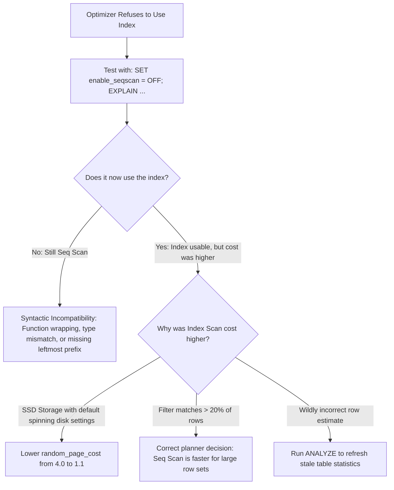

## Scenario

> **How would you troubleshoot an index that is not being used?**

You created an index specifically to optimize a query, but `EXPLAIN` insists on performing a Sequential Scan. The interviewer tests your ability to debug the query planner's cost calculations.

## Fast Revision (10-Second Recall)

- **First Move:** Run **`EXPLAIN`** and compare the estimated cost of a Sequential Scan versus an Index Scan by temporarily running `SET enable_seqscan = OFF;`.
- **The Top 5 Causes of Ignored Indexes:**
- 1. **Cost Math Favoring Seq Scan:** High `random_page_cost` (default 4.0 for spinning disks) makes optimizer believe sequential I/O is cheaper than index random seeks.
- 2. **Implicit Data Type Coercion:** Column is `VARCHAR`, parameter is `INT`; database casts column on every row.
- 3. **Leftmost Prefix Violation:** Index on `(A, B)`, query filters on `B`.
- 4. **Non-SARGable Functions:** `WHERE LOWER(col) = ...` or `WHERE col + 1 = 10`.
- 5. **Small Table Size:** Table fits in 2 disk blocks; sequential read is objectively faster.

## The 30-Second Spoken Script

If asked this in an interview, deliver this structured response:

> *When a database optimizer refuses to use an existing index, it does so because its cost model calculates that a Sequential Scan is cheaper than an Index Scan.*
>
> *My diagnostic procedure:
First, I verify whether the index is syntactically usable. I check for the Leftmost Prefix Rule on composite indexes, check for function wrapping (like WHERE DATE(col) = ...), and verify data types. A classic culprit is passing an integer to a VARCHAR column, which triggers an implicit CAST on the table column, completely invalidating index lookups.*
>
> *Second, in PostgreSQL, I test the planner's cost decision by temporarily running SET enable_seqscan = OFF; in my session and re-running EXPLAIN. This forces PostgreSQL to produce an Index Scan plan. I then inspect the cost numbers:
If the Index Scan cost is astronomical compared to Seq Scan, it usually means the planner's random_page_cost setting is still at the legacy spinning disk default of 4.0. On modern NVMe SSDs, random_page_cost should be set to 1.1, which immediately encourages the planner to use indexes.*
>
> *Third, if the table has low selectivity—where the filter matches 30% of rows—the planner correctly chooses a sequential scan because random seeks for 300,000 rows is slower than streaming sequential blocks. In that case, I create a Partial Index on the rare values.*

## Diagnostic Lifecycle



## Root Causes & Solutions Matrix

| Suspected Layer | Symptoms & Evidence | Immediate Resolution |
| :--- | :--- | :--- |
| **Spinning Disk Cost Model on SSD** | `random_page_cost` set to 4.0; planner avoids index random I/O. | Configure `SET random_page_cost = 1.1;` for SSD/NVMe storage. |
| **Implicit Type Conversion** | `WHERE phone_number = 12345` on VARCHAR column bypasses index. | Pass string: `WHERE phone_number = '12345'`. |
| **Stale Optimizer Statistics** | Planner estimated 5 rows, but actual rows returned was 200,000. | Run `ANALYZE table_name;` to recalculate row distributions. |
| **Leading Wildcard** | `WHERE code LIKE '%ABC'` cannot traverse B-Tree. | Use `pg_trgm` trigram GIN index or reverse string index. |

## Practical Debugging Commands & Code

### Forcing Index Scan in Session to Debug Cost Discrepancy
```sql
-- 1. Check baseline plan (Optimizer chooses Seq Scan)
EXPLAIN SELECT * FROM customer_accounts WHERE account_status = 'SUSPENDED';

-- 2. Force PostgreSQL to evaluate Index Scan cost
SET enable_seqscan = OFF;

EXPLAIN SELECT * FROM customer_accounts WHERE account_status = 'SUSPENDED';

-- Reset back to default!
SET enable_seqscan = ON;

-- 3. If SSD storage is used, align cost parameters with hardware
-- Default PostgreSQL settings assume slow mechanical spinning disks:
-- seq_page_cost = 1.0, random_page_cost = 4.0
-- On modern cloud SSDs (EBS gp3, Google PD-SSD), set:
ALTER DATABASE production_db SET random_page_cost = 1.1;

-- 4. Update statistics to fix row estimation errors
ANALYZE customer_accounts;
```

## Prevention & Senior Best Practices

1. **Align `random_page_cost` with SSD Hardware:** Modern NVMe SSDs have near-zero seek latency penalty; set `random_page_cost` between 1.1 and 1.25.
2. **Never Disable `enable_seqscan` Globally in Production:** Use it strictly as a diagnostic tool in testing sessions.
3. **Run Regular `ANALYZE` After Bulk Imports:** Prevent statistics drift from blinding the optimizer.
