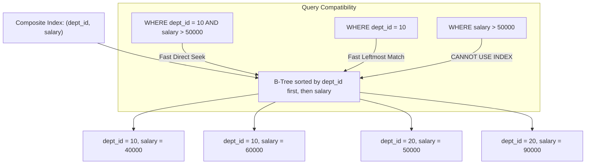

## Scenario

> **What is a composite index?**

A single-column index on column A and a single-column index on column B is NOT the same as a composite index on (A, B). The interviewer tests your understanding of multi-attribute sorting and B-tree page keys.

## Fast Revision (10-Second Recall)

- **First Move:** Define a composite index as a **single B-Tree index built on two or more columns** in a defined sequence.
- **How It Works:** Keys are sorted primarily by the 1st column; rows with identical 1st column values are sorted by the 2nd column, and so on.
- **The Leftmost Prefix Rule:** A composite index on `(A, B, C)` can satisfy queries on `(A)`, `(A, B)`, and `(A, B, C)`, but CANNOT satisfy queries on `(B)` or `(C)` alone.
- **Superiority over Single Indexes:** Eliminates expensive Bitmap Index Scan intersections where the engine must scan two separate indexes and merge results.

## The 30-Second Spoken Script

If asked this in an interview, deliver this structured response:

> *A composite index is a single index structure created on two or more columns of a table, maintaining a multi-attribute sorted order.*
>
> *Inside the B-Tree, keys are ordered lexicographically: sorted first by column 1, then by column 2 for equal values of column 1, and so on.*
>
> *A composite index is far more efficient than having two separate single-column indexes. If a query filters WHERE tenant_id = 42 AND status = 'ACTIVE', having separate indexes on tenant_id and status forces the engine to scan both index trees separately and merge their row pointers using an expensive in-memory BitmapAnd operation. A composite index on (tenant_id, status) satisfies the filter in a single index lookup.*
>
> *Furthermore, a composite index can serve multiple query shapes due to the Leftmost Prefix Rule. An index on (department_id, hire_date) can accelerate queries filtering by department_id alone, queries filtering by both department_id and hire_date, and queries filtering by department_id while ordering by hire_date.*

## Diagnostic Lifecycle



## Root Causes & Solutions Matrix

| Suspected Layer | Symptoms & Evidence | Immediate Resolution |
| :--- | :--- | :--- |
| **Two Single-Column Indexes** | Plan shows `BitmapAnd` merging two separate B-trees; high memory. | Consolidate into a single composite index `(colA, colB)`. |
| **Filter + Sort Combo** | Query filters by `status` and sorts by `created_at`; performs separate sort. | Create composite index on `(status, created_at DESC)`. |
| **Leftmost Prefix Failure** | Query filters on second column of composite index; triggers full table scan. | Query must include the leading column, or create a separate index. |
| **Index Redundancy** | Table has composite `(a, b)` AND single `(a)`. | Drop index on `(a)`; it is already covered by `(a, b)`. |

## Practical Debugging Commands & Code

### Consolidating Single Indexes into a Composite Index
```sql
-- ❌ INEFFICIENT: Two independent single-column indexes
-- CREATE INDEX idx_orders_user ON orders (user_id);
-- CREATE INDEX idx_orders_status ON orders (status);

-- When running this query:
-- SELECT * FROM orders WHERE user_id = 9481 AND status = 'SHIPPED';
-- Postgres must scan BOTH indexes and execute BitmapAnd (wasteful!).

-- ✅ EFFICIENT: Single Composite Index
CREATE INDEX CONCURRENTLY idx_orders_user_status 
ON orders (user_id, status);

-- This composite index satisfies:
-- 1. WHERE user_id = ? AND status = ?  (Both columns)
-- 2. WHERE user_id = ?                (Leading leftmost column)
-- 3. WHERE user_id = ? ORDER BY status (Filter + Sort)

-- Note: It does NOT efficiently satisfy:
-- WHERE status = ?                    (Lacks leftmost prefix!)
```

## Prevention & Senior Best Practices

1. **Audit and Delete Redundant Prefixes:** When you create index `(A, B, C)`, immediately check if you have an existing index on `(A)` or `(A, B)` and drop them.
2. **Cap Composite Indexes at 3-4 Columns:** Composite indexes beyond 4 columns waste disk space and are rarely leveraged fully.
3. **Use INCLUDE for Non-Filtered Projections:** If column C is only needed in SELECT and never in WHERE/ORDER BY, use `(A, B) INCLUDE (C)`.
