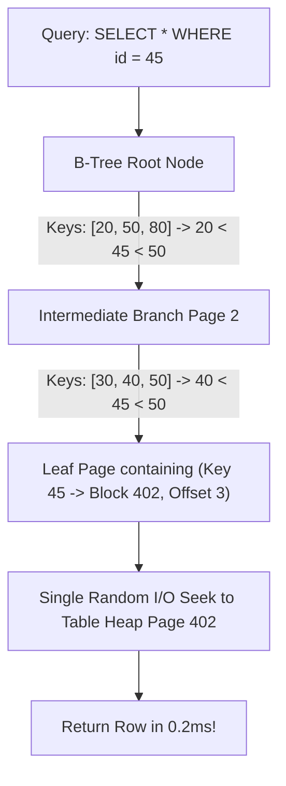

## Scenario

> **What is an index, and how does it improve performance?**

The bedrock foundational database question. The interviewer wants to hear about B-Trees, logarithmic complexity, disk block lookups, and pointer traversal rather than a vague book index analogy.

## Fast Revision (10-Second Recall)

- **First Move:** Define an index as an **auxiliary, self-balancing search tree (typically B-Tree or B+Tree)** that maps search keys to physical heap row pointers (TIDs).
- **Complexity Leap:** Transforms full table scans ($O(N)$ linear disk reads) into balanced tree traversals ($O(\log N)$ logarithmic branch navigations).
- **B-Tree Anatomy:** Root page $\rightarrow$ Internal branch pages $\rightarrow$ Leaf pages containing ordered key-pointer pairs.
- **The Trade-off:** Accelerates SELECT queries while adding write overhead (INSERT, UPDATE, DELETE must update every index) and consuming storage.

## The 30-Second Spoken Script

If asked this in an interview, deliver this structured response:

> *A database index is an auxiliary self-balancing data structure—predominantly a B+Tree—that allows the database engine to locate specific rows in O(log N) time without scanning every page in the table.*
>
> *Without an index, the database must execute a Sequential Scan: reading every 8KB disk block in the table from start to finish, checking each row against the WHERE condition. On a 10-million-row table, that means scanning tens of gigabytes of disk.*
>
> *With a B-Tree index, the database maintains a balanced hierarchical tree of pages. The root page points to intermediate branch pages, which point to leaf pages. The leaf pages store sorted key values paired with physical tuple identifiers (TIDs) indicating the exact disk block and row offset on the storage volume.*
>
> *Because B-Trees have a high branching factor—often hundreds of keys per page—a table with 10 million rows typically has a tree depth of only 3 or 4 levels. This means finding a specific record requires only 3 or 4 quick page lookups rather than scanning 100,000 blocks, reducing query latency from seconds to microseconds.*

## Diagnostic Lifecycle



## Root Causes & Solutions Matrix

| Suspected Layer | Symptoms & Evidence | Immediate Resolution |
| :--- | :--- | :--- |
| **Unindexed Scan** | Query reads 500,000 disk pages sequentially ($O(N)$). | Create a B-Tree index to reduce reads to 3-4 tree page traversals. |
| **B-Tree Fanout Efficiency** | Index depth stays at 3 levels even with 5 million rows. | High fan-out (hundreds of keys per page) minimizes disk seeks. |
| **Index Storage Overhead** | Table size is 10GB; 5 indexes take an additional 12GB disk space. | Only index columns actively used in filtering, joins, and sorting. |
| **Write Amplification** | Bulk inserts slow down because 6 indexes must be updated per row. | Drop or disable non-essential indexes during giant batch imports. |

## Practical Debugging Commands & Code

### Inspecting B-Tree Index Depth and Structure in PostgreSQL
```sql
-- 1. Install pageinspect extension to peek inside B-Tree pages
CREATE EXTENSION IF NOT EXISTS pageinspect;

-- 2. Inspect B-Tree Index Metadata (Depth, Leaf Pages, Root Page)
SELECT 
  level AS tree_depth,
  leaf_pages,
  root_block_no,
  empty_pages
FROM bt_metap('idx_users_email');

-- Sample output:
-- tree_depth: 3  <- Only 3 disk lookups needed to find ANY email among 5M users!
-- leaf_pages: 14820

-- 3. Create a standard B-Tree index safely
CREATE INDEX CONCURRENTLY idx_users_email ON users (email);
```

## Prevention & Senior Best Practices

1. **Use B-Tree for Equality and Range:** B-Tree is the default and ideal for `=`, `<`, `>`, `<=`, `>=`, and `BETWEEN`.
2. **Use GIN for Arrays and JSONB:** Standard B-Tree cannot index array elements or JSON containment; use GIN instead.
3. **Use BRIN for Append-Only Time Series:** On massive sorted tables (billions of rows), BRIN indexes take 99% less space than B-Trees.
