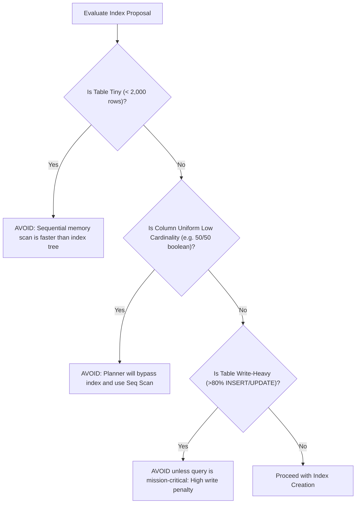

## Scenario

> **When should you avoid creating an index?**

Junior developers assume "more indexes = more speed". Senior engineers know exactly when an index hurts performance more than it helps. The interviewer tests your trade-off awareness.

## Fast Revision (10-Second Recall)

- **First Rule:** Avoid indexing **Small Tables (under 1,000 rows)** and **Low-Cardinality Columns** without skewed distribution.
- **The 4 Red Flags Where Indexes Should Be Avoided:**
- 1. **Small Tables:** A 500-row table fits on 2 disk pages; a Sequential Scan in memory is faster than traversing an index and fetching heap pointers.
- 2. **Low-Cardinality Uniform Columns:** Columns with 2-3 evenly distributed values (e.g. `gender`, `is_verified` 50/50 split); index is ignored by the planner.
- 3. **High-Throughput Write-Heavy Tables:** Tables receiving 10,000 inserts/sec (audit logs, telemetry, metrics); every index slows down writes.
- 4. **Columns with Frequent UPDATEs:** Updating an indexed column invalidates B-Tree pages and breaks HOT (Heap-Only Tuple) optimization in PostgreSQL.

## The 30-Second Spoken Script

If asked this in an interview, deliver this structured response:

> *You should avoid creating an index when the write overhead exceeds read benefits, when table size is small, or when column cardinality is too low for the optimizer to use it.*
>
> *First, on small tables with fewer than a few thousand rows. A small table fits into one or two 8KB disk blocks. The database engine can read those blocks sequentially in memory far faster than traversing a B-tree and performing secondary pointer lookups.*
>
> *Second, on low-cardinality columns with uniform distribution—like a boolean column or a status with only two evenly split states. The planner calculates that filtering matches roughly 50% of the table. Because random disk I/O from index lookups is slower than sequential disk streaming, the planner will completely ignore the index.*
>
> *Third, on write-heavy tables like log aggregations, IoT telemetry, or high-speed ledger entries. Every additional index turns a single disk write into multiple synchronized B-tree balance writes.*
>
> *Finally, avoid indexing columns that are frequently updated. In PostgreSQL, updating an unindexed column can use Heap-Only Tuple (HOT) optimization, avoiding index writes entirely. Indexing that column destroys HOT optimization, causing severe table and index bloat.*

## Diagnostic Lifecycle



## Root Causes & Solutions Matrix

| Suspected Layer | Symptoms & Evidence | Immediate Resolution |
| :--- | :--- | :--- |
| **Tiny Lookup Table** | Creating index on a 15-row `countries` table. | Skip index; full table scan in RAM takes 0.02ms. |
| **Uniform Boolean Column** | B-tree index on `is_active` where 50% of users are active. | Drop index; planner will always choose sequential scan. |
| **High-Write Ingestion Log** | Table taking 20,000 writes/sec slows to a crawl under 8 indexes. | Keep minimum indexes; archive cold data to ClickHouse/Snowflake. |
| **Breaking HOT Optimization** | Frequently updated column causes high table bloat on every `UPDATE`. | Avoid indexing columns updated multiple times per second. |

## Practical Debugging Commands & Code

### Checking PostgreSQL Heap-Only Tuple (HOT) Optimization Health
```sql
-- 1. Check HOT Update Ratio on High-Churn Tables
-- If n_tup_hot_upd is high, Postgres is updating without touching indexes!
-- If you index the updated column, n_tup_hot_upd drops to 0 (bad!).
SELECT 
  relname AS table_name,
  n_tup_upd AS total_updates,
  n_tup_hot_upd AS hot_updates,
  round((100.0 * n_tup_hot_upd / nullif(n_tup_upd, 0))::numeric, 2) AS hot_update_ratio
FROM pg_stat_user_tables
WHERE relname = 'user_sessions';

-- 2. Check Write-to-Read Ratio
-- If writes vastly exceed reads, adding an index hurts overall throughput!
SELECT 
  relname,
  (n_tup_ins + n_tup_upd + n_tup_del) AS total_writes,
  seq_scan + idx_scan AS total_reads,
  round(((n_tup_ins + n_tup_upd + n_tup_del)::numeric / nullif(seq_scan + idx_scan, 0)), 2) AS write_to_read_ratio
FROM pg_stat_user_tables
WHERE relname = 'audit_events';
```

## Prevention & Senior Best Practices

1. **Maintain HOT Optimization:** Never index columns that undergo frequent micro-updates unless strictly necessary for search.
2. **Use BRIN for Append-Only Big Data:** For time-series tables with hundreds of millions of append-only rows, use BRIN instead of B-Trees to minimize write penalty.
3. **Audit Write Latency Before/After Indexing:** Measure `INSERT` p99 latency in staging when proposing new indexes.
