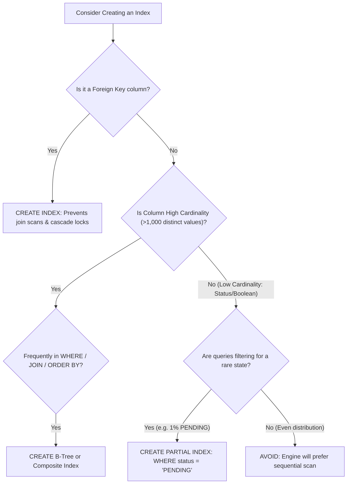

## Scenario

> **When should you create a database index?**

Creating indexes without clear criteria leads to index bloat and degraded write performance. The interviewer evaluates your decision framework for when an index is genuinely justified.

## Fast Revision (10-Second Recall)

- **First Rule:** Index based on **Query Patterns and Column Cardinality**—never index speculatively.
- **The 5 High-Impact Indexing Scenarios:**
- 1. **Primary & Foreign Keys:** Enforce constraints and prevent full table scans during child table `JOIN`s and cascading deletes.
- 2. **High-Cardinality Filter Columns:** Columns with high unique value distribution (e.g. `uuid`, `email`, `ssn`).
- 3. **Frequent JOIN and WHERE Predicates:** Columns repeatedly queried together in production API endpoints.
- 4. **ORDER BY and GROUP BY Columns:** Columns sorted frequently to eliminate expensive in-memory/disk sorts.
- 5. **State Flag Partial Indexes:** Highly skewed columns where you only query the rare status (`WHERE status = 'PENDING'`).

## The 30-Second Spoken Script

If asked this in an interview, deliver this structured response:

> *I create a database index based on query volume, column cardinality, and join relationships.*
>
> *My primary criteria for creating an index include:*
>
> *First, Foreign Keys. While primary keys are indexed automatically, most databases do not automatically index foreign keys. Without an index on foreign key columns, joining parent and child tables or running cascading deletes requires full table scans on the child table.*
>
> *Second, High-Cardinality Filter Columns. Columns with high uniqueness that appear frequently in WHERE clauses—such as email addresses, account numbers, or external UUIDs—benefit immensely from B-tree indexing.*
>
> *Third, Sorting and Grouping optimization. If an API endpoint regularly executes ORDER BY created_at DESC with a LIMIT 20, an index on created_at allows the database to read the top 20 rows in sorted order and exit immediately, avoiding an expensive sort of millions of rows.*
>
> *Fourth, Partial Indexes for skewed workflows. In an orders table with 10 million completed orders and only 500 pending orders, indexing the entire table wastes space. I create a partial index WHERE status = 'PENDING', which takes negligible memory while delivering sub-millisecond lookups for order processing workers.*

## Diagnostic Lifecycle



## Root Causes & Solutions Matrix

| Suspected Layer | Symptoms & Evidence | Immediate Resolution |
| :--- | :--- | :--- |
| **Foreign Key Joining** | `JOIN orders o ON o.customer_id = c.id` performs slow table scans. | Add index on `orders (customer_id)`. |
| **Top-N Sorting** | `ORDER BY created_at DESC LIMIT 10` causes high CPU sort on 5M rows. | Add index on `(created_at DESC)` to stream rows directly. |
| **Unique Business Keys** | Need to prevent duplicate email or tax ID registrations. | Create `UNIQUE INDEX` to enforce constraint and speed up lookups. |
| **Skewed Status Queues** | Worker polls `WHERE status = 'UNPROCESSED'` across 20M completed rows. | Create partial index: `CREATE INDEX ... WHERE status = 'UNPROCESSED'`. |

## Practical Debugging Commands & Code

### High-Impact Index Patterns: Foreign Keys & Partial Indexes
```sql
-- 1. Foreign Key Index (Mandatory for high-performance joins)
CREATE INDEX CONCURRENTLY idx_order_items_order_id 
ON order_items (order_id);

-- 2. Sort Alignment Index with LIMIT optimization
CREATE INDEX CONCURRENTLY idx_posts_user_created 
ON posts (user_id, created_at DESC);

-- 3. Partial Index: Ultra-compact, fast index for skewed data
-- Only contains rows where is_active is false (e.g., deleted accounts)
CREATE INDEX CONCURRENTLY idx_users_deactivated 
ON users (deactivated_at) 
WHERE is_active = FALSE;
```

## Prevention & Senior Best Practices

1. **Never Index Speculatively:** Do not add indexes before verifying production query patterns with `pg_stat_statements`.
2. **Always Index Foreign Keys:** Make foreign key indexing a mandatory check in your database migration CI pipeline.
3. **Use Partial Indexes for Queue States:** Reduce index size by 95% by indexing only unprocessed rows.
