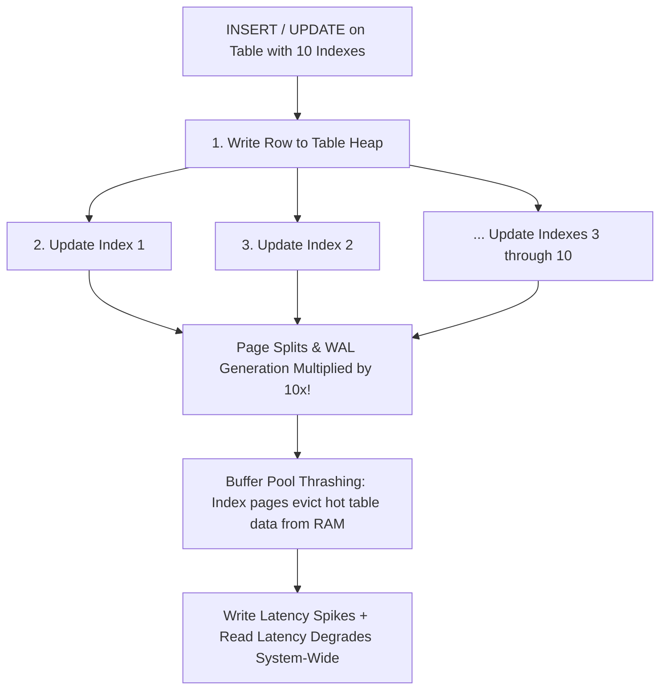

## Scenario

> **Why can too many indexes reduce performance?**

Every time a team has a slow query, someone adds an index. Two years later, a table has 25 indexes and writes grind to a halt. The interviewer tests your understanding of database write amplification and memory mechanics.

## Fast Revision (10-Second Recall)

- **First Move:** Understand **Write Amplification**—every `INSERT`, `UPDATE`, and `DELETE` must write to the table heap PLUS every single index on that table.
- **The 4 Ways Over-Indexing Destroys Performance:**
- 1. **Write Latency Multiplier:** An INSERT on a table with 10 indexes must perform 11 separate page writes instead of 1.
- 2. **B-Tree Page Splits:** Inserting random keys causes B-Tree pages to fill up, split into two 50% pages, and generate heavy WAL write volume.
- 3. **Buffer Pool Eviction:** 20GB of indexes displaces hot table data from RAM cache, increasing disk reads.
- 4. **Query Planner Slowdown:** The query optimizer must evaluate dozens of execution permutations, increasing query planning time.

## The 30-Second Spoken Script

If asked this in an interview, deliver this structured response:

> *While indexes accelerate read operations, having too many indexes severely degrades database performance across write latency, memory utilization, and storage I/O.*
>
> *First, Write Amplification. When you insert a single row into a table with 10 indexes, the database must write the record to the table heap and perform 10 separate writes to update each B-tree index. If an index page is full, it triggers an expensive B-tree page split, requiring locking, page rebalancing, and heavy Write-Ahead Log (WAL) generation.*
>
> *Second, Memory Cache Contention. Database memory (the buffer pool) is finite. When a table has 15 indexes totaling 40 gigabytes, those index pages compete directly with active table pages for RAM. Frequently queried table rows are evicted from cache, causing read latency across the entire system to degrade.*
>
> *Third, UPDATE Performance Degradation. In PostgreSQL, updates to unindexed columns can take advantage of Heap-Only Tuple (HOT) optimization, avoiding index writes altogether. Excessive indexes guarantee that almost any column update touches an indexed field, breaking HOT optimization and creating severe table bloat.*
>
> *Finally, Query Planning Overhead. The query optimizer must evaluate combinations of all available indexes. With 20 indexes on a table, query planning time alone can exceed execution time.*

## Diagnostic Lifecycle



## Root Causes & Solutions Matrix

| Suspected Layer | Symptoms & Evidence | Immediate Resolution |
| :--- | :--- | :--- |
| **Write Latency Spike** | `INSERT` statement takes 120ms on a table with 18 indexes. | Audit and drop indexes with `idx_scan = 0`. |
| **Excessive Page Splits** | High WAL generation and disk I/O spikes during bulk inserts. | Consolidate multiple single indexes into 2-3 composite indexes. |
| **Broken HOT Optimization** | Frequent micro-updates cause rapid table bloat and high autovacuum load. | Remove indexes from frequently updated status/counter columns. |
| **Storage Cost Inflation** | Table size is 5GB, but total relation size is 35GB due to indexes. | Drop duplicate prefix indexes and unused legacy indexes. |

## Practical Debugging Commands & Code

### Comparing Table Size vs Total Index Size in PostgreSQL
```sql
-- 1. Identify Over-Indexed Tables where Indexes dwarf Table Data
SELECT
  relname AS table_name,
  pg_size_pretty(pg_relation_size(relid)) AS table_size,
  pg_size_pretty(pg_indexes_size(relid)) AS total_index_size,
  round((pg_indexes_size(relid)::numeric / nullif(pg_relation_size(relid), 0)), 2) AS index_to_table_ratio
FROM pg_stat_user_tables
ORDER BY pg_indexes_size(relid) DESC
LIMIT 10;

-- If index_to_table_ratio > 2.0 (indexes are 2x+ larger than the table),
-- the table is almost certainly over-indexed!

-- 2. Audit unused indexes on the over-indexed table
SELECT indexrelname, idx_scan, pg_size_pretty(pg_relation_size(indexrelid))
FROM pg_stat_user_indexes
WHERE relname = 'orders' AND idx_scan < 100;
```

## Prevention & Senior Best Practices

1. **Limit Indexes per Table:** Aim for no more than 4 to 6 well-designed composite indexes per active OLTP table.
2. **Consolidate Overlapping Indexes:** A composite index `(A, B)` eliminates the need for a separate index on `(A)`.
3. **Separate OLTP from Analytics:** Move heavy analytical reporting to a Read Replica or Snowflake/BigQuery so production OLTP tables don't need 20 ad-hoc indexes.
