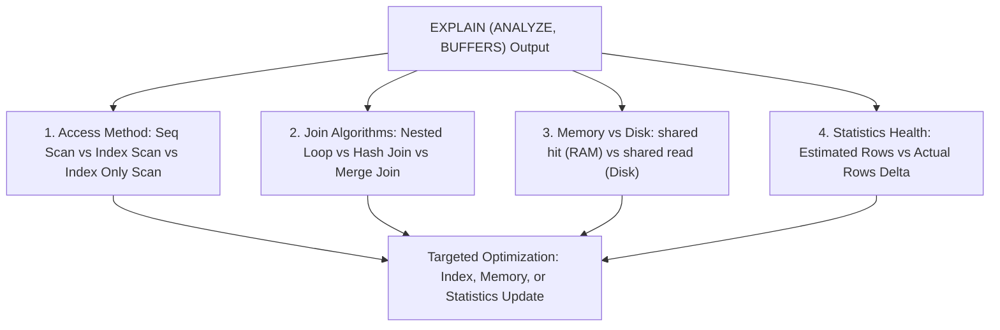

## Scenario

> **How would you analyze an SQL execution plan?**

Anyone can run `EXPLAIN`, but senior engineers can interpret cost numbers, scan types, join methods, and buffer statistics. The interviewer tests your ability to read the planner tree.

## Fast Revision (10-Second Recall)

- **First Move:** Run **`EXPLAIN (ANALYZE, BUFFERS)`** (EXPLAIN alone is only an estimate; ANALYZE executes the query and shows ground truth!).
- **The 4 Critical Plan Elements:**
- 1. **Access Method:** Seq Scan (slow on large tables) vs Index Scan vs Index Only Scan vs Bitmap Index Scan.
- 2. **Join Strategy:** Nested Loop (fast for small subsets) vs Hash Join (best for large unsorted sets) vs Merge Join (best for sorted inputs).
- 3. **Actual Rows vs Estimated Rows:** A large gap (e.g. estimated 1 vs actual 100,000) means statistics are stale.
- 4. **Buffers Hit vs Read:** `shared hit` = read from RAM cache; `shared read` = fetched from slow disk SSD.

## The 30-Second Spoken Script

If asked this in an interview, deliver this structured response:

> *Analyzing an SQL execution plan requires reading the plan tree from inside-out, bottom-to-top, comparing cost estimates against actual execution metrics.*
>
> *First, I always run EXPLAIN (ANALYZE, BUFFERS). A plain EXPLAIN only shows the query planner's guesses; ANALYZE actually runs the query, providing true execution times, actual row counts, and memory/buffer statistics.*
>
> *Second, I examine access methods. I look for Sequential Scans on large tables. If a Sequential Scan removes 99% of scanned rows with a filter, it is a glaring candidate for a targeted B-tree index. For indexed queries, I look for Index Only Scans, which satisfy the query purely from the index pages without touching table heap storage.*
>
> *Third, I examine join algorithms:
Nested Loops are optimal when the outer set is small and the inner set is indexed.
Hash Joins are selected for larger unindexed datasets.
If a Hash Join spills into Workfile disk storage, it means work_mem was exhausted.*
>
> *Finally, I compare Estimated Rows with Actual Rows. If the planner estimated 10 rows but actual rows returned was 500,000, the planner made suboptimal join and scan choices due to stale statistics, which I fix with ANALYZE.*

## Diagnostic Lifecycle



## Root Causes & Solutions Matrix

| Suspected Layer | Symptoms & Evidence | Immediate Resolution |
| :--- | :--- | :--- |
| **Sequential Scan** | `Seq Scan on users (cost=0.00..45281.00 rows=1500000)` | Add index on WHERE filter columns. |
| **Heap Fetch Bottleneck** | `Index Scan` has high time due to visiting table heap pages for unindexed columns. | Create a Covering Index with `INCLUDE (col1, col2)`. |
| **Hash Join Spill** | `Hash Join ... Disk: 24320kB` | Increase `work_mem` for the query session. |
| **Stale Cost Estimation** | Estimated Rows: 1, Actual Rows: 240,000; bad join algorithm chosen. | Run `ANALYZE table_name;` or increase `default_statistics_target`. |

## Practical Debugging Commands & Code

### Reading and Interpreting PostgreSQL EXPLAIN Plan Output
```sql
-- Example Query to Profile
EXPLAIN (ANALYZE, BUFFERS, TIMING)
SELECT u.username, o.total_amount
FROM users u
JOIN orders o ON u.id = o.user_id
WHERE o.status = 'PENDING'
  AND o.created_at >= '2026-01-01';

/* Sample Plan Analysis Output:
-> Hash Join (cost=2150.00..8450.00 rows=450 actual time=12.45..85.20 rows=420 loops=1)
   Hash Cond: (o.user_id = u.id)
   Buffers: shared hit=1250 read=42
   -> Seq Scan on orders o (cost=0.00..6100.00 rows=450 actual time=5.12..70.10 rows=420)
      Filter: ((status = 'PENDING') AND (created_at >= '2026-01-01'))
      Rows Removed by Filter: 850000  <-- RED FLAG: Scanned 850k rows to keep 420!
   -> Hash (cost=1800.00..1800.00 rows=25000 actual time=7.10..7.10 rows=25000)
      -> Seq Scan on users u

FIX: Create composite index:
CREATE INDEX idx_orders_pending_date ON orders (status, created_at) INCLUDE (user_id, total_amount);
*/
```

## Prevention & Senior Best Practices

1. **Use Visual Explain Tools:** Use `explain.dalibo.com` or `explain.depesz.com` to visualize complex multi-table execution trees.
2. **Never Run ANALYZE in Prod on Giant Tables Without CONCURRENTLY/Care:** Standard ANALYZE takes brief sample locks; for massive tables run during low-traffic windows.
3. **Check `shared hit` Ratios:** Aim for > 99% `shared hit` to ensure hot data stays resident in PostgreSQL shared buffers.
