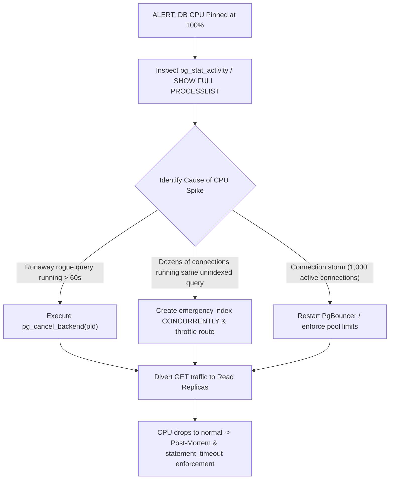

## Scenario

> **How would you troubleshoot database CPU utilization reaching 100%?**

Production alerts are firing: RDS CPU is pinned at 100%, API response times are spiking from 50ms to 30 seconds, and cascading timeouts are threatening a total outage. The interviewer tests your crisis triage and senior response protocol.

## Fast Revision (10-Second Recall)

- **First Move:** Run **`pg_stat_activity`** (Postgres) or **`SHOW PROCESSLIST`** (MySQL) sorted by query duration to find the query eating CPU.
- **Emergency Action Hierarchy:**
- 1. **Cancel the Runaway Query:** Terminate rogue queries with `pg_cancel_backend(pid)` or `KILL query_id`.
- 2. **Scale Read Traffic:** Point read-only API traffic to Read Replicas immediately.
- 3. **Throttle / Rate Limit Ingress:** Rate-limit non-essential traffic or bad bots at Cloudflare / API Gateway.
- 4. **Apply Emergency Index:** If a missing index is causing repeated table scans across 50 connections, create it `CONCURRENTLY`.

## The 30-Second Spoken Script

If asked this in an interview, deliver this structured response:

> *When database CPU hits 100% in production, I execute a structured incident response protocol: Triage, Stabilize, Identify, and Remediate.*
>
> *Step 1: Stabilize the system.
I immediately inspect pg_stat_activity or SHOW PROCESSLIST to see what is currently executing. High CPU is almost always driven by either an influx of unindexed sequential scans across dozens of concurrent connections, or a rogue analytical query running unbounded. If I identify a runaway query consuming CPU, I terminate it immediately using pg_cancel_backend(pid).*
>
> *Step 2: Relieve connection pressure.
If the CPU spike is caused by overall read volume, I immediately divert read traffic to read replicas and throttle non-critical background jobs (like batch syncs or email campaigns) at the application layer.*
>
> *Step 3: Root cause analysis.
Once CPU stabilizes to a safe 60-70%, I query pg_stat_statements ordered by total_exec_time to identify the query fingerprint that spiked. Nine out of ten times, a recent release introduced an unindexed query, or a sudden spike in table size triggered a query plan flip from index scan to sequential scan.*
>
> *Step 4: Permanent remediation.
I deploy an emergency index using CREATE INDEX CONCURRENTLY, tune connection pool limits in PgBouncer, and enforce a strict 3-second statement_timeout so a single rogue query can never pin CPU to 100% again.*

## Diagnostic Lifecycle



## Root Causes & Solutions Matrix

| Suspected Layer | Symptoms & Evidence | Immediate Resolution |
| :--- | :--- | :--- |
| **Runaway Analytical Query** | Single query has been running for 8 minutes, pinning 1 core at 100%. | Cancel query with `pg_cancel_backend(pid)`. |
| **Unindexed Query Stampede** | 50 concurrent API requests all running Seq Scan on same 5M row table. | Add missing index `CONCURRENTLY` and throttle API route at gateway. |
| **Connection Pool Storm** | Active connections jumped from 50 to 1,500; context switching destroys CPU. | Enforce PgBouncer connection pooling with max 50 server connections. |
| **Postgres Plan Flip After Vacuum** | Statistics drift caused planner to abandon index for Seq Scan. | Run `ANALYZE table_name;` to restore proper index scan plan. |

## Practical Debugging Commands & Code

### Emergency CPU Triage Queries (Find & Kill Runaway Queries)
```sql
-- 1. Emergency Inspection: Find queries consuming CPU right now
SELECT 
  pid,
  usename,
  client_addr,
  now() - query_start AS duration,
  state,
  query
FROM pg_stat_activity
WHERE state = 'active'
  AND (now() - query_start) > interval '5 seconds'
ORDER BY duration DESC;

-- 2. Gracefully cancel the offending query (does NOT kill connection)
SELECT pg_cancel_backend(14295);

-- 3. If query ignores cancel, forcefully terminate backend connection
SELECT pg_terminate_backend(14295);

-- 4. Terminate ALL active queries running longer than 30 seconds (EMERGENCY RESTORATION)
SELECT pg_cancel_backend(pid)
FROM pg_stat_activity
WHERE state = 'active'
  AND pid != pg_backend_pid()
  AND (now() - query_start) > interval '30 seconds';
```

## Prevention & Senior Best Practices

1. **Enforce Global Statement Timeout:** Set `statement_timeout = '5s';` so no query can ever run indefinitely.
2. **Always Use Connection Pooling:** Deploy PgBouncer or AWS RDS Proxy; never allow thousands of raw client connections directly to PostgreSQL.
3. **Configure Auto-Scaling & Replica Routing:** Automatically route read-only queries to Read Replicas using database connection splitting.
