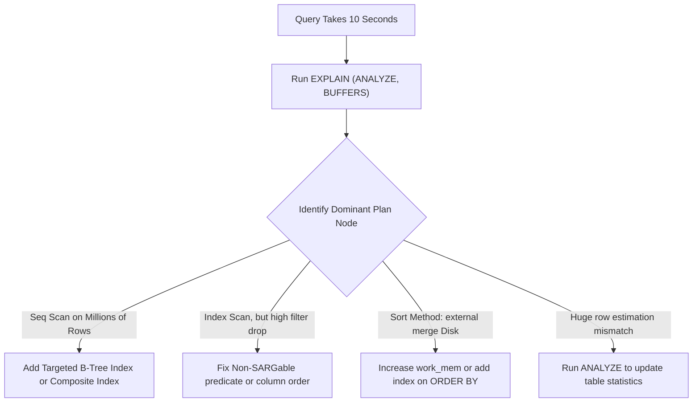

## Scenario

> **Your database query takes 10 seconds. How would you optimize it?**

A staple senior database question. The interviewer wants to verify that you follow a rigorous, data-driven diagnostic workflow rather than blindly adding random indexes.

## Fast Revision (10-Second Recall)

- **First Move:** Run **`EXPLAIN (ANALYZE, BUFFERS)`** in PostgreSQL or **`EXPLAIN ANALYZE`** in MySQL 8 to inspect the actual execution plan.
- **Primary Bottlenecks:**
- 1. **Seq Scan / Full Table Scan:** Query scans millions of rows from disk because no matching B-Tree index exists.
- 2. **Disk I/O Spill:** Sorting or hash joins spilling to disk (`Sort Method: external merge Disk`) due to low `work_mem`.
- 3. **Stale Statistics:** The query planner picked a bad plan because `ANALYZE` hasn't run since a bulk insert.
- 4. **Non-SARGable WHERE Clause:** Wrapping indexed columns in functions (e.g. `WHERE DATE(created_at) = ...`), disabling index lookups.

## The 30-Second Spoken Script

If asked this in an interview, deliver this structured response:

> *To optimize a 10-second database query, I never guess—I rely strictly on the query execution engine.*
>
> *First, I run EXPLAIN (ANALYZE, BUFFERS) in PostgreSQL or EXPLAIN ANALYZE in MySQL. This gives me actual execution times, row count estimates versus actual rows, join algorithms used, and buffer cache hits versus disk reads.*
>
> *Second, I look for the most expensive node in the plan tree:
If I see a Sequential Table Scan filtering through millions of rows, I add a targeted B-tree or composite index covering the filter conditions.
If the query already has an index but isn't using it, I check for non-SARGable expressions like function wrappers or implicit type conversions.
If the planner estimates 10 rows but actually processes 2 million, table statistics are stale, and running ANALYZE table_name fixes the plan immediately.
If there are disk spills during sorting or hashing, I increase work_mem for that session.*
>
> *Finally, I project only required columns instead of SELECT *, push predicates into joins, and verify the new plan runs in sub-100ms before pushing to production.*

## Diagnostic Lifecycle



## Root Causes & Solutions Matrix

| Suspected Layer | Symptoms & Evidence | Immediate Resolution |
| :--- | :--- | :--- |
| **Missing Index** | Execution plan shows `Seq Scan` with millions of rows removed by filter. | Create a B-Tree index on the filtered column(s). |
| **Memory Spill to Disk** | `Sort Method: external merge Disk: 48MB` observed in query plan. | Increase session `work_mem` or add an index that satisfies `ORDER BY`. |
| **Stale Table Statistics** | Planner estimated 5 rows, but actual rows returned was 850,000. | Execute `ANALYZE orders;` to refresh planner statistics. |
| **SELECT * Overhead** | Query fetches 40 unneeded JSON/text columns, blowing out network and buffer cache. | Project only required columns: `SELECT id, status, total`. |

## Practical Debugging Commands & Code

### PostgreSQL EXPLAIN ANALYZE Inspection & Index Fix
```sql
-- 1. Inspect Execution Plan with Buffer Cache Stats
EXPLAIN (ANALYZE, BUFFERS, VERBOSE)
SELECT customer_id, SUM(total_amount)
FROM orders
WHERE created_at >= '2026-01-01' 
  AND status = 'COMPLETED'
GROUP BY customer_id;

-- 2. If Seq Scan shows high execution time, create targeted Composite Index
-- Put equality filters first, range filters last!
CREATE INDEX CONCURRENTLY idx_orders_status_created_customer
ON orders (status, created_at) 
INCLUDE (customer_id, total_amount);

-- 3. Update optimizer statistics if row estimates were wildly off
ANALYZE orders;
```

## Prevention & Senior Best Practices

1. **Enforce Statement Timeouts:** Set `SET statement_timeout = '3000';` at the database role level to abort rogue queries before they exhaust pool connections.
2. **Automate Slow Query Logging:** Configure `pg_stat_statements` with `log_min_duration_statement = 1000` to catch 1s+ queries in staging.
3. **Create Indexes Concurrently:** Always use `CREATE INDEX CONCURRENTLY` in production PostgreSQL to prevent table read/write locks.
