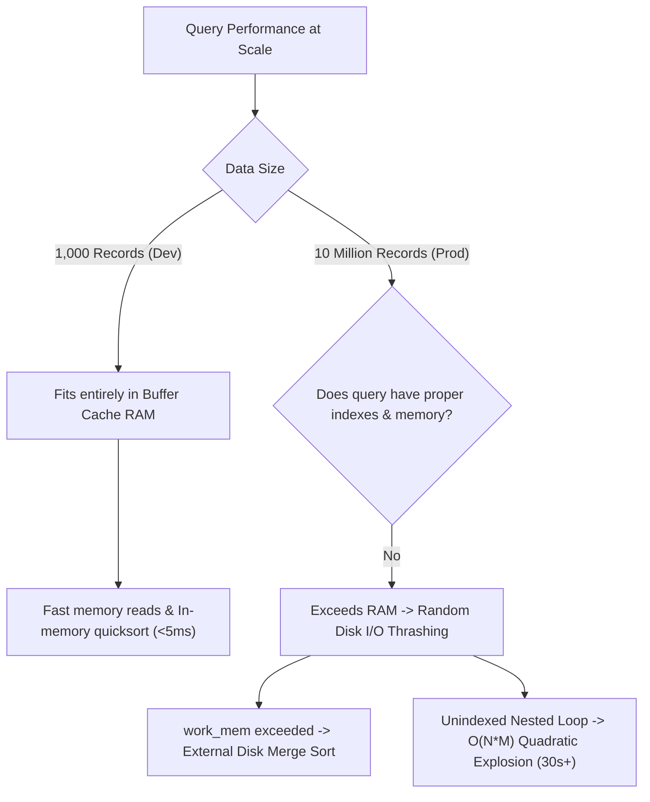

## Scenario

> **Your query runs fast with 1,000 records but slowly with 10 million records. Why?**

In development, a query runs in 5ms. In production with 10 million records, it takes 30 seconds. The interviewer evaluates your knowledge of asymptotic complexity, memory boundaries, and execution plan flips.

## Fast Revision (10-Second Recall)

- **First Move:** Understand that **In-Memory vs Disk-Spill** is the cliff edge where database performance collapses.
- **The 4 Core Reasons for the Scalability Cliff:**
- 1. **Full Dataset Fits in RAM in Dev:** 1,000 records fit in shared buffer memory; 10M records force cold random disk I/O.
- 2. **Execution Plan Algorithm Shift:** Planner switches from Nested Loop ($O(N)$) to Nested Loop on unindexed table ($O(N \times M)$ quadratic explosion).
- 3. **Memory Quota Exhaustion (`work_mem`):** Sorts/joins that ran in RAM in dev now spill to temporary disk files.
- 4. **Non-SARGable Query Masks Performance in Dev:** A sequential scan on 1,000 rows takes 1ms; on 10M rows it takes 20 seconds.

## The 30-Second Spoken Script

If asked this in an interview, deliver this structured response:

> *A query running fast with 1,000 records but collapsing with 10 million records indicates an asymptotic algorithmic cliff or a transition from memory caching to physical disk I/O.*
>
> *There are four primary reasons for this collapse:*
>
> *First, RAM versus Disk I/O. In local development or staging, a 1,000-row table fits entirely within the database buffer pool and operating system page cache. Even an unindexed sequential scan executes in memory in 2 milliseconds. At 10 million records, the dataset exceeds RAM capacity, forcing hundreds of thousands of high-latency disk reads.*
>
> *Second, the optimizer plan shifts. A join without an index might execute as a Nested Loop in development because looping 1,000 times takes negligible time. At 10 million records, an unindexed nested loop requires 10 million times 10 million evaluations—a quadratic O(N squared) disaster.*
>
> *Third, memory buffer exhaustion. Sorting 1,000 rows easily fits inside default work_mem (typically 4MB), executing in memory via quicksort. At 10 million records, the sort spills to disk as an external merge sort, thrashing I/O.*
>
> *To prevent this, we seed staging environments with production-scale synthetic datasets so developers catch algorithmic complexity issues before deploying to production.*

## Diagnostic Lifecycle



## Root Causes & Solutions Matrix

| Suspected Layer | Symptoms & Evidence | Immediate Resolution |
| :--- | :--- | :--- |
| **Memory vs Disk Cliff** | Dev has 100% buffer cache hits; prod suffers heavy `shared read` disk I/O. | Size database buffer pool to fit working set; index filter columns. |
| **Unindexed Nested Loop** | Query was $O(N)$ on small table, but degrades quadratically on large tables. | Add index on joined foreign key columns. |
| **External Disk Sort** | Sort runs in memory in dev, but spills 200MB to disk in production. | Create index on `ORDER BY` column or increase `work_mem`. |
| **Offset Pagination Collapse** | `OFFSET 10` is instant in dev; `OFFSET 5000000` scans 5M rows in prod. | Switch from offset pagination to keyset (cursor-based) pagination. |

## Practical Debugging Commands & Code

### Demonstrating Offset Pagination Degradation vs Keyset Cursor
```sql
-- ❌ FAST IN DEV, DEADLY AT 10M ROWS: Offset Pagination
-- At OFFSET 5,000,000, PostgreSQL must read 5,000,020 rows and discard 5,000,000!
-- Runtime: 12.8 seconds!
SELECT id, title, created_at 
FROM posts 
ORDER BY id ASC 
LIMIT 20 OFFSET 5000000;

-- ✅ CONSTANT TIME O(1) AT 10M ROWS: Keyset (Cursor-Based) Pagination
-- Uses B-Tree index pointer directly.
-- Runtime: 0.4 milliseconds regardless of whether table has 1,000 or 100,000,000 rows!
SELECT id, title, created_at 
FROM posts 
WHERE id > 5000000 
ORDER BY id ASC 
LIMIT 20;
```

## Prevention & Senior Best Practices

1. **Seed Staging with Production Volume:** Never test performance against empty or 100-row databases; generate 5M realistic seed records with scripts.
2. **Ban High-Offset Pagination:** Replace `OFFSET N` with cursor-based pagination for large datasets.
3. **Run Load Tests in CI:** Use k6 or Locust against production-scale staging databases before releasing new features.
