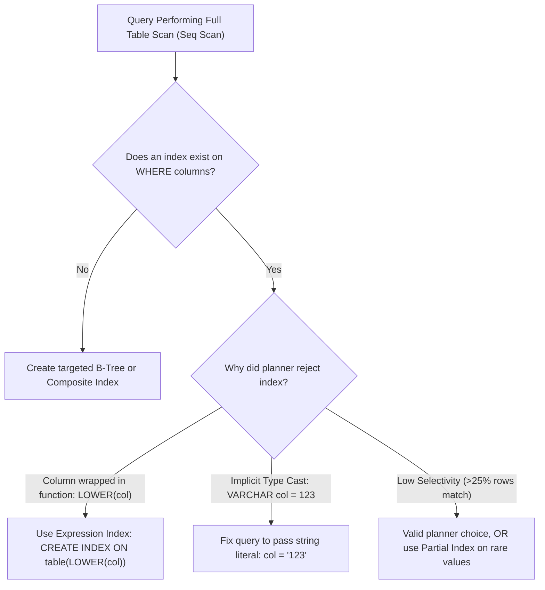

## Scenario

> **What would you do if a query performs a full table scan?**

A full table scan (Seq Scan) on 10,000 rows takes 2ms; on 50 million rows it takes 45 seconds and evicts the entire buffer cache from RAM. Interviewers test your diagnosis and remediation strategies.

## Fast Revision (10-Second Recall)

- **First Move:** Verify whether an index exists on the filtered columns, and check if the query is **SARGable** (Search Argument Able).
- **Top Reasons Queries Default to Full Table Scan:**
- 1. **Missing Index:** No index on the WHERE condition columns.
- 2. **Function Wrapping:** `WHERE UPPER(email) = ...` or `WHERE DATE(created_at) = ...` invalidates standard B-Tree indexes.
- 3. **Low Selectivity:** If filter returns > 20-30% of total rows, the planner intentionally chooses a Seq Scan because random I/O from index lookups is slower than sequential disk reads.
- 4. **Implicit Type Conversion:** Querying VARCHAR column with an integer (`WHERE phone = 1234567890`), forcing a cast on every row.

## The 30-Second Spoken Script

If asked this in an interview, deliver this structured response:

> *When a query performs an unexpected full table scan on a large table, I determine why the query planner rejected or lacked an index path.*
>
> *First, I check for missing indexes. If there is no index covering the WHERE filter, I create a B-Tree index.*
>
> *Second, if an index exists but the planner ignores it, I check for non-SARGable clauses. Wrapping columns in functions—such as WHERE LOWER(email) = 'test@example.com' or WHERE created_at + interval '1 day' > NOW()—prevents the engine from using standard B-Tree index structures. I rewrite the query to keep the column bare, or create a Functional (Expression) Index like CREATE INDEX ON users (LOWER(email)).*
>
> *Third, I check data type consistency. If a column is VARCHAR and the application query passes a raw number without quotes, the engine implicitly applies CAST(phone AS bigint) to every single row in the table, invalidating the index.*
>
> *Fourth, I check index selectivity. If a query requests 'WHERE status = ACTIVE' and 90% of rows are ACTIVE, the planner intentionally chooses a sequential scan because sequential I/O is faster than jumping around random index pointers. In that case, I create a Partial Index on the rare status instead.*

## Diagnostic Lifecycle



## Root Causes & Solutions Matrix

| Suspected Layer | Symptoms & Evidence | Immediate Resolution |
| :--- | :--- | :--- |
| **Function Wrapping Column** | `WHERE DATE(created_at) = '2026-01-01'` ignores index on `created_at`. | Rewrite as range: `WHERE created_at >= '2026-01-01' AND created_at < '2026-01-02'`. |
| **Leading Wildcard LIKE** | `WHERE username LIKE '%john%'` forces full table scan. | Use `pg_trgm` GIN trigram index or Elasticsearch for full-text search. |
| **Type Mismatch Implicit Cast** | `WHERE order_code = 12345` on VARCHAR column scans full table. | Pass string literal: `WHERE order_code = '12345'`. |
| **Low Selectivity / Skew** | Table has 10M rows; 9.9M are 'COMPLETED', 10k are 'PENDING'. | Create Partial Index: `CREATE INDEX ... WHERE status = 'PENDING'`. |

## Practical Debugging Commands & Code

### Rewriting Non-SARGable Queries & Creating Expression Indexes
```sql
-- ❌ NON-SARGABLE: Wraps column in DATE() function -> Full Table Scan
SELECT * FROM payments 
WHERE DATE(processed_at) = '2026-03-15';

-- ✅ SARGABLE REWRITE: Keeps column bare -> Uses standard B-Tree Index Scan!
SELECT * FROM payments 
WHERE processed_at >= '2026-03-15 00:00:00' 
  AND processed_at <  '2026-03-16 00:00:00';

-- ❌ NON-SARGABLE: Case-insensitive search on unindexed expression
SELECT id FROM accounts WHERE LOWER(email) = 'alice@example.com';

-- ✅ FIX: Expression (Functional) Index
CREATE INDEX idx_accounts_lower_email ON accounts (LOWER(email));

-- ✅ FIX: Partial Index for highly skewed status tables
-- Only indexes 10,000 pending rows; 9.9 million completed rows take 0 bytes of index space!
CREATE INDEX idx_orders_unprocessed 
ON orders (created_at) 
WHERE status = 'PENDING';
```

## Prevention & Senior Best Practices

1. **Never Apply Functions to Columns in WHERE:** Always apply math or transformations to the literal parameter value, not the table column.
2. **Use Partial Indexes for State Flags:** Never index boolean or low-cardinality status columns across the whole table; use `WHERE status = 'TARGET'`.
3. **Strict ORM Type Mappings:** Ensure ORM entities map string IDs to string columns to avoid implicit cast conversions.
