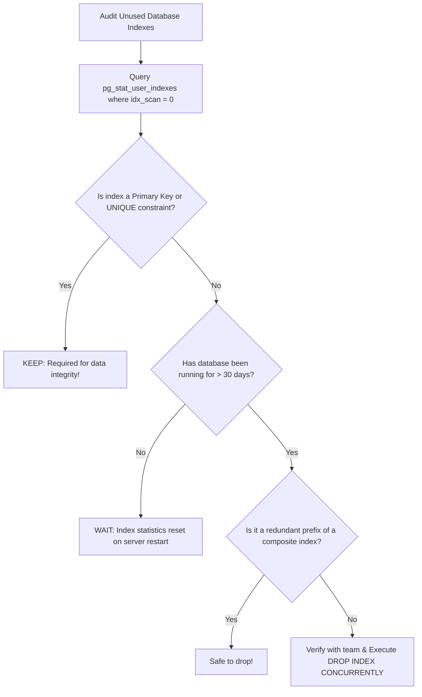

## Scenario

> **How would you identify unused indexes?**

Every index added to a table speeds up reads but penalizes every single INSERT, UPDATE, and DELETE. Unused indexes consume gigabytes of RAM buffer cache and disk space. Interviewers test index lifecycle management.

## Fast Revision (10-Second Recall)

- **First Move:** Query **`pg_stat_user_indexes`** where `idx_scan = 0` (or MySQL `sys.schema_unused_indexes`).
- **Why Unused Indexes Are Dangerous:**
- 1. **Write Overhead:** Every row inserted must update 8 separate B-Trees instead of 1.
- 2. **Buffer Pool Pollution:** Unused index pages displace active query data from RAM.
- 3. **Storage & Backup Waste:** A 20GB unused index increases backup times and disk costs.
- **Crucial Caveat:** **NEVER drop primary key or unique constraint indexes** even if `idx_scan = 0` (they enforce integrity!).

## The 30-Second Spoken Script

If asked this in an interview, deliver this structured response:

> *To identify and remove unused indexes, I audit index usage statistics over a statistically significant period of time—typically 30 to 60 days to account for monthly accounting reports.*
>
> *In PostgreSQL, I query pg_stat_user_indexes and filter for indexes where idx_scan is zero, excluding primary keys and unique constraints which are required for relational integrity.*
>
> *I also identify redundant duplicate indexes. For example, if a table has an index on (user_id, status) and another index on (user_id), the standalone user_id index is redundant because the composite index already covers queries filtering by user_id alone.*
>
> *Before dropping an unused index in production:
First, I verify with product and analytics teams that the index isn't used for an annual financial report.
Second, I verify that the index is not enforcing an essential foreign key constraint.
Third, I drop the index using DROP INDEX CONCURRENTLY. This ensures the operation does not acquire an exclusive table lock that would block live user reads and writes.*
>
> *Dropping dead indexes immediately restores write throughput and frees up valuable RAM in the buffer cache.*

## Diagnostic Lifecycle



## Root Causes & Solutions Matrix

| Suspected Layer | Symptoms & Evidence | Immediate Resolution |
| :--- | :--- | :--- |
| **Zero Scan Index** | A 15GB index on `orders` has `idx_scan = 0` after 60 days of uptime. | Drop index safely using `DROP INDEX CONCURRENTLY`. |
| **Redundant Prefix Index** | Table has both `idx_a_b (a, b)` and `idx_a (a)`. | Drop `idx_a`; the composite index satisfies all queries for `(a)`. |
| **Locking Production Table** | Standard `DROP INDEX` takes AccessExclusiveLock, queuing live queries. | Always execute `DROP INDEX CONCURRENTLY idx_name`. |
| **Stats Reset Premature Drop** | Database was rebooted yesterday; all `idx_scan` numbers read 0. | Check `pg_stat_database.stats_reset` before evaluating scan counts. |

## Practical Debugging Commands & Code

### Detecting Unused and Duplicate Indexes in PostgreSQL
```sql
-- 1. Identify Unused Indexes (Excluding Primary Keys & Unique Constraints)
SELECT
  s.schemaname,
  s.relname AS table_name,
  s.indexrelname AS index_name,
  s.idx_scan AS scan_count,
  pg_size_pretty(pg_relation_size(s.indexrelid)) AS index_size
FROM pg_stat_user_indexes s
JOIN pg_index i ON s.indexrelid = i.indexrelid
WHERE s.idx_scan = 0
  AND NOT i.indisunique      -- Do NOT drop unique constraints!
  AND NOT i.indisprimary     -- Do NOT drop primary keys!
ORDER BY pg_relation_size(s.indexrelid) DESC;

-- 2. Check when database statistics were last reset
SELECT stats_reset FROM pg_stat_database WHERE datname = current_database();

-- 3. Safely drop unused index in production (Zero write downtime!)
DROP INDEX CONCURRENTLY IF EXISTS idx_orders_old_status;
```

## Prevention & Senior Best Practices

1. **Always Check `stats_reset` First:** Never drop indexes on a database that rebooted recently; verify statistics represent weeks of traffic.
2. **Avoid Creating Indexes for Single Ad-Hoc Queries:** Use temporary indexes during data migrations and drop them immediately afterward.
3. **Audit Duplicate Foreign Key Indexes:** When adding composite indexes, review existing single-column indexes on the same leading column.
