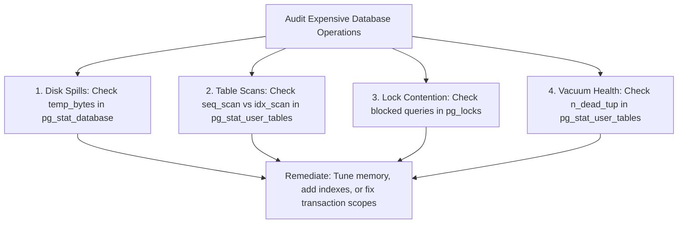

## Scenario

> **How would you identify expensive database operations?**

When the database as a whole is struggling, you need to diagnose which operations (disk writes, table scans, lock waits, vacuuming) are consuming system capacity.

## Fast Revision (10-Second Recall)

- **First Move:** Inspect database engine statistics views: **`pg_stat_database`** and **`pg_stat_user_tables`**.
- **The 4 Categories of Expensive Operations:**
- 1. **I/O Heavy Operations:** Queries causing massive disk reads (`heap_blks_read`).
- 2. **Disk Temp File Spills:** Queries generating gigabytes of temporary sorting files (`temp_bytes`).
- 3. **Lock Contention:** Transactions waiting on row/table exclusive locks (`pg_locks`).
- 4. **Write Amplification / Table Bloat:** Heavy updates causing dead tuple accumulation and high WAL volume.

## The 30-Second Spoken Script

If asked this in an interview, deliver this structured response:

> *To identify expensive operations across the entire database system, I look beyond individual query execution times and examine cumulative resource consumption: I/O, disk space, locking, and CPU.*
>
> *First, I query pg_stat_database to measure aggregate health: looking at the buffer cache hit ratio, deadlocks count, and temp_bytes. If temp_bytes is high, queries are generating massive temporary files on disk due to undersized work_mem.*
>
> *Second, I inspect pg_stat_user_tables to find tables undergoing the heaviest sequential scans (seq_scan vs idx_scan) and those suffering from dead tuple bloat (n_dead_tup) caused by un-vacuumed high-volume updates.*
>
> *Third, to identify lock contention, I query pg_locks joined with pg_stat_activity. This highlights transactions holding ExclusiveLocks that block dozens of waiting connections.*
>
> *Fourth, on AWS RDS or GCP Cloud SQL, I correlate these engine stats with OS-level metrics like Write IOPS, Read Latency, and Freeable Memory to identify whether the bottleneck is storage throughput, CPU compute, or connection pooling.*

## Diagnostic Lifecycle



## Root Causes & Solutions Matrix

| Suspected Layer | Symptoms & Evidence | Immediate Resolution |
| :--- | :--- | :--- |
| **Disk Temporary Files** | High disk writes; `temp_bytes` in gigabytes on `pg_stat_database`. | Identify queries with `log_temp_files = 0`; increase `work_mem`. |
| **Dead Tuple Accumulation** | Table size is 50GB, but active data is only 5GB; slow scans. | Tune autovacuum settings: lower `autovacuum_vacuum_scale_factor`. |
| **Lock Waiting Bottleneck** | Hundreds of connections waiting on row locks (`waiting = true`). | Shorten transaction scopes; commit immediately after writes. |
| **High WAL Write Volume** | Storage IOPS maxed out writing transaction logs. | Batch bulk inserts into multi-row batches; tune checkpoint intervals. |

## Practical Debugging Commands & Code

### Finding Tables with Highest Sequential Scans & Lock Contention
```sql
-- 1. Find Tables with High Sequential Scans vs Index Scans (Postgres)
SELECT 
  schemaname,
  relname AS table_name,
  seq_scan,
  seq_tup_read,
  idx_scan,
  idx_tup_fetch,
  round((100.0 * idx_scan / nullif(seq_scan + idx_scan, 0))::numeric, 2) AS percent_index_use
FROM pg_stat_user_tables
WHERE (seq_scan + idx_scan) > 100
ORDER BY seq_scan DESC
LIMIT 10;

-- 2. Detect Blocked Queries and Lock Contention
SELECT 
  blocked_locks.pid AS blocked_pid,
  blocked_activity.usename AS blocked_user,
  blocking_locks.pid AS blocking_pid,
  blocking_activity.usename AS blocking_user,
  blocked_activity.query AS blocked_statement,
  blocking_activity.query AS blocking_statement
FROM pg_catalog.pg_locks blocked_locks
JOIN pg_catalog.pg_stat_activity blocked_activity ON blocked_activity.pid = blocked_locks.pid
JOIN pg_catalog.pg_locks blocking_locks 
  ON blocking_locks.locktype = blocked_locks.locktype
  AND blocking_locks.database IS NOT DISTINCT FROM blocked_locks.database
  AND blocking_locks.relation IS NOT DISTINCT FROM blocked_locks.relation
  AND blocking_locks.page IS NOT DISTINCT FROM blocked_locks.page
  AND blocking_locks.tuple IS NOT DISTINCT FROM blocked_locks.tuple
  AND blocking_locks.virtualxid IS NOT DISTINCT FROM blocked_locks.virtualxid
  AND blocking_locks.transactionid IS NOT DISTINCT FROM blocked_locks.transactionid
  AND blocking_locks.classid IS NOT DISTINCT FROM blocked_locks.classid
  AND blocking_locks.objid IS NOT DISTINCT FROM blocked_locks.objid
  AND blocking_locks.objsubid IS NOT DISTINCT FROM blocked_locks.objsubid
  AND blocking_locks.pid != blocked_locks.pid
JOIN pg_catalog.pg_stat_activity blocking_activity ON blocking_activity.pid = blocking_locks.pid
WHERE NOT blocked_locks.granted;
```

## Prevention & Senior Best Practices

1. **Log Temp Files:** Set `log_temp_files = 10240` (logs any temp file > 10MB) to immediately capture memory-heavy queries.
2. **Tune Autovacuum for High Churn:** Prevent dead tuple bloat by setting aggressive autovacuum thresholds on write-heavy tables.
3. **Keep Transactions Minimal:** Never call external HTTP APIs or perform heavy processing inside database transactions.
