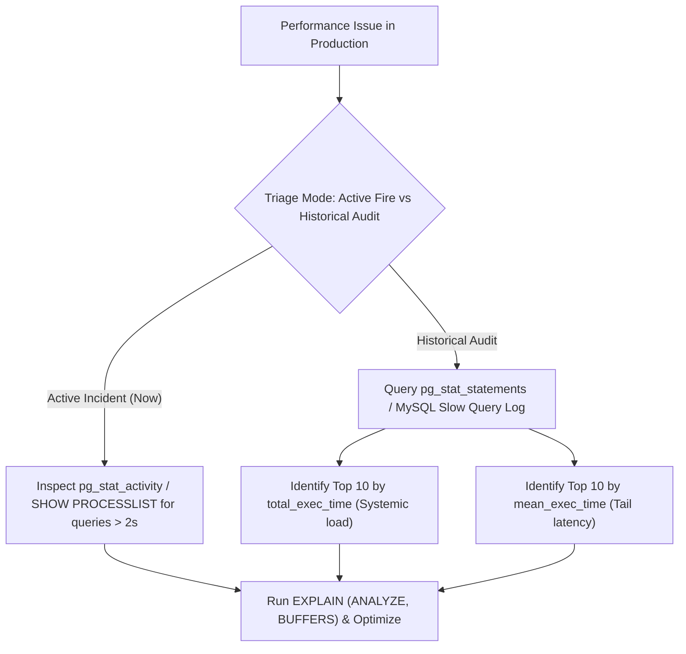

## Scenario

> **How would you identify slow queries in production?**

Users complain the app is slow, but developers don't know which of the 500 API queries is the bottleneck. The interviewer tests database observability mastery.

## Fast Revision (10-Second Recall)

- **First Move:** Query **`pg_stat_statements`** (PostgreSQL) or inspect the **Slow Query Log / Performance Schema** (MySQL).
- **The 3 Detection Levels:**
- 1. **Database Runtime Telemetry:** `pg_stat_statements` records total execution time, call count, and buffer usage normalized by query fingerprint.
- 2. **Active Slow Query Inspection:** Query `pg_stat_activity` (Postgres) or `SHOW PROCESSLIST` (MySQL) to see what is running right now.
- 3. **Application APM:** Datadog / OpenTelemetry traces showing p95 and p99 query latency by database span.

## The 30-Second Spoken Script

If asked this in an interview, deliver this structured response:

> *To identify slow queries in production, I use both real-time query monitors and historical aggregated telemetry.*
>
> *For historical aggregation in PostgreSQL, my primary tool is the pg_stat_statements extension. It groups queries by normalized fingerprint and tracks total execution time, mean latency, call count, and buffer cache hits. I query it ordered by total_exec_time or mean_exec_time to identify two types of problematic queries: rare queries that take 10 seconds per run, and fast 10ms queries called 500,000 times a minute in an N+1 loop.*
>
> *In MySQL, I enable the Slow Query Log with long_query_time set to 1 second and analyze it using pt-query-digest from Percona Toolkit.*
>
> *For active production incidents where the database CPU is currently spiked, I query pg_stat_activity filtered for active non-idle queries running longer than 2 seconds.*
>
> *Finally, I correlate database metrics with our APM distributed traces in Datadog or OpenTelemetry to map database bottlenecks directly back to the offending application route.*

## Diagnostic Lifecycle



## Root Causes & Solutions Matrix

| Suspected Layer | Symptoms & Evidence | Immediate Resolution |
| :--- | :--- | :--- |
| **Rare Slow Outliers** | Admin report runs once an hour but takes 45 seconds, blocking locks. | Sort `pg_stat_statements` by `mean_exec_time DESC`; add covering indexes. |
| **High-Frequency N+1 Load** | Simple 3ms query called 100,000 times per minute, driving CPU to 90%. | Sort `pg_stat_statements` by `total_exec_time DESC`; batch with `DataLoader`. |
| **Currently Stalled Query** | A rogue migration or unindexed lock is currently blocking all workers. | Find PID via `pg_stat_activity` and cancel with `pg_cancel_backend(pid)`. |
| **Unindexed Foreign Keys** | Cascading deletes take 30 seconds due to table-wide scans on child tables. | Index all foreign key reference columns. |

## Practical Debugging Commands & Code

### Top Queries by Total Time in pg_stat_statements & Active Queries
```sql
-- 1. Top 5 Most Expensive Queries by Cumulative Execution Time (Postgres)
SELECT 
  round(total_exec_time::numeric, 2) AS total_time_ms,
  calls,
  round(mean_exec_time::numeric, 2) AS mean_time_ms,
  round((100 * total_exec_time / sum(total_exec_time) OVER ())::numeric, 2) AS pct_overall,
  substring(query, 1, 100) AS short_query
FROM pg_stat_statements
ORDER BY total_exec_time DESC
LIMIT 5;

-- 2. Inspect Currently Running Slow Queries (> 2 seconds)
SELECT 
  pid,
  now() - query_start AS duration,
  state,
  query
FROM pg_stat_activity
WHERE state != 'idle'
  AND (now() - query_start) > interval '2 seconds'
ORDER BY duration DESC;

-- 3. Safely terminate a stuck query if needed
-- SELECT pg_cancel_backend(pid);   -- Graceful cancellation
-- SELECT pg_terminate_backend(pid); -- Immediate termination
```

## Prevention & Senior Best Practices

1. **Enable `pg_stat_statements` Everywhere:** Ensure it is loaded via `shared_preload_libraries` in `postgresql.conf` on all production clusters.
2. **Alert on Latency Percentiles:** Set alerts on database p95 > 250ms and p99 > 1000ms rather than overall average query time.
3. **Log Slow Queries Automatically:** Configure `log_min_duration_statement = 1000` so queries taking over 1 second are dumped to CloudWatch/Datadog logs.
