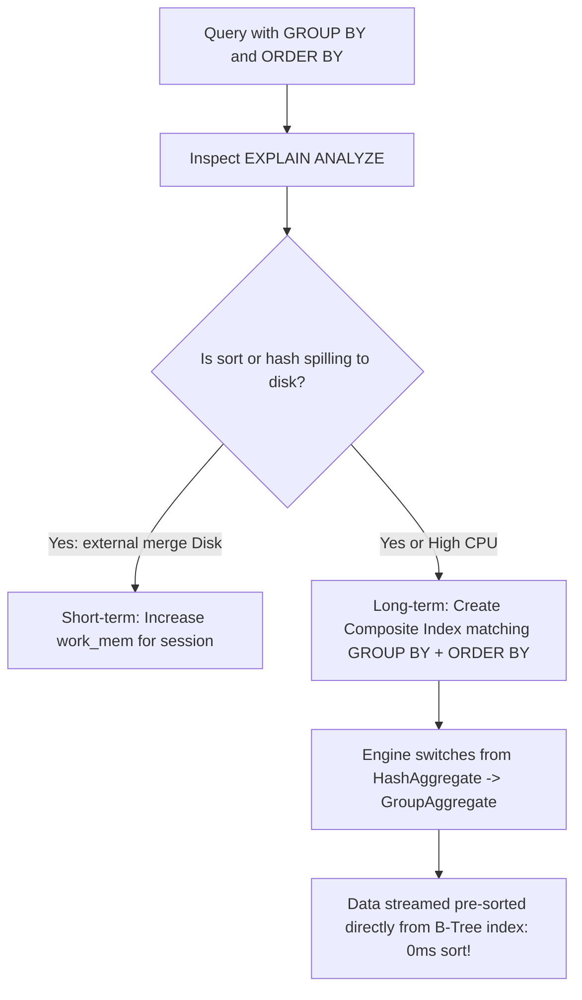

## Scenario

> **How would you optimize a query with GROUP BY and ORDER BY?**

Combining GROUP BY with ORDER BY forces the engine to aggregate and then sort. If memory runs out, it spills to temporary disk files, turning a 50ms query into a 15-second disk thrashing nightmare.

## Fast Revision (10-Second Recall)

- **First Move:** Check if sorting is spilling to disk: look for `Sort Method: external merge Disk` or `HashAggregate ... Disk` in `EXPLAIN ANALYZE`.
- **The 2 Core Optimizations:**
- 1. **Composite Index Covering Both Operations:** Create an index matching `(group_by_cols, order_by_cols)` so data is read pre-sorted from index storage.
- 2. **Increase `work_mem`:** Allocate sufficient RAM (e.g. `SET work_mem = '64MB';`) so sorting and hashing occur entirely in memory (`Sort Method: quicksort Memory`).
- **Match Direction:** If ordering by `(dept_id ASC, salary DESC)`, the composite index must be created with explicit ASC/DESC matching.

## The 30-Second Spoken Script

If asked this in an interview, deliver this structured response:

> *To optimize queries combining GROUP BY and ORDER BY, my goal is eliminating disk spills and leveraging pre-sorted B-tree index structures.*
>
> *First, I run EXPLAIN (ANALYZE, BUFFERS) to see how the engine processes the aggregation and sort.
If I see 'HashAggregate' or 'Sort Method: external merge Disk', the database ran out of memory (work_mem) and spilled intermediate state onto physical disk, degrading performance by orders of magnitude. For complex batch queries, I temporarily increase work_mem for that session so the sort completes in memory.*
>
> *Second, the best optimization is avoiding the sort step entirely. B-trees store keys in sorted order. If I create a composite index that matches the GROUP BY and ORDER BY columns in exact sequence, the engine can use a 'GroupAggregate' node. It streams rows that are already pre-sorted directly from the index, performing the grouping and sorting in a single linear pass with zero memory overhead.*
>
> *Third, if the query includes WHERE filters alongside GROUP BY, I place the equality filter columns first in the composite index, followed by the grouping columns.*

## Diagnostic Lifecycle



## Root Causes & Solutions Matrix

| Suspected Layer | Symptoms & Evidence | Immediate Resolution |
| :--- | :--- | :--- |
| **External Disk Merge Sort** | `Sort Method: external merge Disk: 64120kB` in EXPLAIN plan. | Increase session `work_mem` or create covering pre-sorted index. |
| **HashAggregate Memory Spill** | Postgres falls back to multi-batch disk hash aggregation. | Tune `work_mem` or rewrite to utilize B-tree index ordering. |
| **Mismatched Sort Direction** | Index is `(a ASC, b ASC)`, but query asks for `ORDER BY a ASC, b DESC`. | Define index with matching direction: `CREATE INDEX ... (a ASC, b DESC)`. |
| **Grouping by Unnecessary Columns** | `GROUP BY u.id, u.name, u.email, u.phone...` slows down hashing. | Group strictly by Primary Key `u.id` (Postgres auto-recognizes functional dependency). |

## Practical Debugging Commands & Code

### Eliminating Disk Sorts with Composite Indexes & work_mem
```sql
-- 1. Increase work_mem for current transaction/session (Postgres)
SET work_mem = '64MB';

-- 2. Problem Query: Groups sales by category and sorts by date
EXPLAIN (ANALYZE, BUFFERS)
SELECT 
  category_id, 
  DATE_TRUNC('month', sale_date) AS sale_month,
  SUM(amount) AS total_sales
FROM sales
WHERE region = 'US-WEST'
GROUP BY category_id, DATE_TRUNC('month', sale_date)
ORDER BY category_id, sale_month DESC;

-- 3. Composite Index Solution:
-- Filter column first (region) -> Grouping columns next
CREATE INDEX idx_sales_perf 
ON sales (region, category_id, sale_date DESC) 
INCLUDE (amount);

-- With this index, PostgreSQL reads rows directly in pre-sorted order!
-- Result: "Sort" step disappears entirely from the plan tree!
```

## Prevention & Senior Best Practices

1. **Group by Primary Key Only:** In PostgreSQL 9.1+, once you group by a table's primary key, you do not need to group by other columns from that table.
2. **Align Index Sort Direction:** Ensure index `ASC`/`DESC` definitions mirror the query's `ORDER BY` clause when combining multiple sort columns.
3. **Monitor Temporary File Creation:** Query `pg_stat_database.temp_files` and `temp_bytes` to detect system-wide disk spill events.
