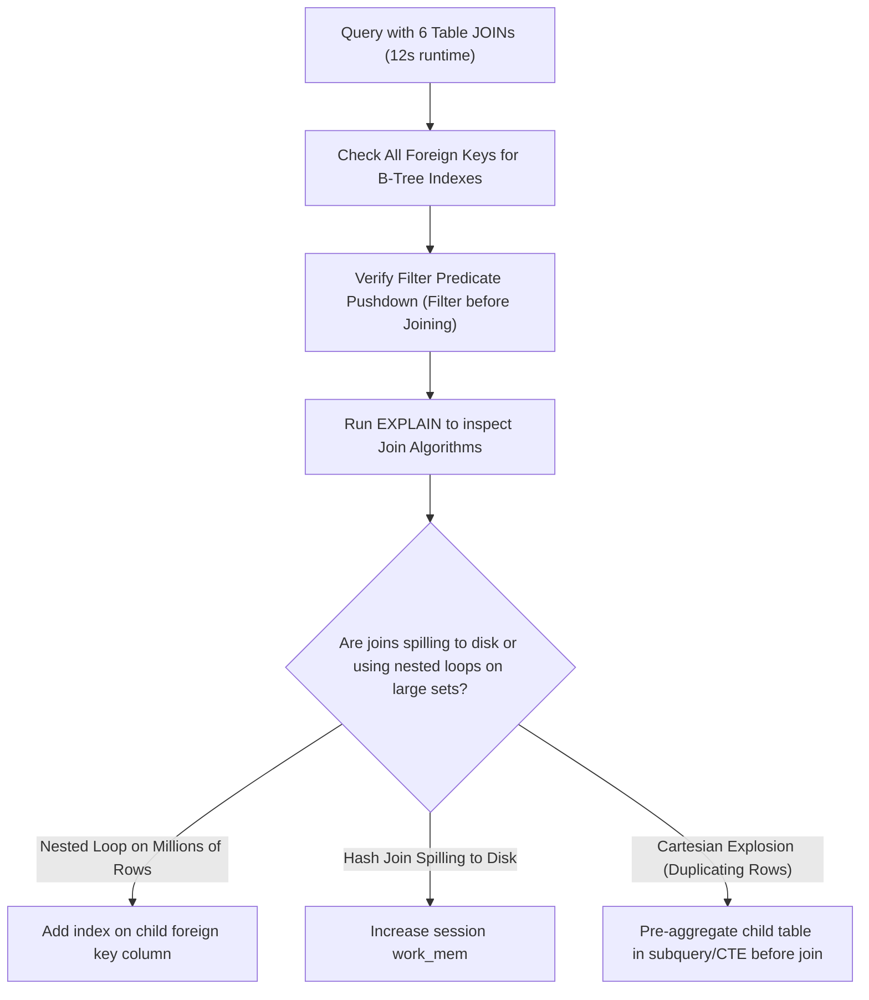

## Scenario

> **How would you optimize a query containing multiple JOINs?**

Queries joining 5 to 10 tables can result in exponential execution times if join orders are miscalculated. The interviewer tests relational algebra and join algorithm selection.

## Fast Revision (10-Second Recall)

- **First Move:** Verify that **every foreign key column used in `ON` conditions has an index**.
- **The 3 Join Algorithms:**
- 1. **Nested Loop:** Fast when one table is tiny (under 100 rows) and the other has an index on join key.
- 2. **Hash Join:** Builds in-memory hash table of smaller table, then probes with larger table. Ideal for large unsorted sets.
- 3. **Merge Join:** Both tables pre-sorted by join key; iterates through both in linear $O(N + M)$ time.
- **Watch Out For:** Accidental Cartesian products (`CROSS JOIN`), joining on non-indexed columns, or joining before filtering.

## The 30-Second Spoken Script

If asked this in an interview, deliver this structured response:

> *To optimize a query containing multiple JOINs, my focus is reducing intermediate row sets as early in the pipeline as possible and ensuring optimal join algorithms.*
>
> *First, I verify that every single foreign key and join condition column is indexed. Without an index on order_items.order_id, joining orders with order_items forces repeated full table scans, resulting in catastrophic latency.*
>
> *Second, I check filter placement. I ensure selective WHERE filters are applied before or during joins rather than after an expansive cross product. Pushing predicates down reduces the working set from millions of rows to hundreds before joins execute.*
>
> *Third, I analyze the join algorithms in EXPLAIN:
If the optimizer chooses a Nested Loop on two multi-million row tables, it means join key indexes or statistics are missing, causing billions of comparisons.
If Hash Joins spill to disk, I increase work_mem so hash tables fit in RAM.*
>
> *Finally, for reporting queries with 8+ joins, the optimizer's join search limit (such as join_collapse_limit) can cause it to miss the optimal order. In those cases, I rewrite the query using Common Table Expressions (CTEs) or temporary tables to pre-aggregate child tables first.*

## Diagnostic Lifecycle



## Root Causes & Solutions Matrix

| Suspected Layer | Symptoms & Evidence | Immediate Resolution |
| :--- | :--- | :--- |
| **Unindexed Foreign Key** | Joining 10,000 orders to 1M items takes 8s via Nested Loop Seq Scan. | Create index on `order_items (order_id)`. |
| **Cartesian Explosion** | Joining a user to multiple orders AND multiple addresses duplicates rows exponentially. | Pre-aggregate items with `GROUP BY` in a CTE before joining. |
| **Hash Spill to Disk** | `Hash Join ... Batches: 16 Memory Usage: 32768kB Disk: 45000kB`. | Increase `work_mem` to allow single-batch in-memory hashing. |
| **Optimizer Join Exhaustion** | Query planning alone takes 2 seconds on a 12-table join. | Tune `from_collapse_limit` or use explicit CTEs to guide plan order. |

## Practical Debugging Commands & Code

### Pre-Aggregating Child Tables to Prevent Cartesian Duplication
```sql
-- ❌ BAD: Joining before aggregating causes row explosion and redundant math
SELECT 
  o.id,
  o.order_date,
  SUM(i.quantity * i.unit_price) AS order_total,
  COUNT(p.id) AS payment_count
FROM orders o
JOIN order_items i ON o.id = i.order_id     -- Multiplies rows by 5 items
JOIN payments p ON o.id = p.order_id        -- Multiplies rows by 3 payments -> 15 rows per order!
WHERE o.created_at >= '2026-01-01'
GROUP BY o.id, o.order_date;

-- ✅ SENIOR FIX: Pre-aggregate in isolated CTEs before joining!
WITH aggregated_items AS (
  SELECT order_id, SUM(quantity * unit_price) AS order_total
  FROM order_items
  GROUP BY order_id
),
aggregated_payments AS (
  SELECT order_id, COUNT(id) AS payment_count
  FROM payments
  GROUP BY order_id
)
SELECT 
  o.id,
  o.order_date,
  COALESCE(ai.order_total, 0) AS order_total,
  COALESCE(ap.payment_count, 0) AS payment_count
FROM orders o
LEFT JOIN aggregated_items ai ON o.id = ai.order_id
LEFT JOIN aggregated_payments ap ON o.id = ap.order_id
WHERE o.created_at >= '2026-01-01';
```

## Prevention & Senior Best Practices

1. **Always Index Both Sides of Joins:** Index the primary key on the parent and the foreign key on the child.
2. **Eliminate Unnecessary Joins:** Remove joined lookup tables if only foreign key IDs are selected.
3. **Pre-Aggregate One-to-Many Relationships:** Never join two independent one-to-many child tables directly; aggregate them first.
