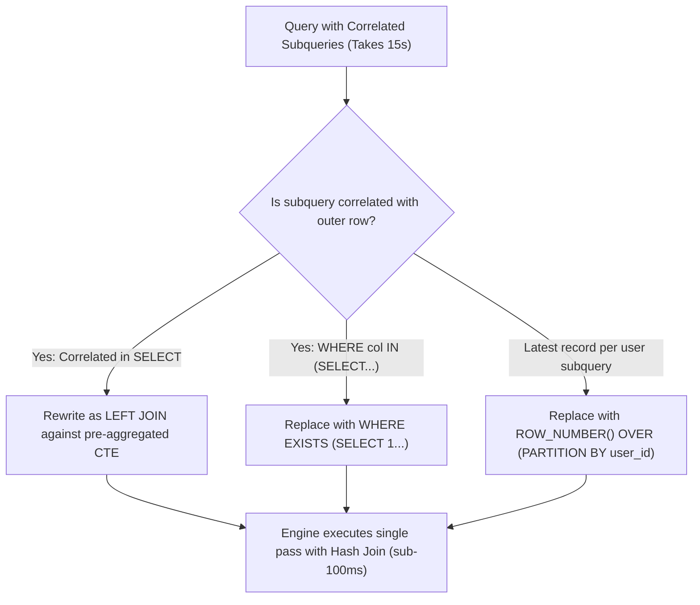

## Scenario

> **How would you optimize a query with multiple subqueries?**

Correlated subqueries execute once per outer row: on a 100,000-row table, that is 100,000 separate subquery executions. Interviewers test your ability to convert subqueries into efficient joins and set operations.

## Fast Revision (10-Second Recall)

- **First Move:** Identify whether subqueries are **Correlated** (depends on outer row $\rightarrow$ runs $N$ times) or **Uncorrelated** (runs once).
- **Top Optimization Tactics:**
- 1. **Convert Correlated Subquery to JOIN:** Replace subquery in SELECT with a `LEFT JOIN` or window function.
- 2. **Replace `IN (SELECT ...)` with `EXISTS`:** `EXISTS` short-circuits on first match; `IN` evaluates full list and handles NULLs inefficiently.
- 3. **PostgreSQL 12+ CTE Inlining:** Ensure CTEs are inlined (`WITH ... AS NOT MATERIALIZED`) so optimizer can push down predicates.
- 4. **Window Functions:** Use `ROW_NUMBER() OVER (PARTITION BY ...)` instead of self-referencing subqueries.

## The 30-Second Spoken Script

If asked this in an interview, deliver this structured response:

> *To optimize queries containing multiple subqueries, my primary objective is eliminating correlated subqueries that trigger the N+1 query problem inside the database engine.*
>
> *A correlated subquery in the SELECT or WHERE clause executes once for every single row evaluated by the outer query. If the outer query processes 50,000 rows, that subquery runs 50,000 times.*
>
> *I optimize them using three primary techniques:*
>
> *First, I rewrite correlated SELECT subqueries as LEFT JOINs against pre-aggregated subqueries or Common Table Expressions. This allows the query engine to scan the child table once using a single Hash Join rather than thousands of index lookups.*
>
> *Second, for membership filtering, I replace WHERE id IN (SELECT...) with WHERE EXISTS (SELECT 1...). IN creates an in-memory list and fails to short-circuit if NULL values are present, whereas EXISTS stops searching the moment the first matching index entry is found.*
>
> *Third, I replace self-referencing subqueries used for finding 'latest per group' with modern window functions like ROW_NUMBER() or DENSE_RANK(), executing the filter in a single sequential pass.*

## Diagnostic Lifecycle



## Root Causes & Solutions Matrix

| Suspected Layer | Symptoms & Evidence | Immediate Resolution |
| :--- | :--- | :--- |
| **Correlated Subquery in SELECT** | Subquery in SELECT clause takes 10s on 50,000 rows. | Rewrite as a single `LEFT JOIN` on a pre-aggregated subquery. |
| **Slow `IN (SELECT ...)`** | Optimizer builds large sub-plan; degrades when NULLs exist. | Replace with `WHERE EXISTS (SELECT 1 FROM ... WHERE foreign_id = outer.id)`. |
| **Subquery for Latest Item** | `WHERE created_at = (SELECT MAX(created_at) FROM ...)` | Use `ROW_NUMBER() OVER (PARTITION BY user_id ORDER BY created_at DESC)`. |
| **CTE Optimization Fence (Pre-PG 12)** | Postgres forces full materialization of CTE, ignoring outer filters. | Add `WITH ... AS NOT MATERIALIZED` (PostgreSQL 12+). |

## Practical Debugging Commands & Code

### Rewriting Correlated Subqueries to Window Functions & EXISTS
```sql
-- ❌ BAD: Correlated subquery in SELECT runs once per customer!
SELECT 
  c.id,
  c.name,
  (SELECT COUNT(*) FROM orders o WHERE o.customer_id = c.id) AS order_count,
  (SELECT MAX(total_amount) FROM orders o WHERE o.customer_id = c.id) AS max_order
FROM customers c;

-- ✅ FIXED: Single LEFT JOIN with pre-aggregated GROUP BY
SELECT 
  c.id,
  c.name,
  COALESCE(stats.order_count, 0) AS order_count,
  COALESCE(stats.max_order, 0) AS max_order
FROM customers c
LEFT JOIN (
  SELECT customer_id, COUNT(*) AS order_count, MAX(total_amount) AS max_order
  FROM orders
  GROUP BY customer_id
) stats ON c.id = stats.customer_id;

-- ❌ BAD: Slow IN subquery
SELECT * FROM products WHERE id IN (SELECT product_id FROM order_items);

-- ✅ FIXED: EXISTS short-circuits on first index match!
SELECT * FROM products p
WHERE EXISTS (
  SELECT 1 FROM order_items oi WHERE oi.product_id = p.id
);
```

## Prevention & Senior Best Practices

1. **Avoid Subqueries in SELECT Lists:** Always prefer joins or window functions over scalar subqueries in projection.
2. **Prefer `EXISTS` over `IN` for Subqueries:** `EXISTS` avoids NULL three-valued logic pitfalls and optimizes to semi-joins.
3. **Audit ORM Query Generation:** ORMs frequently emit correlated subqueries for nested relationships; use explicit eager loading or joins.
