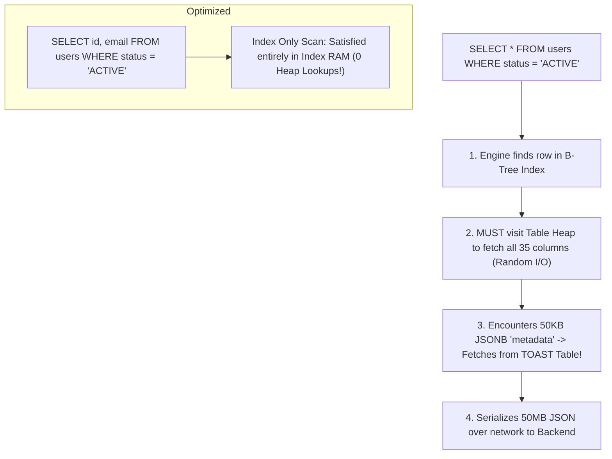

## Scenario

> **How would you optimize queries that return too many columns?**

Developers habitually write `SELECT * FROM orders` even when they only need `status`. The interviewer tests your understanding of database internal storage (heap fetches, TOAST storage, and network serialization).

## Fast Revision (10-Second Recall)

- **First Axiom:** **`SELECT *` is an anti-pattern in production APIs**.
- **The 4 Hidden Costs of Too Many Columns:**
- 1. **Disables Index Only Scans:** Forces database to visit the table heap for every row instead of answering from index RAM.
- 2. **TOAST Storage Thrashing:** Large TEXT/JSON columns are stored out-of-line in TOAST tables, requiring secondary disk lookups.
- 3. **Memory & Serialization Bloat:** Application server spends CPU cycles parsing 50MB of unneeded JSON.
- 4. **Network Bandwidth Saturation:** Slows down data transfer between database and application server.

## The 30-Second Spoken Script

If asked this in an interview, deliver this structured response:

> *Optimizing queries that return too many columns starts by eliminating SELECT * and projecting strictly the columns required by the client application.*
>
> *The performance cost of returning too many columns is substantial:
First, returning all columns completely disables Index Only Scans. If a query requests only id and status, and an index covers both, PostgreSQL never touches the table heap. Adding SELECT * forces the database to perform random I/O into heap disk pages for every matching row.*
>
> *Second, in PostgreSQL, wide columns like JSONB payloads, rich text descriptions, or binary blobs exceeding 2 kilobytes are stored out-of-line in separate TOAST (The Oversized-Attribute Storage Technique) tables. Querying SELECT * forces the engine to read the base table heap and then perform secondary lookups into the TOAST table to decompress the data, drastically increasing I/O.*
>
> *Third, transferring wide payloads inflates network bandwidth between database and backend, increases application server garbage collection, and blows out memory.*
>
> *The fix is simple: project only needed fields (SELECT id, total), and use covering indexes with the INCLUDE clause for high-frequency queries.*

## Diagnostic Lifecycle



## Root Causes & Solutions Matrix

| Suspected Layer | Symptoms & Evidence | Immediate Resolution |
| :--- | :--- | :--- |
| **TOAST Table Disk Spills** | `SELECT *` pulls in unneeded 50KB JSONB profile column, 10x slower. | Select only primitive columns: `SELECT id, name, email`. |
| **Heap Fetch Inefficiency** | Plan shows `Index Scan` with 50,000 heap fetches. | Project minimal columns and use `INCLUDE (col)` for `Index Only Scan`. |
| **App Server Memory Pressure** | Node.js/Java backend OOMs serializing 100,000 wide rows from ORM. | Use ORM projection (`select: ["id", "status"]`) or DTO projections. |
| **Network Saturation** | Database egress bandwidth maxes out network interface at 1 Gbps. | Filter columns at SQL query level; never filter in application memory. |

## Practical Debugging Commands & Code

### Covering Index with INCLUDE vs SELECT * Heap Fetching
```sql
-- ❌ SLOW: SELECT * forces heap fetches and TOAST table lookups
EXPLAIN (ANALYZE, BUFFERS)
SELECT * 
FROM customer_orders 
WHERE status = 'PAID' 
ORDER BY created_at DESC 
LIMIT 50;

-- Output: Index Scan ... Heap Fetches: 50 (Reads heavy description & JSON data)

-- ✅ FAST: Covering Index enables pure Index Only Scan!
CREATE INDEX idx_orders_covering 
ON customer_orders (status, created_at DESC) 
INCLUDE (id, total_amount, customer_id);

-- Project ONLY the columns in the covering index:
EXPLAIN (ANALYZE, BUFFERS)
SELECT id, total_amount, customer_id 
FROM customer_orders 
WHERE status = 'PAID' 
ORDER BY created_at DESC 
LIMIT 50;

-- Output: Index Only Scan ... Heap Fetches: 0! (Zero disk reads!)
```

## Prevention & Senior Best Practices

1. **Ban `SELECT *` in Code Reviews:** Enforce ESLint/SonarQube rules flagging raw `SELECT *` statements.
2. **Configure ORM Projections:** When using Prisma, TypeORM, or Hibernate, always specify explicit `select` fields rather than loading full entities.
3. **Store Large Blobs in Object Storage:** Store images, PDFs, and massive JSON in AWS S3 or Cloud Storage, keeping only a lightweight URL string in the database.
