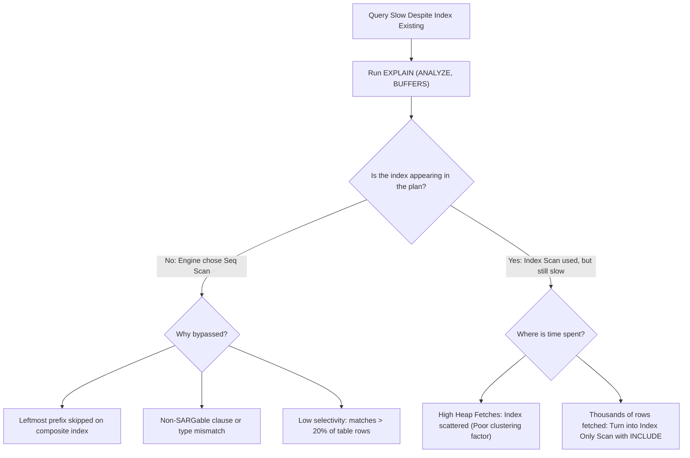

## Scenario

> **A query is slow even though an index exists. What would you check?**

A developer says: "I created an index on that column, but the query is still taking 8 seconds!" The interviewer wants you to explain the technical mechanics of when and why an index fails to deliver performance.

## Fast Revision (10-Second Recall)

- **First Move:** Check if the query is actually using the index via `EXPLAIN`, and if so, check the **Clustering Factor / Heap Fetches**.
- **Top 5 Reasons an Index is Slow or Bypassed:**
- 1. **Skipping Leftmost Prefix:** Index is `(department_id, salary)`, but query filters only `WHERE salary > 50000`.
- 2. **Poor Clustering Factor:** Rows matching the index are scattered randomly across 100,000 distinct disk blocks, causing 100,000 random disk seeks.
- 3. **High Table Selectivity:** The filter matches 40% of the table; sequential scan is faster than thousands of random lookups.
- 4. **Non-SARGable Transformations:** Column used in an expression or wildcard (`LIKE '%abc'`).
- 5. **Outdated Index Statistics:** Autovacuum hasn't updated page stats, leading planner to assume index is inefficient.

## The 30-Second Spoken Script

If asked this in an interview, deliver this structured response:

> *When a query is slow despite an index existing on the filtered column, I investigate four distinct failure modes:*
>
> *First, is the index actually being used? If the execution plan shows a Sequential Scan, the index was bypassed. The most common cause is violating the Leftmost Prefix Rule on composite indexes—for example, having an index on (org_id, status, created_at) but querying WHERE status = 'ACTIVE'. B-Trees cannot skip the leading column.*
>
> *Second, if the index is being used but latency is still high, I check the Clustering Factor. If the index points to rows scattered randomly across millions of physical disk blocks, every single index hit requires a separate random disk read. Running a CLUSTER command or rebuilding the table ordered by that index solves this.*
>
> *Third, I check if the query is fetching too many columns. An Index Scan must jump back and forth between index pages and heap pages. Adding unindexed SELECT columns to the index using the INCLUDE clause turns it into an Index Only Scan, eliminating heap lookups entirely.*
>
> *Finally, I check for NULL comparisons or data type mismatches where integer/varchar casting disables index access.*

## Diagnostic Lifecycle



## Root Causes & Solutions Matrix

| Suspected Layer | Symptoms & Evidence | Immediate Resolution |
| :--- | :--- | :--- |
| **Violating Leftmost Prefix** | Index on `(tenant_id, created_at)`; query filters only `WHERE created_at > ...`. | Create index starting with `created_at` or reorder composite columns. |
| **Scattered Physical Heap (Clustering)** | Index scan performs 80,000 `shared read` disk I/O operations for 80,000 rows. | Reorganize table physical layout with `CLUSTER orders USING idx_orders_date`. |
| **Excessive Heap Lookups** | Index filtered rows fast, but engine spent 6s reading non-indexed columns from heap. | Add missing columns to index via `INCLUDE (colA, colB)`. |
| **Corrupted or Bloated Index** | Index size is 10x larger than table due to dead tuples from high updates. | Run `REINDEX TABLE CONCURRENTLY table_name;`. |

## Practical Debugging Commands & Code

### Diagnosing Index Bloat and Leftmost Prefix Matching
```sql
-- 1. Demonstrate Leftmost Prefix Rule
-- Given Composite Index:
CREATE INDEX idx_users_org_status_date ON users (org_id, status, created_at);

-- ❌ DOES NOT USE INDEX (or uses inefficient skip-scan):
SELECT * FROM users WHERE status = 'ACTIVE' AND created_at >= '2026-01-01';

-- ✅ USES FULL COMPOSITE INDEX:
SELECT * FROM users WHERE org_id = 42 AND status = 'ACTIVE' AND created_at >= '2026-01-01';

-- 2. Check Index Bloat in PostgreSQL
SELECT
  current_database(), nspname AS schemaname, tblname, idxname,
  bs*(sub.relpages)::bigint AS real_size,
  bs*(sub.relpages-est_pages)::bigint AS extra_size
FROM (
  -- Index bloat estimation query
  SELECT ceil(reltuples*(datahdr+ma-CASE WHEN datahdr%ma=0 THEN ma ELSE datahdr%ma END)/(bs-20)) AS est_pages,
         tbl.reltuples, tbl.relpages, idx.relpages AS relpages, tbl.relname AS tblname, idx.relname AS idxname,
         fillfactor, current_setting('block_size')::numeric AS bs, 24 AS datahdr, 8 AS ma, nspname
  FROM pg_index i
  JOIN pg_class tbl ON tbl.oid = i.indrelid
  JOIN pg_class idx ON idx.oid = i.indexrelid
  JOIN pg_namespace n ON n.oid = tbl.relnamespace
  WHERE tbl.relname = 'orders'
) sub;

-- 3. Rebuild bloated index without blocking concurrent writes
REINDEX INDEX CONCURRENTLY idx_users_org_status_date;
```

## Prevention & Senior Best Practices

1. **Follow Leftmost Prefix Order:** Always order composite indexes by: Equality filters first $\rightarrow$ Range filters second $\rightarrow$ Projected columns in `INCLUDE`.
2. **Reindex High-Churn Tables Periodically:** Tables with frequent UPDATEs and DELETEs accumulate B-tree dead page bloat.
3. **Use Covering Indexes for Frequent Lookups:** Avoid visiting table heap storage for hot high-volume queries.
