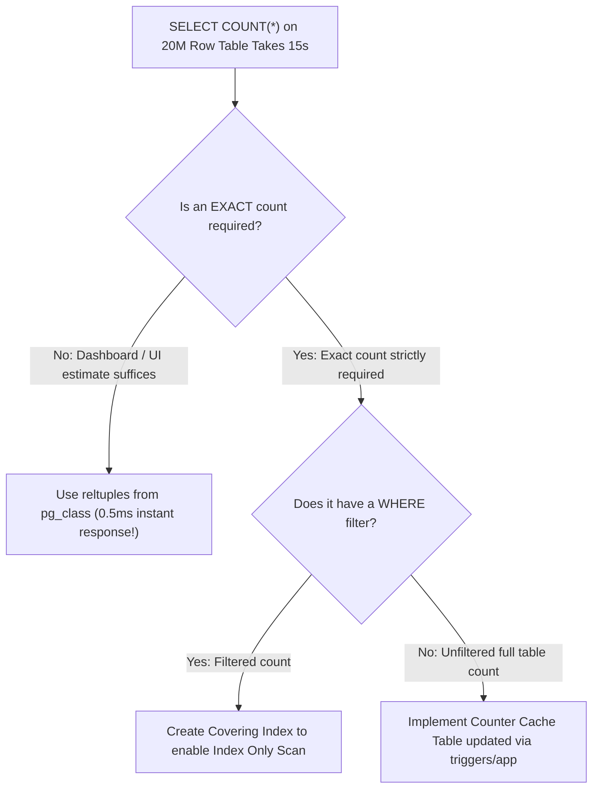

## Scenario

> **How would you troubleshoot slow COUNT queries?**

A developer runs `SELECT COUNT(*) FROM orders` on a 50-million-row PostgreSQL table and it takes 30 seconds. The interviewer tests your understanding of Multi-Version Concurrency Control (MVCC) and fast estimation strategies.

## Fast Revision (10-Second Recall)

- **First Axiom:** In MVCC databases like PostgreSQL, **`COUNT(*)` must scan every row** to check transaction visibility—there is no single magic counter in the table header!
- **The 4 Solutions to Slow COUNT Queries:**
- 1. **Approximate Count (Instant under 1ms):** Use `reltuples` from `pg_class` for admin dashboards where exact counts are unnecessary.
- 2. **Index Only Scan:** Add a small B-Tree index on a single narrow column (or `COUNT(1)`) so the engine scans a compact index rather than the wide table heap.
- 3. **Transactional Counter Table:** Maintain an explicit `counter_cache` table updated via triggers or application logic.
- 4. **Pagination Optimization:** Never run `COUNT(*)` just to show total pages on mobile; use infinite scroll or "Next >" without total count.

## The 30-Second Spoken Script

If asked this in an interview, deliver this structured response:

> *Slow COUNT(*) queries on large PostgreSQL tables are a direct consequence of Multi-Version Concurrency Control (MVCC). Because multiple transactions see different snapshots of the database simultaneously, PostgreSQL cannot maintain a single global row counter. It must inspect every row's visibility tags, resulting in a full table scan.*
>
> *To solve slow COUNT queries, I determine whether the business requirement truly demands an exact count or if an approximation is acceptable.*
>
> *First, for dashboard cards, pagination estimates, or monitoring screens, an exact count is rarely needed. I query the PostgreSQL system catalog table pg_class for reltuples, which returns an estimated row count in under 1 millisecond regardless of table size. Alternatively, using EXPLAIN to extract the planner's row estimate provides instant sub-millisecond feedback.*
>
> *Second, if an exact count is strictly required with a WHERE filter, I ensure the query can perform an Index Only Scan by indexing the filter columns alongside a narrow column.*
>
> *Third, for high-traffic tables requiring exact real-time counts, I implement a dedicated counter cache table updated incrementally via triggers or Redis, avoiding table-wide aggregations entirely.*

## Diagnostic Lifecycle



## Root Causes & Solutions Matrix

| Suspected Layer | Symptoms & Evidence | Immediate Resolution |
| :--- | :--- | :--- |
| **MVCC Visibility Scan** | `SELECT COUNT(*) FROM orders` takes 25s on 30M rows. | Use `pg_class.reltuples` for instant approximation. |
| **UI Pagination Total Count** | API takes 4s just to calculate total pages for page 1. | Switch to cursor pagination or "Next >" without total page count. |
| **Unindexed Filtered Count** | `COUNT(*) WHERE status = 'ACTIVE'` does a Seq Scan. | Create index on `(status)` to turn into an `Index Only Scan`. |
| **High Write Conflict on Counter** | Single global counter row locks all concurrent inserts. | Batch counter updates asynchronously or shard the counter row across 10 slots. |

## Practical Debugging Commands & Code

### Instant Approximate Counting vs Exact Index Only Scan
```sql
-- 1. Instant Row Count Estimation (< 1ms on any size table)
SELECT reltuples::bigint AS estimated_count
FROM pg_class
WHERE relname = 'orders';

-- 2. Fast Exact Filtered Count via Index Only Scan
-- Ensure table has been VACUUMed so visibility map allows Index Only Scan!
CREATE INDEX CONCURRENTLY idx_orders_status ON orders (status);

EXPLAIN (ANALYZE, BUFFERS)
SELECT COUNT(*) FROM orders WHERE status = 'COMPLETED';

-- 3. Dedicated Counter Table Pattern (For real-time exact counts)
CREATE TABLE entity_counters (
  entity_name VARCHAR(50) PRIMARY KEY,
  total_count BIGINT NOT NULL DEFAULT 0
);

-- Incremented in same transaction as insert:
-- UPDATE entity_counters SET total_count = total_count + 1 WHERE entity_name = 'orders';
```

## Prevention & Senior Best Practices

1. **Avoid Total Count on Mobile APIs:** Infinite scrolling and "Load More" eliminate the need to run `COUNT(*)` entirely.
2. **Cap Pagination Offsets:** Never allow users to query `?page=50000`; restrict maximum pagination depth.
3. **Regular Autovacuum:** Autovacuum updates visibility maps, allowing `COUNT(*)` to use Index Only Scans without visiting heap pages.
