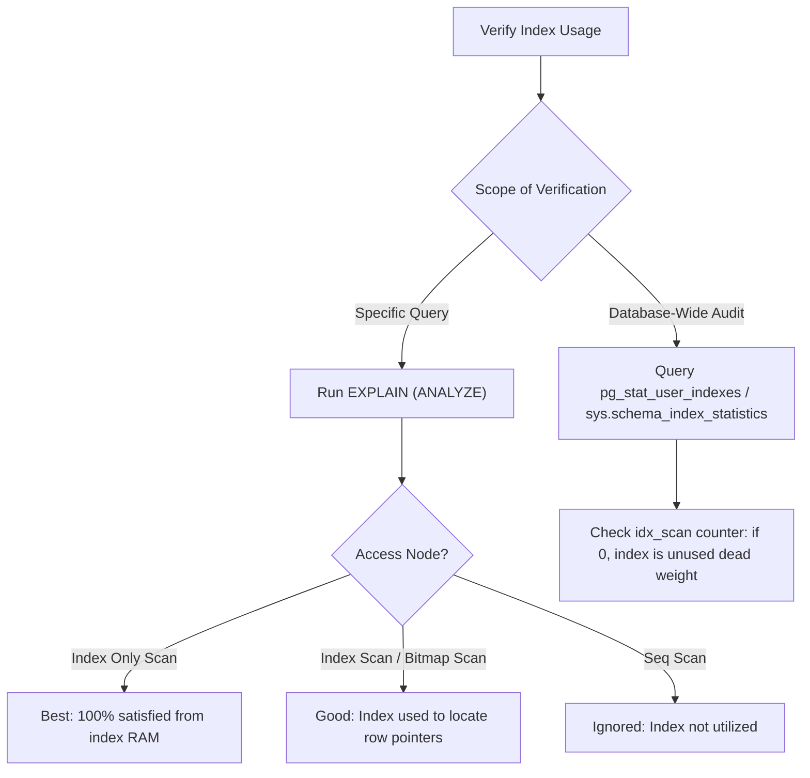

## Scenario

> **How would you identify whether an index is being used?**

Engineers add indexes hoping they fix latency, but databases often ignore them. Interviewers test your ability to verify index usage in individual queries and across the database lifetime.

## Fast Revision (10-Second Recall)

- **First Move:** Check individual query plan with **`EXPLAIN`** $\rightarrow$ look for `Index Scan`, `Index Only Scan`, or `Bitmap Index Scan`.
- **Cumulative Production Verification:** Check **`pg_stat_user_indexes`** in PostgreSQL (look at `idx_scan` count).
- **Index Scan Hierarchy:**
- 1. **Index Only Scan (Best):** All requested data found in index; zero table heap lookups.
- 2. **Index Scan (Good):** Traverses index tree to find matching row pointers, then visits table heap.
- 3. **Bitmap Index Scan (Moderate):** Scans index to construct a bitmap of page locations, then reads pages in physical disk order.
- 4. **Seq Scan (Unused):** Index completely ignored.

## The 30-Second Spoken Script

If asked this in an interview, deliver this structured response:

> *To verify whether an index is being used, I inspect both individual query execution plans and cumulative database index statistics.*
>
> *For an individual query, I run EXPLAIN on the SQL statement. I look at the top access node:
An 'Index Only Scan' is the gold standard—it means the index contains all required columns (a covering index) and the visibility map confirms pages are clean, so the engine never touches table heap storage.
An 'Index Scan' means the index was used to filter row pointers, followed by heap fetches.
A 'Bitmap Index Scan' means the planner combined multiple indexes or batched pointers to minimize random disk I/O.
If it shows 'Seq Scan', the index was ignored.*
>
> *For macro-level production verification across days or weeks, I query pg_stat_user_indexes in PostgreSQL. I inspect the idx_scan column. If idx_scan is 0 or hasn't incremented after hundreds of API calls, the index is dead weight—consuming storage and slowing down writes without serving a single read.*

## Diagnostic Lifecycle



## Root Causes & Solutions Matrix

| Suspected Layer | Symptoms & Evidence | Immediate Resolution |
| :--- | :--- | :--- |
| **Index Only Scan** | `Index Only Scan using idx_users_email` | Optimal performance; query satisfied without reading table heap. |
| **Index Scan** | `Index Scan using idx_orders_customer` with high `Heap Fetches`. | Consider adding `INCLUDE` columns to turn it into an Index Only Scan. |
| **Bitmap Index Scan** | `Bitmap Index Scan` followed by `Bitmap Heap Scan`. | Normal when matching hundreds of rows; minimizes random disk seeks. |
| **Zero Cumulative Scans** | `idx_scan = 0` in `pg_stat_user_indexes` on a 5GB index. | Drop the unused index to restore write throughput. |

## Practical Debugging Commands & Code

### Querying Cumulative Index Usage in PostgreSQL
```sql
-- 1. Check cumulative index scan counts and index disk sizes
SELECT
  schemaname,
  relname AS table_name,
  indexrelname AS index_name,
  idx_scan AS number_of_scans,
  idx_tup_read AS tuples_read,
  idx_tup_fetch AS tuples_fetched,
  pg_size_pretty(pg_relation_size(indexrelid)) AS index_size
FROM pg_stat_user_indexes
WHERE relname = 'orders'
ORDER BY idx_scan ASC;

-- 2. Verify specific query uses the index
EXPLAIN (COSTS OFF)
SELECT email, created_at 
FROM users 
WHERE email = 'alex@example.com';

-- Desired Output:
-- Index Only Scan using idx_users_email_created on users
--   Index Cond: (email = 'alex@example.com')
```

## Prevention & Senior Best Practices

1. **Audit Indexes Quarterly:** Run automated scripts to find indexes with `idx_scan = 0` older than 30 days and drop them.
2. **Avoid Redundant Prefix Indexes:** If you have index `(a, b)`, you do not need index `(a)`.
3. **Run VACUUM to Maintain Visibility Maps:** Index Only Scans require up-to-date visibility maps maintained by autovacuum.
